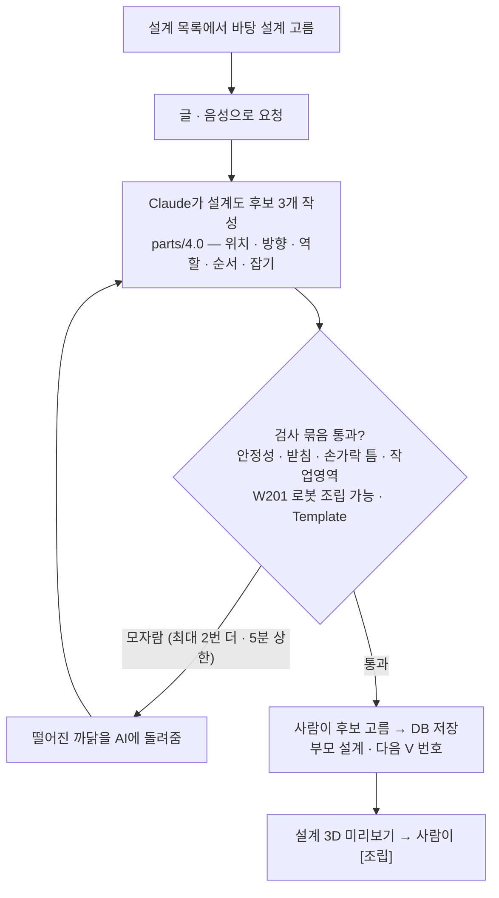
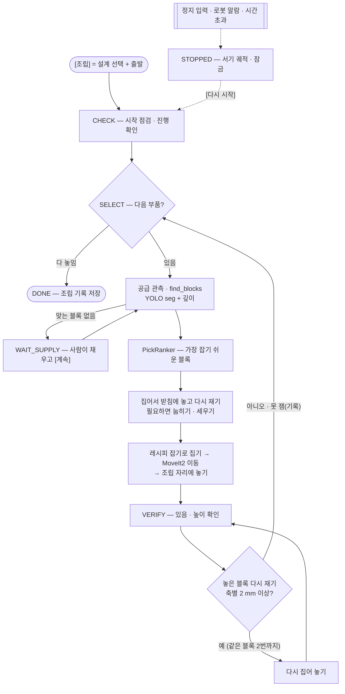
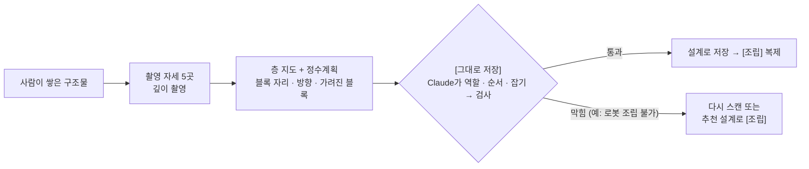

# 🧱 BuildMind — AI가 설계하고 로봇이 조립하는 젠가 가구 (ROS 2 Jazzy + MoveIt2 + YOLO seg + Claude)

이 프로젝트는 **ROS 2 Jazzy**와 두산 협동로봇 **M0609 + OnRobot RG2** 환경에서 동작하는 젠가 가구 설계 · 조립 시스템입니다.
사람이 글이나 말로 가구를 요청하면 **AI(Claude)가 젠가 설계도를 직접 쓰고**, 무너지지 않는지 · 로봇이 지을 수 있는지 **검사**한 설계를 **DB에 세대별로 저장**합니다. 그다음 로봇이 흩어진 블록을 손목 카메라(**YOLO seg + 깊이**)로 찾아 **MoveIt2로 하나씩 집어 조립**합니다. 사람이 쌓은 구조물을 **스캔해 설계도로 복원하고 똑같이 복제**할 수도 있습니다.

> 두산 로보틱스 ROKEY Boot Camp 9기 · 협동-2 · **D2팀** — 한석형 · 황인재(PL) · 민범진 · 박진용 · 한세교 · 2026-10-01 ~ 10-16

## 목차

1. [📌 주요 기능](#-주요-기능-key-features)
2. [🛠️ 시스템 설계](#️-시스템-설계-system-architecture) · [🔄 알고리즘 플로우 차트](#-알고리즘-플로우-차트-logic-flow)
3. [💻 개발 환경](#-개발-환경-environment)
4. [⚙️ 사용 장비](#️-사용-장비-hardware-setup)
5. [📦 의존성 설치](#-의존성-설치-installation)
6. [🚀 실행 순서](#-실행-순서-how-to-run)
7. [📊 결과 · 👥 팀 · 📁 문서](#-결과-요약)

---

## 📌 주요 기능 (Key Features)

### 1. AI 설계 생성 → 검사 → 레시피
- **요청:** 설계 목록에서 바탕 설계를 고르고 글 창 [AI 생성], 또는 마이크 버튼 → 시동어 "hello rokey" → 말(받아 적은 문장이 글 창에 들어가 바로 생성)로 요청합니다.
- **생성:** Claude(웹 PC에 로그인된 Claude Code를 호스트 중계 `claude_bridge`로 부름 — API 키 없음)가 고른 설계와 같은 Template의 다른 설계를 참고해, 부품마다 **위치 · 방향 · 역할 · 그룹 · 순서 · 단계 · 잡기**를 쓴 설계도 후보 3개(`parts/4.0`)를 만듭니다. JSON Schema 구조화 출력이라 형식 오류가 없고, 생성 전체는 5분 안에 끝냅니다.
- **검사:** 무게중심 여유 ≥ 7 mm(쌓는 도중 포함) · 받침 · 손가락 틈 · 작업영역 · Template 범위 + **로봇 조립 가능 검사(W201)** — 어떤 순서로든 그리퍼로 지을 수 있는지(한 층 1.5초 상한). 떨어지면 까닭을 AI에 돌려줘 최대 2번 더 만듭니다. 통과한 설계만 레시피 파일(`_recipe.json` + `_placements.csv`)이 되고, **사람이 미리보기를 보고 [조립]을 눌러야 로봇이 움직입니다.**

### 2. 설계 DB 세대 관리 (PLM + RAG)
- PostgreSQL 16(`designs` · `builds` · `gen_logs`)에 기본 설계 4개(벤치 · 등받이 의자 · 세운 다리 책상 · 가운데 기둥 책상, `_V000`)와 생성본(`_V001`, `_V002` …)을 **부모 설계와 이어서** 저장합니다. 버전 트리 · 조립 결과(성공 · 오차 · 시간) · AI 호출 기록이 남습니다.
- 생성 때 AI가 같은 Template의 설계 목록을 보고 도구(`get_design`)로 골라 참고합니다(RAG). 사람이 보는 표시 이름도 붙일 수 있습니다.

### 3. 흩어진 블록 집기
- 공급 영역에 흩뿌린 블록을 손목 카메라 D435i로 찍어 **YOLO seg(자체 학습 모델) 윤곽 + 깊이**로 자세 · yaw · 손가락 틈 · 겹침 · 기울어짐을 판정하고, **PickRanker**가 가장 잡기 쉬운 블록을 고릅니다.
- 집은 블록은 받침에 한 번 놓고 다시 재어(세운 블록은 눕히고, 세울 블록은 `STANDUP_HIGH` · `STANDUP_SIDE`로 세움) 레시피 잡기로 다시 집습니다(**받침 경유**). 모든 이동은 MoveIt2로, 쌓인 블록과 쥔 블록을 피합니다.

### 4. 놓은 블록 다시 재기 · 다시 집기 + 놓기 보정
- 블록을 놓을 때마다 손목 카메라로 있음 · 없음 + 높이를 확인하고, 방금 놓은 블록을 **YOLO 마스크 + 카메라 광선**으로 다시 잽니다. 축별 2 mm 이상 어긋나면 같은 블록을 최대 2번 다시 집어 놓습니다(기본 켬). 못 재면 까닭만 기록하고 다음 블록으로 갑니다.
- `FLAT_SHORT`로 놓는 블록은 놓기 위치를 블록 긴 축으로 +2.4 mm 보정합니다(`robot.yaml` `motion.place_offset_flat_short_m`).

### 5. 스캔 복제
- 사람이 쌓은 구조물을 촬영 자세 5곳에서 깊이 촬영 → **층 지도 + 정수계획(SciPy milp)** 으로 블록 자리 · 방향 · 가려진 블록까지 복원합니다(젠가 블록 크기가 하나라 15 · 25 · 75 mm 격자에 맞출 수 있음).
- [그대로 저장] → Claude가 역할 · 순서 · 잡기를 채움 → 검사 → 설계로 저장 → 사람이 치우면 로봇이 같은 자리에 복제합니다. 저장이 검사에 막히면 저장된 설계 중 **추천 설계(일치율 상위)** 로 바로 조립합니다.

### 6. 언제나 멈춤 · 복구
- 화면 [정지] · Ctrl+C · 로봇 알람 · 작업 관리자 시간 초과 · 음성 '정지' + 펜던트 비상정지 → 늘 켜 둔 **정지 노드**가 '지금 자리에 서기' 궤적을 제어기에 직접 보내고 잠급니다.
- 화면 [다시 시작] — 항상 진행 확인부터 — 또는 [초기화] → 치우고 [정리 끝]으로만 풉니다. 블록이 없으면 "공급 채워 주세요", 맞는 블록이 없으면 "맞는 블록이 없어요"를 띄우고 사람이 [계속]을 누릅니다.

### 7. 웹 화면 · 음성
- 설계 목록 · three.js 3D 미리보기 · 버전 트리 · 진행표 · 손목 검출 영상(고른 블록과 까닭) · 스캔 점군 비교를 한 화면에서 봅니다.
- 음성은 마이크 버튼 → 시동어(openWakeWord) → 받아 적기(OpenAI `gpt-4o-mini-transcribe`, 안 되면 `whisper-1`) → 요청 문장, 또는 '정지'입니다.

---

## 🛠️ 시스템 설계 (System Architecture)

### 전체 구조

시스템은 **PC 2대**로 나뉩니다. **로봇 PC**에는 ROS 2 노드가 모두 있고, **웹 PC**에는 ROS가 없습니다. 둘은 **MQTT 다리(`d2_bridge`)** 한 곳으로만 이어집니다.

1. **Perception(인식):** 손목 카메라 D435i → `wrist_block`(배치 확인 · 흩어진 블록 찾기 YOLO seg · 놓은 블록 다시 재기 · 스캔 추론기) · `scan_live_preview`(스캔 중 점군 미리보기)
2. **Decision(판단):** `task` — 작업 관리자(상태표) · 작업 판단(다음 부품) · PickRanker(집을 블록) · **검사 묶음 `DesignChecker`**(안정성 · 받침 · 잡기 · W201 조립 가능) · 변환기
3. **Control(동작):** `pick_place`(집기 · 놓기 + MoveIt2 실행기) · `scene_manager`(MoveIt2 장면) · `gripper`(RG2) · `safety_stop`(정지 노드 — 서기 궤적 · 잠금)
4. **HMI(웹 PC):** docker compose `mosquitto`(MQTT 브로커) · `db`(PostgreSQL) · `web`(FastAPI backend + Next.js 화면) + 호스트 `claude_bridge`(설계 AI 중계) · `voice.py`(음성)

<p align="center">
  <br>
  <sub>시스템 아키텍처 v7(main c0d5c71 — 노드 카드마다 입력 → 처리 → 출력, 화살표 색 = 데이터 갈래) · 따라 읽는 법: <a href="docs/guides/시스템아키텍처_설명_v4_101608.md">시스템 아키텍처 설명</a> · 인터랙티브 그림(브라우저로 열기): <a href="docs/images/archify/시스템아키텍처_노드토픽_v1_101519.html">노드 · 토픽</a> · <a href="docs/images/archify/DB_ERD_v1_101519.html">DB ERD</a> · <a href="docs/images/archify/MQTT토픽흐름_v1_101519.html">MQTT 토픽 흐름</a></sub>
</p>

| 위치 | 노드 · 프로그램 | 하는 일 |
|---|---|---|
| 로봇 PC | `task` | 조립 · 스캔 상태표, 다음 부품 고르기, 검사 묶음(`/d2/task/check_design`), 정지 · 다시 시작 처리 |
| 로봇 PC | `wrist_block` · `scan_live_preview` | 배치 확인 · 흩어진 블록 찾기 · 놓은 블록 재기 · 스캔 촬영 · 추론 / 스캔 중 점군 미리보기 |
| 로봇 PC | `pick_place` · `scene_manager` · `gripper` · `safety_stop` | 집기 · 놓기(MoveIt2) · 장면 · 그리퍼 · 정지(서기 궤적 · 잠금) |
| 로봇 PC | `bridge` | ROS ↔ MQTT 변환(토픽 `d2/…`, 요청 `…/req` · `…/res`) |
| 웹 PC(컨테이너) | `mosquitto` · `db` · `web` | MQTT 브로커 · PostgreSQL · backend(REST · WebSocket · AI 생성 · 저장소) + 화면 정적 파일 |
| 웹 PC(호스트) | `claude_bridge` · `voice.py` | 설계 AI 중계(Claude Code) · 음성(시동어 · 받아 적기 · '정지') |

이름 · 칸의 정본은 [인터페이스 문서(IRD)](docs/02_인터페이스_IRD_v4_101608.md), 패키지 · 상태표 · 절차는 [설계 문서(SDD)](docs/03_설계_SDD_v4_101608.md)입니다. 좌표 · 그리퍼 값 · 시간 기준은 설정 파일 하나(`src/d2_robot/d2_bringup/config/robot.yaml`)에 둡니다.

### 🔄 알고리즘 플로우 차트 (Logic Flow)

**① 요청 → AI 설계 생성 → 검사 → 저장**



**② 로봇 조립 (작업 관리자 `task` 상태표)**



**③ 스캔 복제**



---

## 💻 개발 환경 (Environment)

- **OS:** Ubuntu 24.04 LTS (로봇 PC · 웹 PC)
- **Middleware:** ROS 2 Jazzy · CycloneDDS(로봇 PC 안, `ROS_DOMAIN_ID` 60) · MQTT Mosquitto 2(PC 사이)
- **Motion:** MoveIt2(OMPL BiTRRT → RRTConnect) · 두산 `doosan-robot2`(Jazzy, `dsr_moveit_controller`) · OnRobot RG2 드라이버(`onrobot_rg_control`)
- **Vision:** Intel RealSense `realsense2_camera` · Ultralytics YOLO seg(자체 학습 모델 `block_seg_26s_e150_261008.pt`) · OpenCV · NumPy(< 2) · SciPy
- **AI · 음성:** Claude(Claude Code `claude -p`, 기본 opus — 웹 PC 호스트 중계) · OpenAI `gpt-4o-mini-transcribe`(→ `whisper-1`) · openWakeWord("hello rokey")
- **Web · DB:** FastAPI · uvicorn · paho-mqtt · psycopg 3 · PostgreSQL 16 · Next.js 16 · React 19 · three.js 0.186 · Node 24
- **Language:** Python 3.12 · TypeScript
- **Infra:** Docker compose(웹 PC 컨테이너 3개) · GitHub Actions CI(pytest · colcon · ruff)

---

## ⚙️ 사용 장비 (Hardware Setup)

| 장비 | 모델 · 사양 | 수량 | 용도 |
|---|---|---|---|
| 협동로봇 | Doosan M0609(6축 · 가반 6 kg · 도달 900 mm) + 제어기 · 펜던트 | 1 | 집기 · 옮기기 · 놓기 · 스캔 촬영 자세 |
| 그리퍼 | OnRobot RG2(0 ~ 110 mm · 3 ~ 40 N, 잡는 힘 10 N) | 1 | 블록 잡기 · 폭으로 잡힘 확인 |
| 손목 카메라 | Intel RealSense D435i(컬러 + 깊이 640 × 480) | 1 | 흩어진 블록 찾기 · 배치 확인 · 놓은 블록 재기 · 스캔 |
| 마이크 · 스피커 | 웹 PC에 연결 | 1 | 시동어 · 음성 요청 · '정지' |
| 블록 | 표준 젠가 75 × 25 × 15 mm(실측 두께 14.7 mm) · 1세트 54개 | 1 | 기본 설계 9 ~ 16개 + 공급 |
| 작업대 | 1200 × 650 mm | 1 | 조립 작업영역 · 흩뿌린 공급 영역 · 받침 상자 |
| PC | 노트북 2대 — 로봇 PC(ROS 2 Jazzy, 로봇과 유선 192.168.1.x) · 웹 PC(Docker, ROS 없음) · 둘 다 Ubuntu 24.04 | 2 | 로봇 PC · 웹 PC(Wi-Fi로 MQTT) |

| Component | Type | Topic / Spec |
|---|---|---|
| Robot | Doosan M0609 + RG2 | `/dsr01/...` · MoveIt2 `move_group` · `/dsr_moveit_controller/joint_trajectory`(서기 궤적) |
| Vision | RealSense D435i | `/camera/camera/color/image_raw` · `/camera/camera/aligned_depth_to_color/image_raw` · `camera_info` |
| 작업 | 우리 노드 | `/d2/task/state` · `/d2/task/progress` · `/d2/vision/find_blocks` · `/d2/motion/pick_place` · `/d2/safety/state` |
| PC 사이 | MQTT | `d2/task/state` · `d2/hmi/command/req` · `d2/safety/stop/req` · `d2/bridge/alive` … (전체는 IRD 10장) |

---

## 📦 의존성 설치 (Installation)

### 1. Python 필수 라이브러리 (`requirements.txt`)

```bash
# 로봇 PC — ROS 2 노드가 쓰는 pip 꾸러미(YOLO · 스캔 추론기 · 다리)
pip install -r requirements.txt
# 웹 PC 음성(호스트) — 가상 환경 하나에
pip install sounddevice openwakeword openai paho-mqtt "numpy<2"
```

웹 PC backend 꾸러미(`web/backend/requirements.txt`)는 `web` 컨테이너 이미지가 깝니다. 자동 시험 꾸러미는 `tests/requirements.txt`입니다.

### 2. ROS 2 패키지 (로봇 PC)

```bash
sudo apt update
sudo apt install ros-jazzy-desktop ros-jazzy-moveit ros-jazzy-realsense2-camera ros-jazzy-rmw-cyclonedds-cpp python3-paho-mqtt
# 두산 드라이버(doosan-robot2, Jazzy) · 브링업 바탕(m0609_rg2_integration) · OnRobot RG2 드라이버는 교육 과정 배포본 — 저장소 밖에서 colcon build
cd <이 저장소> && colcon build --symlink-install && source install/setup.bash
```

판(커밋)과 환경 변수(`RMW_IMPLEMENTATION=rmw_cyclonedds_cpp` · `ROS_DOMAIN_ID=60`)는 [환경 문서](docs/env/README.md)를 따릅니다.

### 3. 웹 PC

```bash
sudo apt install docker.io docker-compose-v2 libportaudio2
# 화면 빌드용 Node 24(nvm) · Claude Code 설치 후 이 PC에서 로그인(설계 AI — 키 없음)
cd web && cp .env.example .env    # OpenAI 키(음성 받아 적기) · DB 비밀번호는 .env 에만 — 커밋하지 않음
```

---

## 🚀 실행 순서 (How to Run)

전체 시스템은 아래 순서대로 터미널을 열어 실행합니다. 로봇을 움직이기 전에 **펜던트를 든 사람이 옆에 있고, 사람이 작업 영역 밖인지** 확인합니다.

### 1. 웹 PC — 화면 · 브로커 · DB · 설계 AI · 음성

```bash
# 터미널 1 — 화면 빌드(처음 · 화면이 바뀐 때) → 방화벽(브로커는 로봇 PC만) → 컨테이너 3개
(cd web/frontend && npm ci && npm run build)
mkdir -p web/backend/data
sudo bash tools/install_mqtt_access.sh <로봇 PC IP> <웹 PC IP>
D2_WEB_IPV4=<웹 PC IP> WEB_UID=$(id -u) WEB_GID=$(id -g) docker compose -f web/compose.yaml up -d

# 터미널 2 — 설계 AI 중계(점검 → 실행)
python3 web/claude_bridge.py --check --host 172.17.0.1
python3 web/claude_bridge.py --host 172.17.0.1

# 터미널 3 — 음성(점검 → 실행)
python3 web/backend/voice.py --check --host <웹 PC IP>
python3 web/backend/voice.py --host <웹 PC IP>
```

화면은 웹 PC 브라우저에서 `http://127.0.0.1:8000`을 엽니다(다른 PC에서는 안 열림 — 보안).

### 2. 로봇 PC — 브링업 · 카메라 · 노드

```bash
# 모든 터미널: source /opt/ros/jazzy/setup.bash && source <두산 워크스페이스>/install/setup.bash && source install/setup.bash
# 터미널 1 — 브링업(두산 드라이버 · MoveIt2 · 그리퍼 드라이버)
ros2 launch d2_bringup real_moveit.launch.py mode:=real host:=192.168.1.100
# 터미널 2 — 손목 카메라(정렬 깊이)
ros2 launch realsense2_camera rs_launch.py align_depth.enable:=true
# 터미널 3 — 정지 노드 · 그리퍼 · 장면 · 집기 놓기(노드 4개)
ros2 launch d2_bringup robot_nodes.launch.py mode:=real
# 터미널 4 · 5 · 6 — 손목 비전 · 작업 관리자 · MQTT 다리
ros2 run d2_vision wrist_block
ros2 run d2_task task
ros2 run d2_bridge bridge --ros-args -p mqtt_host:=<웹 PC IP>
# (선택) 터미널 7 — 스캔 중 점군 미리보기
ros2 run d2_vision scan_live_preview
```

### 3. 화면에서 조립 · 스캔

1. 화면 위 연결 줄에서 웹 서버 · 브로커 · 로봇 PC 연결이 모두 정상인지 봅니다.
2. 설계 목록에서 설계를 고르고 → (원하면) [AI 생성] → 설계 3D에서 **[조립]**.
3. 스캔 복제는 구조물을 두고 **[스캔]** → 스캔 칸에서 [그대로 저장] 또는 추천 설계 [조립].
4. 멈추면 [다시 시작] 또는 [초기화] → [정리 끝] — 자세한 것은 [복구 절차](docs/ops/복구절차_정지뒤다시시작_v1_101608.md).

로봇 없이 돌려 보기(개발 PC)는 `ros2 run d2_bridge mock_bridge` · `ros2 run d2_vision mock_wrist_block` · `python3 web/backend/mock_robot.py` — [설계 문서](docs/03_설계_SDD_v4_101608.md) 3.5. main을 받은 뒤 PC별 반영(웹 PC `restart web` · 로봇 PC 바뀐 패키지 빌드)은 [web/README](web/README.md) · [src/README](src/README.md).

---

## 📊 결과 요약

시연(10/16) 판정은 [결과표](docs/04_결과_결과표_v2_101608.md)에 채웁니다. 아래는 10/15까지 실기 기록입니다.

| 항목 | 결과 |
|---|---|
| 자동 조립(벤치 11개) | 11/11 — 10/6 230초(속도 0.3) · 10/7 200.8초 · 10/15 9차 통합 테스트(받침 경유 · 다시 재기 켬) 14분 36초 · 집기 시도 35번 실패 0 |
| 흩어진 블록 집기 · 받침 경유 | 10/13 정식 흐름 벤치 11/11(37번 중 35번) · 가운데 기둥 책상 11/11(37번 중 36번) · 세운 다리 책상 9/9(10/14) |
| AI 설계 생성 | 10/14 실제 Claude — 글 요청 후보 3/3 검사 합격 165초 · 음성 요청 3/3 합격 115초 |
| 생성 설계 조립 | 음성으로 만든 설계 2종 실제 조립 DONE(`003_DESK_STAND_V002` · `004_DESK_PEDESTAL_V001`) |
| 스캔 복제 | 사람이 쌓은 벤치 일치율 100 %(10/13) · 사진 판정 62/65 = 95 % |
| 놓은 블록 다시 집기 | 다시 집기 뒤 어긋남 dy 2.17 → 0.73 mm(10/14) |
| 정지 | Ctrl+C · 펜던트 비상정지 즉시 정지 · 로봇 알람 → 잠금(10/7) · 음성 '멈춰' 정상(10/15) |
| 자동 시험 | pytest — `src/d2_task/test` 1,442 · `tests/` 503 · `src/d2_vision/test` 306 통과(CI가 PR마다) |

## 👥 팀 · 역할

| 파트 | 담당 | 맡은 것 |
|---|---|---|
| 로봇 동작 | 박진용 · 한세교 | 로봇 셀 · MoveIt2 집기 · 놓기 · 정지 · 장면 · 세우기 · CAD · 레시피 · 변환기 ① |
| 비전 | 민범진 · 한석형 · 황인재 | 손목 보정 · 블록 인식 · 배치 확인 · 흩어진 블록 찾기 · 고르기 · 작업 관리자 · 검사 묶음 · 스캔 추론기 · 음성(민범진) |
| HMI | 황인재(PL) | 웹 화면 · AI 설계 생성 · DB · MQTT 다리 · 웹 PC compose · 일정 · 발표 |

## 📁 프로젝트 구조 · 문서

| 경로 | 내용 |
|---|---|
| [`src/`](src/README.md) | ROS 2 패키지 — `d2_interfaces` · `d2_robot/`(`d2_bringup` · `d2_motion` · `d2_gripper` · `d2_safety`) · `d2_vision` · `d2_task` · `d2_bridge` · `recipe_manager`(레시피 도구) |
| [`web/`](web/README.md) | 웹 PC — `backend/`(FastAPI · AI 생성 · 저장소 · 음성) · `frontend/`(Next.js + three.js) · `claude_bridge.py` · `compose.yaml` · `db/` |
| [`docs/`](docs/README.md) | 정본 01 요구사항 · 02 인터페이스 · 03 설계 · 04 결과 · 05 작업 분류 · 06 [팀 협업 규칙](docs/06_팀협업규칙_v1_101608.md) · `decisions/`(결정 기록) · `guides/` · `ops/` · `test-reports/` · `env/` · `images/` |
| [`tests/`](tests/README.md) | ROS 없는 자동 시험(pytest) — CI가 PR마다 돈다 |
| `tools/` | 문서 이름 도구 `docver.py` · 웹 PC 브로커 방화벽 `install_mqtt_access.sh` · 포트 확인 등 |
| `.github/` | 협업 규칙 · PR 양식 · PR 검사 · CI · Claude 검토 · auto-merge |

협업 규칙은 [팀 협업 규칙](docs/06_팀협업규칙_v1_101608.md) · [.github/CONTRIBUTING.md](.github/CONTRIBUTING.md) · [AGENTS.md](AGENTS.md)(AI 에이전트 규칙)에 있습니다. 날마다 바뀐 것은 [CHANGES.md](CHANGES.md)입니다.

## 라이선스

[Apache License 2.0](LICENSE). 두산 · OnRobot 드라이버(저장소 밖)는 각 제공자의 라이선스를 따릅니다.
