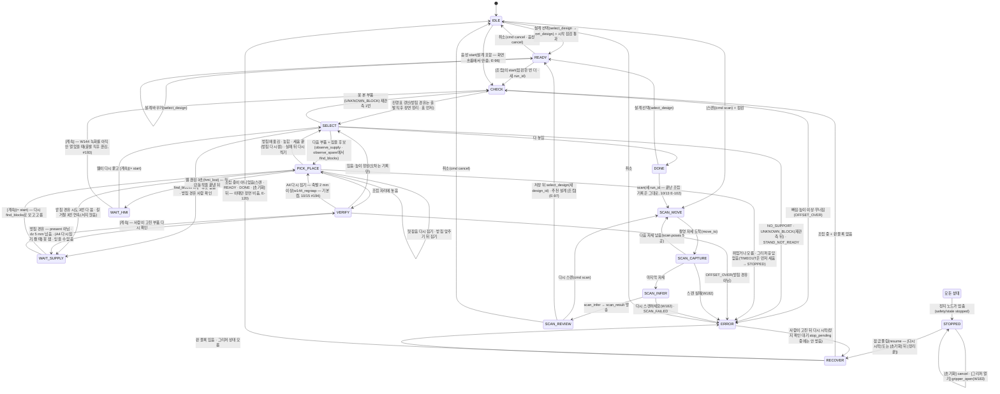

# 시스템 설계 문서 (SDD)
## AI가 설계하고 로봇이 조립하는 젠가 가구 — 요청 → 생성 → 검사 → 세대 관리 → 자동 조립 (+ 스캔 복제)

| 항목 | 내용 |
|---|---|
| 문서 | SDD(System Design Document) **v3** · 2026-10-06 18시. **10/15 최종본(PM — main 2d74462 기준, 10/14 오전 점검(139c946) 뒤 E-112 ~ E-122 · 1 ~ 8차 통합):** `db`(PostgreSQL — W088, `COMPOSE_PROFILES=db` · `DATABASE_URL`, E-112 P2) · 음성 `voice.py`(#171 — 받아 적기 `gpt-4o-mini-transcribe` → `whisper-1`, 확신도, 대표 '정지', 로봇 패널 [🎤 말로 정지] 361469d — E-118 · E-120 ④) · 정지 확인 대기 `stop_pending`(E-117) · 장면 비우기 때(E-120 ①) · 속도 0.5 · 하강 · 정지 뒤 첫 이동 0.2(595fe0a) · 공중 이동 여유 20 → 10 → 0 mm(86ae560) · 흩뿌린 블록 집는 순서(ad4a417) · 실행기 공급 칸 상자 지움(5c63fba · E-120 ③) · W144 A4(기본 꺼짐 — E-119) · AI 생성 5분 상한 · 음성 오인식 바로잡기 · 표시 이름(W197 · E-115) · W201 계산 파일(검사기 연결은 15일 통합 대기 — E-121) — §1 ~ §11. **10/14 전체 점검(PM — 10/14 E-112 P7 '옛 이름 정리 지금'):** 형식 · 칸 이름 = E-111 C6 · 용어 B(E-94)(`parts/4.0` · `recipe/4.0` · `placements/4.0` · `design/4.0` · `check_result/3.0` · 스캔 `blocks/2` · `build/2` · `state/2` · `scan_result/2.0`, `design_id` · `sequence` · `group` · `part_id` · `part_name`) · 파일 · 클래스 · 웹 구성(main 139c946) · 검사 묶음(요청 확인 · `base_recipe` · 21번 · `kind` · `made_by: "scan"`) · 세우기 `STANDUP_*`(E-110) · 스캔 추론 LayerSolver · 5자세 · 상태 전이 · 시작 점검 · DesignStore 함수 · Wi-Fi · `pick_place` 120초 · 충돌 감도 75 %(E-100 ④) · 키 정지 안 씀(10/14 E-112 P4) · [초기화] · [그리퍼 열기] (#157) — §1 ~ §11. **아래 옛 이력 속 이름 · 값은 그때 것이다.** 옛 이력: **10/6 저녁 PC 배치 · MQTT 다리 · CI(E-26~E-35)** 반영: PC 2대 = **웹 PC(ROS 없음) + 로봇 PC(모든 ROS 노드)**, PC 사이는 **MQTT 다리**, HMI 코드는 `web/`, CI는 토큰 없이. v2(16시, 주제 개편 E-01~E-25) · v1(10/4~5)은 git 이력. **10/7 고침:** 웹 = frontend · backend(E-41, 아키텍처 v6) · 미리보기 three.js 하나 · STT Whisper(E-40) · DB PostgreSQL 16(E-39). **10/7 문서 2중 검증 반영:** Claude 검토 = 팀원 PR 전부 · 카메라 끊김 · 음성 '멈춰' 등은 챌린지가 아니라 '나중에' · 상태 전이(SELECT → CHECK 재관측, VERIFY → CHECK 없음) · 핵심 `WAIT_SUPPLY`(find_blocks 0개) · 장면 공급 블록 뺌 · 측정값(조립 원점 · 관측 자세 · place_up 0.001 · 속도 0.3) · 실행 이름 `safety_stop` · `wrist_block` · V-52 · V-53. **10/7 19시 — 주제 · 시나리오 전체 점검(PM):** 로봇 패키지 폴더 `src/d2_robot/`(PR #51) · `recipe_manager` · `BlockPicker`(W130) · `find_blocks` · `observe_supply` · `cancel` · `save_build` · `/d2/hmi/alive` 반영, 1차 판정용 작업(W063 · W097, E-50) · 옛 이름(Lv) · 10/9 기한 정리, PICK_PLACE `TIMEOUT` → STOPPED로 맞춤, 역할 E-51 · 두산 일반 모드 E-48. **10/8 E-69(PL · 한세교):** AI가 설계도를 **직접 쓴다**(템플릿 길 없음) · 레시피 파일 2개(`<모델ID>_recipe.json` `recipe/2.0` + `_placements.csv`) · `blocks/2.0`(`role` · `part` · `stage` · `grasp`) · 변환기 ①은 계산 값만 · 스캔 = 추론기(위치 · 방향) + GPT(역할 · 순서 · 잡기) — §3.1.1 · §6.6 · §6.7 · §6.9 · §7 · §11. **10/8 21시 남은 옛 글 정리(PM):** 사진 · 점군 · 손목 검출 영상(E-67) · `CheckProgress.run_id`(E-60) · 정지 이유 · `tcp_link`(E-62) · 집은 뒤 밀림 재기 없음(E-63) · 변환기 ①의 AI 칸 검사 · `placements/2.0` 정함(#93) · HMI 일정 다시 잡음(10/8) — §1 · §2 · §3 · §4.3 · §4.6 · §5 · §6.4 · §6.7 · §6.8 · §6.9 · §6.10 · §6.11 · §7.1 · §8.1 · §9 · §11. **10/9 전체 점검(PM):** 손목 보정 · 촬영의 로봇 자세 = TF `rg2_tcp`(E-70 ③) · 알림 `no_match_block`(E-73) · 세우기 = `PickPlace` 놓을 자세(E-77) · 손목 보정 #88 · `roles.json` 정함(#99) · 노드 `wrist_block` 하나(#102) · 10/8에 못 한 일정 → 일정표 — §1 · §3 · §4 · §5 · §6.6 · §6.8 · §6.9 · §6.11 · §8 · §9 · §10 · §11 |
| 팀 | D2 — 로봇 동작 박진용 · 한세교(+CAD · 레시피 · 변환기 ① 한세교) · 비전 민범진 · 한석형 · 황인재(손목 보정 · 블록 인식 · 흩어진 블록 찾기 · 고르기 · 작업 판단 · 작업 관리자 · 검사 묶음 · 변환기 ② · 스캔 추론기 — 황인재는 10/7부터, E-42. **10/8~11(E-51):** W115 스캔 추론기 · W086 흩어진 블록 찾기 = 민범진, YOLO 학습 · W130 고르기 = 한석형, 황인재는 라벨링 · YOLO 학습만 도움) · HMI 황인재(화면 · 음성 · AI 생성 · DB, +PL) |
| 상위 문서 | [01_요구사항_BR-SR_v3_101321.md](01_요구사항_BR-SR_v3_101321.md) · [02_인터페이스_IRD_v3_101315.md](02_인터페이스_IRD_v3_101315.md) |
| 근거 | [결정 기록 10/6 저녁 PC 배치 · MQTT · CI](decisions/결정기록_PC배치_MQTT_CI_1006_v1_101321.md) · [10/6 주제 개편](decisions/결정기록_주제개편_1006_v1_101315.md) · [10/4](decisions/결정기록_시나리오_역할_인터페이스_1004_v1_101321.md) · [10/3](decisions/결정기록_주제확정_1003_v1_101321.md) |
| 관련 | [04 결과표](04_결과_결과표_v2_101320.md) · [05 작업 분류](05_작업분류_파트별_v2_100917.md) · [06 팀 규칙](06_팀협업규칙_v1_101321.md) · [TS-01](troubleshooting/TS-01_정지가_안_들음_R-01_v1_100916.md) · [TS-02](troubleshooting/TS-02_블록_쥔_채_계획_실패_R-03_v1_100414.md) |
| 표시 | **(안)** = 제안(팀 확인 전) · **＿＿** = 아직 재지 않은 값 · **(미정)** = 정할 사람 · 때만 정해진 것 · **15일 통합 대기** = main 2d74462에 아직 없음 · E-nn = 10/6 ~ 14 결정(E-69 = 10/8 PL · 한세교, AI 직접 작성 · 레시피 파일 · E-70~E-77 = 10/9 PL) · S-nn = 10/4~5 결정 · FR · NFR · V = 01 번호 |

이 문서는 요구사항(01)을 "실제로 어떻게 만들 것인가"로 바꾼다. PC 배치, 네트워크, 패키지, 워크셀 좌표, 작업 관리자 상태 머신, 기능별 절차(조립 · **AI 생성 · 검사 · 변환 · DB · 스캔**), 예외 처리, 안전, 시험 계획을 정한다.
- 토픽 · 서비스 · 액션의 이름 · 칸 · 단위는 02가 정본이다. 다르면 02가 맞다.
- **조립 엔진(집기 · 놓기 · 장면 · 그리퍼 · 정지 · 진행 확인)은 v1 그대로**다. 바뀐 것은 ① 협동 모드 · 웹캠 · 손 찾기를 뺌 ② 설계가 '파일 하나'에서 '요청 → AI 생성 → 검사 → DB'로 바뀜 ③ 스캔 복제 흐름 추가 ④ 10/6 박진용 값 · 서기 궤적 토픽 · 실패 코드 ⑤ **(18시) PC 2대 = 웹 PC(ROS 없음) + 로봇 PC, PC 사이는 MQTT 다리 노드 하나, task가 로봇 PC로, HMI 코드는 `web/`(E-26~E-33).** ⑥ (10/6 20시~10/7) 공급이 칸 6개에서 흩뿌림으로 — 흩어진 블록 찾기 · 고르기(E-36 · E-46, §6.11) (→ 10/13 E-103 ⑤: 공급 칸 없앰 — 흩뿌림 + 받침 경유만, `supply_mode: scatter` · `scatter.via_spare: true`).

---

## 1. 시스템 개요 · PC 배치

> 그림: [시스템 아키텍처 v7](images/시스템아키텍처_v7_101320.png) — 따라 읽는 법은 [시스템 아키텍처 설명 v4](시스템아키텍처_설명_v4_101321.md).

**한 줄 요약.** 사람이 설계 목록에서 바탕 설계를 고르고 웹 글이나 말로 요청하면 AI(Claude — 10/13 E-99)가 고른 설계를 바탕으로, 같은 Template의 다른 설계는 도구로 참고만 읽어(10/9 E-72 → 10/13 E-96) 젠가 설계도를 부품마다 **직접 쓰고**(위치 · 방향 · 역할 · 그룹 · 순서 · 단계 · 잡기 — 10/8 E-69 · E-94, 템플릿 없음), 검사를 통과한 설계를 DB에 세대별로 저장한 뒤, 로봇이 MoveIt2로 조립한다. 사람이 완성한 구조물을 스캔해 설계도로 만들어 똑같이 조립할 수도 있다. 사람은 요청 · 확인 · [조립] (출발 확인, E-96) · 정지 · 공급 채우기를 맡는다(협동 동작은 챌린지).

**구조 한 줄 요약.** 설계는 **웹 PC의 HMI 코드 안**에서 만들어지고 저장된다(생성 · 저장소 · DB). 쌓을 만한지는 **로봇 PC task 노드의 검사 묶음**이 정하고 레시피(구조) · 조립 방법까지 만든다(코드는 계산 값만, E-69). 조립은 **작업 관리자 상태 머신**이 블록 1개 액션으로 맡긴다. **웹 PC ↔ 로봇 PC는 MQTT 다리 노드 하나**(E-27). **판단은 한 곳에서만** 한다.

| 판단 | 정하는 곳 | 보는 것 |
|---|---|---|
| 멈출지 | 정지 노드(로봇 PC) | 정지 입력(화면 버튼 · Ctrl+C — 옛 '키'는 안 씀, 10/14 E-112 P4) · 로봇 알람 · 시간 초과(작업 관리자 요청) · 음성 '정지'(보조 — E-105 · E-118). 그리퍼 응답 없음 · ERROR는 작업 관리자가 ERROR로 멈춤(10/9 E-74) |
| 진행표(부품마다 놓였나) | 작업 판단(task) | 손목 블록 인식(있음 · 없음 · 높이 — 수평 오차 `dx_m` · `dy_m`는 1차 늘 NaN) + 레시피 |
| **설계가 쌓을 만한지** | 검사 묶음(task · DesignChecker + TemplateChecker) | 부품 JSON(`parts/4.0`) + `base_recipe` → 요청 확인 · 1 ~ 20번(형식(AI 칸 포함) · 파고듦 · 받침 · 안정성 7 mm · 잡기 틈 · 막힌 칸 · 작업영역 · 블록 수) · 21번 Template(스캔 설계는 건너뜀 — E-106) → 레시피 `recipe/4.0` + 조립 방법 `placements/4.0`(E-69 · E-90 · E-111 C6) |
| **무엇을 쌓을지** | 사람(화면 [조립] 한 번 — E-96) | AI가 만든 설계도 사람이 [조립]을 눌러야 움직인다(SR-09) |
| MoveIt2 장면 | 장면 관리 | 진행표(쌓인 블록 · 스캔한 실물) + 쥔 블록 |
| DB에 들어가는 것 | HMI(design_store) | 검사 통과 후보 중 사람이 고른 생성 설계(10/8 E-67 — §6.6), [저장]을 누른 스캔 설계(E-56), 조립 결과(작업 관리자가 넘김) |

### 1.1 PC 배치 (2대)

| PC | 실행 방식 | 실행하는 것 | 꽂는 장비 |
|---|---|---|---|
| **로봇 PC**(고정 — 박진용 PC, E-92) | 호스트(ROS 2) | 브링업 `real_moveit.launch.py` · 집기 · 놓기 + 실행기 · 장면 관리 · 그리퍼 · 정지 노드 · 손목 블록 인식 `wrist_block`(+ **스캔 추론기** · `find_blocks` 흩어진 블록 찾기 · 받침 재기) · 스캔 중 실시간 점군 `scan_live_preview`(E-82) · **task(작업 관리자 · 작업 판단 · 검사 묶음 · 변환기 ① · ②)** · **다리 `bridge`(ROS ↔ MQTT)** · 레시피 도구(라이브러리) | 제어기(유선) · RG2 · 손목 카메라 D435i(USB) · 웹 PC(Wi-Fi — #135 · #136) |
| **웹 PC**(옛 운영 PC — 한석형 PC, E-92, **ROS 없음**) | docker compose(`mosquitto` · `db` · `web`) + 호스트 | `mosquitto`: MQTT 브로커 / `db`: DB(PostgreSQL 16 — `.env` `COMPOSE_PROFILES=db`일 때만 뜸, W088 · E-112 ③) / `web`: **backend**(FastAPI :8000 — REST · WebSocket · **AI 생성 · 저장소 인터페이스**) 한 프로세스 + **frontend** 정적 파일(Next.js + three.js — 브라우저에서 실행, E-41) / 호스트: 설계 AI 중계 `claude_bridge`(:8790 → Claude, E-99) · 음성 `voice.py`(마이크 버튼 → 시동어 → 받아 적기 — E-105 · E-118, 민범진 W045 · W046 · #171) | 마이크 · 화면 · 로봇 PC(Wi-Fi) |
| 개발 PC(5명) | 호스트 | 로봇 쪽: 맡은 노드 + 가짜 노드 + 에뮬레이터(ROS). 웹 쪽: 로컬 mosquitto + `mock_robot.py`(ROS 없이) | — |

- 2대로 시작. 로봇 PC 노드는 어느 PC에서나 돌게 짠다(박힌 경로 없음). 브링업 · 정지 노드는 로봇 PC 고정. 카메라는 처리하는 PC에 꽂는다.
- **웹 PC에는 ROS 2 · 두산 환경을 깔지 않는다**(E-26). 웹 PC 코드는 저장소 `web/backend` · `web/frontend`(E-32 · E-41). ROS 2(CycloneDDS 60)는 로봇 PC 안에서만.
- **컨테이너는 웹 PC에만**(E-31): `mosquitto` + `db`로 평가 조건(컨테이너 2개 이상 + DB)을 채우고 `web`(backend + frontend 정적 파일, W102)도 컨테이너. `db`는 `.env`에 `COMPOSE_PROFILES=db`일 때만 뜨므로 **시연 웹 PC는 꼭 넣는다**(E-112 덧붙임 ③). 컨테이너 `hmi` · `db-hmi` · `vision`은 없다. `claude_bridge` · `voice.py`는 컨테이너 밖 호스트(로그인된 Claude Code · 마이크 · 스피커를 쓰므로 — compose는 `voice.py`를 연결하지 않는다).
- 부하(W053 — 10/8 W118 때 재기로 했던 것, 결과 확인 필요 · 일정표)가 CPU 70 %를 넘으면 task를 3번째 PC로(검사 묶음은 생성 때만 돈다 — 조립 중 부하는 작다).


### 1.2 컨테이너 · DB · 브로커 (필수 기술)

| 항목 | 정한 것 | 상태 |
|---|---|---|
| 컨테이너(웹 PC, `web/compose.yaml`) | **`mosquitto`**(MQTT 브로커, 1883) · **`db`**(PostgreSQL 16 — 프로필 `db`, 포트는 열지 않고 `web`만 compose 망 `db:5432`로 붙음, 데이터 = 웹 PC 로컬 폴더 `web/db/data`, 데이터 폴더가 빌 때 `web/db/init/001_schema.sql` 한 번) · **`web`**(backend FastAPI :8000 한 프로세스 + frontend 정적 `out/` · AI 생성 · 저장소 — 이미지 `web/Dockerfile`, 코드 · 설정 · 레시피는 읽기 전용 연결, JSON 폴더 저장소는 `web/backend/data` → `/data`. `db`를 기다리지 않고 시작 때 몇 번 다시 붙음). 셋 다 **황인재** | 정함(E-31 · W102 · W088 — E-112 P2 · ③) |
| 호스트 | 로봇 PC 전부(ROS) + 웹 PC `claude_bridge`(설계 AI 중계, E-99) · 음성 `voice.py`(E-105) | 정함 |
| **PC 사이** | **MQTT**: 브로커(웹 PC) ↔ 다리 노드 `bridge`(로봇 PC, `d2_bridge`). 규칙은 [IRD 10장](02_인터페이스_IRD_v3_101315.md#10-pc-사이-통신--mqtt-다리-e-27e-30) | 정함(E-27 · E-29), 다리 담당 = 황인재(10/7 21시 PL, E-56) |
| **DB 제품** | **PostgreSQL 16**(10/6 21시 PL 확정, E-39): JSONB에 설계 JSON, 트리는 `parent_id` 재귀 쿼리. 스키마는 `web/db/init/001_schema.sql`(3.1.1). MongoDB 비교는 결정 기록 §6(참고) | 정함(E-39) |
| **저장소 인터페이스** | `web/backend/design_store.py` 한 겹(함수는 §6.8). **`.env` `DATABASE_URL`이 있으면 `PgDesignStore`(`db` 컨테이너 PostgreSQL), 비우면 `DesignStore` JSON 파일 폴더**(`/data/designs/<design_id>.json` · `builds/` · `gen_logs/`) — 같은 함수(W088 10/14 e8b4f26, E-39 · E-95 · E-112 P2). DB가 말썽이면 `DATABASE_URL`을 비우고 `web`만 다시 켜 JSON 폴더로 되돌린다. 화면 연결 줄에 '저장소: DB(PostgreSQL) / JSON 폴더' | 정함(E-22 · E-112) |
| 브로커 설정 | `listener 1883` · 익명 허용 · 인증 없음 — 브로커는 웹 PC **Wi-Fi IPv4에만** 열고(`D2_WEB_IPV4`) DOCKER-USER 규칙으로 **로봇 PC만** 받는다. 화면은 웹 PC `127.0.0.1:8000`에서만 연다([web/README](../web/README.md) · `web/compose.yaml`) (옛 E-30 ⓓ '유선 LAN 안' → 두 PC Wi-Fi) | 정함(W102 · W173 — #135 · #136) |
| 원본 자료 | 녹화 · CAD · DB 데이터 · 스캔 점군 · 사진은 로컬 폴더 연결(규칙 ⑥). 사진 · 점군 · 손목 검출 영상은 다리가 MQTT 바이너리로 웹에 보냄(10/8 E-67 — 크기는 IRD 10.5) | 정함 |
| 키 | OpenAI 키(음성 받아 적기만 — `gpt-4o-mini-transcribe`, 안 되면 `whisper-1`, E-118 · E-120 ④. 설계 AI는 키 없는 Claude 중계, E-99)와 DB 비밀번호(`POSTGRES_PASSWORD` · `DATABASE_URL`)는 웹 PC `.env` → `env_file`. 프롬프트 · 응답 기록 · 로그에도 키 · 비밀번호가 없게 | 정함(규칙 ④) |


### 1.3 설계 결정

| 결정 | 이유 | 번호 |
|---|---|---|
| **설계는 부품 JSON(옛 '블록 JSON')으로 오가고 로봇에는 레시피로 간다** | 생성(HMI) · 스캔(비전) · 검사(task)가 한 형식을 쓰고, 조립 엔진은 레시피만 알아 바뀌지 않는다 (→ 10/8 E-69: AI는 레시피 파일을 쓰지 않지만 **선택하는 값**(역할 · 그룹 · 순서 · 단계 · 잡기)은 쓴다 — 완성 설계도 = 부품 JSON `parts/4.0`, 옛 `blocks/2.0` → E-94 · E-111 C6) | E-15 · E-16 → E-69 |
| **생성은 HMI 안, 검사는 task 안, 저장은 HMI 안** | 판단은 한 곳: 쌓을 만한지는 로봇 쪽(작업 판단)이 가장 잘 안다. 저장은 DB 주인(HMI) | 결정 기록 §8 |
| **2단계 생성(파라미터 튜닝 → 자유 생성)** (→ 10/8 E-69: **AI가 설계도를 직접 쓴다**로 바뀜 — 템플릿 길 ① 없앰) | 튜닝은 늘 통과하고 빠르다. 자유 생성은 모양 발전을 맡되 검사 반복으로 거른다 (→ E-69: 직접 쓴 설계도를 검사로 거른다 — 통과 후보만 남기고 모자란 만큼 다시, 처음 + 2번 E-90 ⑥) | E-08 → E-69 |
| **검사 묶음은 서비스 하나(`check_design`)** | 웹 PC ↔ 로봇 PC(MQTT 다리) 왕복을 한 번으로. 통과하면 레시피 · 조립 방법까지 돌려줘 왕복을 줄인다 | E-16 |
| **공용 JSON 서비스(`JsonQuery`)** | 칸마다 srv를 만들지 않는다(규칙 ②). 검사 · 설계 꺼내기 · 스캔에 같이 쓴다 | IRD 1장 |
| 작업 관리자 = 노드 하나, 안에 상태표 | 흐름을 한 노드에서 | D-08 |
| 블록 1개 = 액션 하나 | 작업 관리자는 블록 단위로만 | 인터페이스 결정 |
| 정지 노드 따로, 로봇 PC 고정, 서기 궤적을 **토픽으로** 제어기에 직접 | 실기에서 액션은 서지 않았다(R-01, 10/6 박진용) | D-11 |
| 모든 이동 MoveIt2, 정해진 길 + 출발 전 재계획, 위치 제어 놓기 | v1과 같음 | A2 · D-44 · D-23 |
| 다음 블록 = sequence + 진행 확인 | 다시 시작 · 스캔 복제(남은 블록)에서도 '안 놓인 첫 블록' | D-21 |
| 부품마다 배치 확인 = 있음 · 없음 + 높이, **오차는 측정값만**(1차는 높이 `dz`만 — 수평 `dx` · `dy`는 늘 NaN, `CheckProgress.srv`) | 판정 · 보정(W100)을 빼서 시간을 아끼고, 측정값은 `builds`에 남겨 RAG 재료로 | S-05 · E-20 |
| **사람 감지 없음** → 사람이 영역 밖인지는 [조립] · [스캔] · [계속] 버튼을 누르는 사람이 확인 | 웹캠 뺌 | E-19 · SR-07 |
| 출발 = 화면 [조립] 한 번(`select_design` → `start`), LLM이 로봇 움직임 · 정지를 정하지 않음 (옛 '버튼 또는 음성 출발' → E-96: 음성 출발은 화면 흐름에서 안 씀) | AI가 설계를 만들어도 출발은 사람 | S-16 → E-96 · SR-09 |
| 기록 = 작업 관리자 CSV(1차) → 같은 칸을 `builds`(핵심) | 기록 주인은 작업 관리자, DB 쓰기는 HMI | S-10 · E-22 |
| **웹 = frontend(Next.js 정적 + three.js, 브라우저에서 실행) + backend(FastAPI :8000 — REST · WebSocket `/ws` · paho-mqtt · 정적 서빙), ROS 없음.** 컨테이너는 `web` 하나. 미리보기는 three.js 하나(`Preview3D` — 설계 3D · 후보 · 스캔 칸) · 점군 창(`CloudView` — 스캔 때만) | 10/6 18시 HMI · 10/7 PL(three.js 하나 · 둘로 나눔) | E-32 · E-35 · E-40 · E-41 |
| **PC 사이는 MQTT 다리 노드 하나(`bridge`, 로봇 PC)** — ROS 쪽 이름은 그대로, 웹은 `d2/…` 토픽 + `…/req` · `…/res` | 웹 PC에 ROS를 깔지 않고, DDS 멀티캐스트 문제를 피하고, `mosquitto_sub`로 PC 사이를 다 본다 | E-27~E-30 |
| **task(검사 묶음 포함)는 로봇 PC** | 웹 PC에 ROS가 없으므로 ROS 노드는 모두 로봇 PC | E-26 |
| **CI는 토큰 없이** — pytest(`tests/`) + colcon(두산 의존 없는 패키지) + ruff 치명 오류. Claude ①~⑧ 검토는 팀원 PR 전부(10/7 01시 PL) — '막음'이 없으면 자동 승인 → auto-merge | 구독 토큰을 아낀다 | E-34 |

유효한 옛 결정 S-01(그리퍼 노드 하나) · S-02(장면 = 블록만) · S-03(정지 입력 — 그중 '키'는 10/14 E-112 P4로 안 씀) · S-05 · S-10 · S-14(코드 규칙) · S-16(음성 출발 → 10/13 E-96 화면 흐름에서 안 씀) · S-17 · S-18~S-28은 [10/4 결정 기록](decisions/결정기록_시나리오_역할_인터페이스_1004_v1_101321.md). 뺀 것(협동 S-06 · S-07, 웹캠 S-15의 `vision`, TTS S-08 일부)은 [10/6 결정 기록 E-19~E-21](decisions/결정기록_주제개편_1006_v1_101315.md).

---

## 2. 네트워크

### 2.1 구성도

```
[M0609 제어기 192.168.1.100] ──유선(두산 통신)── [로봇 PC: 브링업·집기·놓기·장면·그리퍼·정지·손목 블록 인식+스캔 추론기·scan_live_preview·task(검사 묶음)·bridge] ──USB── [D435i]
[RG2] ── 로봇 PC 그리퍼 노드(OnRobot 드라이버 /onrobot/sendCommand)          │ ROS 2(CycloneDDS 60)는 이 PC 안에서만
                                                                               │ Wi-Fi · MQTT 1883 (bridge ↔ mosquitto — 웹 PC Wi-Fi IPv4, 로봇 PC만 허용)
[브라우저(웹 PC 127.0.0.1:8000): frontend] ──REST·WebSocket── [웹 PC(ROS 없음): compose{ mosquitto · db · web(backend FastAPI :8000 + frontend 정적: AI 생성·저장소) } + 호스트 claude_bridge · 음성] ─┘
                                        │                                   ├──USB── [마이크] → 호스트 음성(voice.py → 시동어 → STT → MQTT — E-105)
                                        └──HTTPS── OpenAI API (받아 적기 gpt-4o-mini-transcribe → whisper-1 — 키는 .env, voice만) · 설계 AI = 호스트 중계 claude_bridge(:8790) → Claude (10/13 E-99)
```

- **로봇 PC ↔ 웹 PC: MQTT**(E-27). 로봇 PC `bridge`가 브로커(웹 PC Wi-Fi IPv4:1883 — 실행 때 `-p mqtt_host:=<IP>`, 비우면 `robot.yaml` `mqtt.host`)에 붙는다. 토픽 · 요청-응답 · 연결 신호 규칙은 [IRD 10장](02_인터페이스_IRD_v3_101315.md#10-pc-사이-통신--mqtt-다리-e-27e-30). 두 PC는 Wi-Fi(옛 '유선 LAN' → #135 · #136), 지연 목표 NFR-10 ≤ 50 ms(V-14).
- **로봇 PC 안: ROS 2, CycloneDDS, 도메인 60**(NFR-09). `RMW_IMPLEMENTATION=rmw_cyclonedds_cpp ROS_DOMAIN_ID=60`. PC 사이 DDS는 쓰지 않으므로 멀티캐스트 · `CYCLONEDDS_URI` 걱정이 없다.
- 카메라 원본 영상은 PC 사이로 보내지 않는다. 스캔 점군은 로봇 PC에서 처리하고 **블록 JSON**(스캔 추론 `blocks/2` — 위치 · 방향 · `inferred` · 번호 `scan_num`)을 `scan_result/2.0`에 담아 보낸다. 화면용으로는 다리가 MQTT 바이너리를 보낸다(10/8 E-67 · 10/10 E-82, IRD 10.5): 스캔 사진 `d2/vision/scan_image`(JPEG ≤ 500 KB) · 다운샘플 점군 `d2/vision/scan_cloud`(PLY 복셀 3 mm ≤ 2 MB) · 손목 검출 영상 `d2/vision/wrist_image`(검출 결과를 그린 JPEG 640×480 · 약 65 KB · 1~2 Hz) · 스캔 중 점군 미리보기 `d2/vision/scan_preview`(JSON `scan_preview/1.0`) + `d2/vision/scan_preview_cloud`(PLY).
- 브라우저(frontend — Next.js 정적 `out/` + three.js) ↔ backend(FastAPI :8000): REST(`/api/designs` · `/api/robot` · `/api/voice`) + WebSocket `/ws`. 브라우저는 브로커 · DB · Claude · OpenAI에 직접 붙지 않는다(E-41). 화면은 웹 PC에서만 연다(`127.0.0.1:8000`). rosbridge 없음.
- **인터넷이 끊기면** AI 생성(Claude) · 스캔 [그대로 저장] (AI 채우기) · 음성(OpenAI 받아 적기)이 안 된다(옛 '음성 분류'는 E-96으로 없음). 저장된 설계 조립과 스캔 추천 설계 [조립] (E-97)은 된다 → 시연은 생성본을 미리 저장해 두고 순서를 바꿀 수 있게.
- **웹 PC · 브로커 · 다리가 끊기면** 화면 정지 버튼이 닿지 않는다 → **로봇 PC Ctrl+C · 펜던트**(E-30 ⓑ — 10/14 E-112 P4: 옛 '키보드 정지'는 보내는 프로그램이 없어 안 씀). 화면은 `d2/bridge/alive`가 끊기면 "연결 끊김"을 크게 띄운다. (카메라 신호 끊김 → 정지 연결은 나중에.)


### 2.2 통신 정의 (구간별) — 칸은 02

| 이름 | 종류 | 보내는 쪽 → 받는 쪽 | 구간 |
|---|---|---|---|
| `/d2/hmi/command` | 서비스 HmiCommand(`select_design` · `start` · `scan` · `cancel` · `gripper_open` — `gripper_open`과 `STOPPED`의 `cancel`은 #157 W183, E-98 · E-101) | 웹 화면(frontend → REST → backend) → (MQTT `d2/hmi/command/req`) → 다리 → 작업 관리자 | **웹 → 로봇(MQTT 다리)** |
| `/d2/hmi/intent` | 토픽 intent/1(`request_design` · `select_design` · `start` · `cancel` … + 받아 적기 확신도 `confidence` 0 ~ 1 또는 `null` — E-118 ⑤) | 음성 `voice.py`(웹 PC — E-105) → (MQTT `d2/hmi/intent`) → 다리 → 작업 관리자 · 웹(backend → WebSocket → 화면) | **웹 → 로봇(MQTT)**, `request_design`은 웹 안(화면이 글 창에 넣고 바로 생성 — E-96, 작업 관리자는 무시) |
| `d2/hmi/voice/listen`(MQTT만) | `voice_listen/1`(QoS 1, retained 아님) | 화면 마이크 버튼(AI 생성 칸 마이크 · 로봇 패널 [🎤 말로 정지(듣기 시작)] — 361469d) → REST `POST /api/voice/listen` → backend → voice.py | 웹 PC 안(다리 안 거침, E-96) |
| `/d2/hmi/alive` | 토픽(웹 연결 신호) | 웹 백엔드 → (MQTT `d2/web/alive`) → 다리 → 작업 관리자(3초 끊기면 `WAIT_HMI`) | **웹 → 로봇(MQTT)** |
| **`/d2/hmi/get_design`** · **`/d2/hmi/save_build`** | 서비스 JsonQuery | 작업 관리자(`save_build`는 RunLogger · BuildSender) · 손목 블록 인식(`get_design` — run_id가 바뀔 때만, W157) → 다리(제공) → (MQTT `…/req`) → 웹 백엔드(design_store) → `…/res` | **로봇 → 웹(MQTT 다리)** |
| **`/d2/task/check_design`** | 서비스 JsonQuery | 웹 백엔드(design_gen) → (MQTT `…/req`) → 다리 → task(DesignChecker) | **웹 → 로봇(MQTT 다리)**, 3초 목표 |
| `/d2/safety/stop` · `/d2/safety/resume` | 서비스 | 화면(frontend → REST → backend → MQTT `…/req` → 다리) · 작업 관리자(`TIMEOUT` · Ctrl+C 때 먼저 세움, `stop`만) · 음성 '정지'(시동어 뒤 → `d2/safety/stop/req`, E-105 · #171 — 대표 '정지', '멈춰' · '스톱' · '그만'도, E-118) → 정지 노드. 옛 '키'(`source: key`)는 보내는 프로그램이 없어 안 씀(10/14 E-112 P4) | 웹 → 로봇(MQTT) / 작업 관리자는 로봇 PC 안 |
| `/d2/safety/state` | 토픽 safety_state/1(TRANSIENT_LOCAL) | 정지 노드 → 모두 · 다리 → MQTT retained → backend → WebSocket → 화면 | 로봇 PC 안 + 로봇 → 웹 |
| 서기 궤적 | **토픽 `/dsr_moveit_controller/joint_trajectory`** | 정지 노드 → 제어기 | 로봇 PC 안 |
| `/d2/vision/check_progress` | 서비스 CheckProgress | 작업 관리자 → 손목 블록 인식 | 로봇 PC 안 |
| **`/d2/vision/scan_capture` · `scan_infer`** | 서비스 JsonQuery | 작업 관리자 → 스캔 추론기 | 로봇 PC 안 |
| **`/d2/vision/find_blocks`** | 서비스 JsonQuery | 작업 관리자 → 손목 블록 인식(흩어진 블록 찾기 · 받침 재기 `area: spare`, §6.11 · 놓은 블록 하나 다시 재기 `area: assembly` + `design_id` · `part_id` — W144 A4, `w144_measure` 켤 때만, E-119) | 로봇 PC 안 |
| `/d2/vision/camera_status` | 토픽 | 손목 비전 → 정지 노드(연결은 뒤) | 로봇 PC 안 |
| `/d2/vision/scan_preview`(10/10 E-82) · `/d2/vision/scan_live_cloud` | 토픽 `scan_preview/1.0` · PointCloud2(`rviz_cloud:=true`일 때만) | 손목 비전(`capture` — 촬영 자세마다 누적 점군) · `scan_live_preview`(`live` — 스캔 중 1.5 Hz) → 다리 → MQTT `d2/vision/scan_preview` + PLY `scan_preview_cloud` → backend → 화면 점군 창(보기 전용) | **로봇 → 웹(MQTT)** · RViz |
| **`/d2/vision/wrist_image`**(10/8 E-67) | 토픽(CompressedImage JPEG, 1~2 Hz) | 손목 비전 → 다리 → MQTT `d2/vision/wrist_image` → backend → WebSocket → 화면(그대로 보여 줌) | **로봇 → 웹(MQTT)** |
| `/d2/task/progress` · `/d2/task/state` · **`/d2/task/scan_result`** | 토픽 | task → 장면 관리(`progress`만 — 빈 진행표 `parts []`면 장면의 놓인 블록 전부 지움, E-120 ①) · 다리 → MQTT retained → backend → WebSocket → 화면 | 로봇 PC 안 + 로봇 → 웹 |
| `/d2/motion/move_to`(observe · home · observe_supply · observe_spare · 스캔 observe_back_left · observe_front · observe_front_right · observe_side — `MoveTo.srv`) · `/d2/motion/pick_place` | 서비스 · 액션 | 작업 관리자 → 집기 · 놓기 | 로봇 PC 안 |
| `/d2/motion/scene/attach` · `/d2/gripper/command` · `/d2/gripper/state` · `apply_planning_scene` | 서비스 · 토픽 | 로봇 PC 노드끼리(작업 관리자도 출발 때 남은 쥔 상자를 `scene/attach`로 뗌 — 받침 경유) | 로봇 PC 안 |
| `/d2/motion/path_markers` | 토픽 MarkerArray | 실행기 → RViz(계획한 손끝 경로, 보기 전용) | 로봇 PC 안 |
| (뺌) `human_zone` · `hand_wrist` · `task/event` | — | — | — |

- **웹 PC → 로봇 PC(MQTT)는 다섯 갈래**: 명령(`hmi/command`), 의도(`hmi/intent`), 검사(`check_design`), 정지(`stop`), 다시 시작(`resume`) + 웹 연결 신호(`d2/web/alive`). **로봇 PC → 웹 PC**: 상태 토픽 5개(retained) + 설계 꺼내기 · 조립 기록 요청(`get_design` · `save_build`) + 사진 · 점군 · 손목 검출 영상 · 스캔 미리보기(바이너리, 10/8 E-67 · 10/10 E-82) + 다리 연결 신호(`d2/bridge/alive`). 로봇 PC 안 이동 · 진행 확인 · 스캔 · 흩어진 블록 찾기 · 블록 1개는 ROS 그대로.
- 생성 · 저장은 **웹 PC 안**에서, 검사는 **로봇 PC task**에서 끝난다. 로봇 쪽 조립 엔진은 레시피 결과(진행표 · 액션 목표)만 받는다. 다리는 변환만 하고 판단하지 않는다.

---

## 3. 패키지 구성 (안) · 구조 규칙

### 3.1 저장소 구조 (10/15 main 2d74462 기준)

```
rokey_9_pjt2_D2/
├── docs/                         문서·그림·결정 기록·시험 기록·트러블슈팅
├── web/                          (ROS 아님, 웹 PC) — 황인재(E-32). 안쪽은 3.1.1
├── tests/                        ROS 없는 자동 시험(pytest) — CI가 PR마다 돈다(E-34). 공용 표가 패키지마다 같은지 test_shared_tables.py(E-111 C1 ~ C4)
├── .github/workflows/            pr_check.yml(PR 검사 + Claude ①~⑧ 검토 — 팀원 PR 전부(10/7 01시 PL), '막음'이 없으면 자동 승인 → auto-merge) · ci.yml(pytest tests/ · src/d2_task/test · src/d2_vision/test · colcon · ruff, 토큰 없음)
├── tools/                        docver.py · sched.py · check_web_ports.py · mqtt_access.sh · install_mqtt_access.sh(브로커 로봇 PC만 허용, #136) · w144_capture/(W144 기록) (CAD → 레시피 도구는 src/recipe_manager)
└── src/
    ├── d2_interfaces/            action/PickPlace · srv/GripperCommand · CheckProgress · HmiCommand · SceneAttach(held_quat — E-100) · StopRequest · MoveTo · JsonQuery(10/7 W121)
    ├── d2_robot/                 로봇 동작 패키지 4개를 묶은 폴더(10/7 PR #51 — ROS 패키지 이름 · import · launch 이름은 그대로)
    │   ├── d2_bringup/           launch/(real_moveit · robot_nodes · real_demo.rviz) · config/robot.yaml(값 정본) · tcp.json · tool.json · recipes/(→ src/recipe_manager/recipes 링크 — 기본 설계 레시피 `<design_id>_recipe.json` + `_placements.csv`, E-69)
    │   ├── d2_motion/            pick_place_node(집기·놓기 + move_to) · executor.py(실행기 MoveItExecutor) · motion_math.py(좌표 계산 한 곳) · scene_manager_node · run_recipe(시험 도구)
    │   ├── d2_gripper/           gripper_node(실행 이름 gripper)
    │   └── d2_safety/            safety_stop(safety_stop_node.py) + safe_stop.py(서기 궤적 토픽)
    ├── d2_vision/                wrist_block(노드 — check_progress · scan_capture · scan_infer · find_blocks) · block_checker.py(있음 · 없음 · 높이) · block_finder.py(흩어진 블록 찾기, W086) · spare_measure.py(받침 위 블록 재기) · placed_measure.py(조립 자리에 놓은 블록 하나 재기 — `find_blocks area: assembly`, W144 A4 · #177) · height_grid.py(공급 영역 높이 지도) · structure_scanner.py(스캔 추론기 — 점군 → `blocks/2`, W115) · layer_solver.py(LayerSolver — 층 지도 + 정수계획, v12g) · scan_live_preview(노드 — 스캔 중 실시간 점군, W168) · live_cloud.py · tcp_pose.py(카메라 자세 = TF rg2_tcp × 손목 보정) · design_cache.py(설계 캐시 — run_id, W157) · mock_scan.py · mock_wrist_block(가짜 노드) · capture_scene(W114 촬영) · check_wrist_calib · config/T_rg2tcp2camera(손목 보정, rg2_tcp 틀 — W156) · models/(YOLO seg 모델, E-86) — 계산 파일은 모두 ROS 없음
    ├── d2_task/                  (로봇 PC) task_node(실행 이름 task) · task_manager.py(TaskManager) · task_planner.py(TaskPlanner — 작업 판단) · block_picker.py(BlockPicker, W130) · pick_rank.py(PickRanker — 받침 경유 고르기 · spread_parts) · scatter_pick.py(ScatterFlow — 흩뿌림 · 받침 경유 요청) · row_grasp.py(연짝 FLAT_LONG, E-104) · design_checker.py(DesignChecker — 검사 묶음 1 ~ 20번) · template_checker.py(TemplateChecker — 21번, W162) · assembly_feasibility.py(AssemblyFeasibility — W201 로봇 조립 가능 검사 계산, a5994ae · E-121. DesignChecker 연결은 15일 통합 대기) · parts_to_recipe.py(PartsToRecipe — 변환기 ①, 한세교) · recipe_to_parts.py(RecipeToParts — 변환기 ② · 정본 ORIS · ori_extents) · recipe_document.py(RecipeDocument — 레시피 `recipe/4.0` + 조립 방법 `placements/4.0` 읽기 · `recipe_sha256` 짝 확인, 정본 GRASPS · part_name · part_id · same_major) · recipe_builder.py(RecipeBuilder — 레시피 도구 · 변환기 ①이 같이 씀) · roles.json(역할 · 옵션 목록) · run_logger.py(RunLogger) · build_sender.py(BuildSender — save_build) · w144_trace.py · w144_reduce.py(W144 기록)
    ├── d2_bridge/                (로봇 PC — W127, 황인재) bridge_node(MqttBridge: ROS ↔ MQTT — 웹 대신 /d2/hmi/* 제공 · 호출, 상태 토픽 → MQTT retained, 연결 신호) · bridge_codec.py(MQTT 규칙 — 웹 backend도 같은 파일) · mock_bridge(가짜 다리, 옛 mock_web_ui)
    └── recipe_manager/           레시피 도구(라이브러리, COLCON_IGNORE): CAD(`cads/`) → 레시피 2개(`<design_id>_recipe.json` 구조 + `_placements.csv` 조립 방법 — E-69, `_structure.json` 없음) 파이프라인(사람이 돌림). 변환기 ①은 d2_task 안(10/8 PL, E-58 — 옛 blocks_to_recipe.py → parts_to_recipe.py)
```

#### 3.1.1 `web/` 안 구조 (10/6 21시 PL 확정 — 기술 스택 Next.js · three.js / FastAPI · PostgreSQL / compose · Actions / STT · GPT-4o, Vite 없음)

> (10/14 고침 — 제목은 링크 때문에 그대로) 기술 스택 중 설계 AI는 **Claude**(웹 PC 호스트 중계 `claude_bridge`, 10/13 E-99) — GPT-4o는 옛것, STT(Whisper)는 그대로(OpenAI 받아 적기 `gpt-4o-mini-transcribe`, 안 되면 `whisper-1` — 10/14 E-118). 아래 나무는 main 2d74462 그대로.

```
web/
├── compose.yaml             mosquitto(1883 — 웹 PC Wi-Fi IPv4에만, D2_WEB_IPV4) · db(PostgreSQL 16 — 프로필 db, COMPOSE_PROFILES=db일 때만 · 포트 안 엶 · 데이터 ./db/data) · web(backend + frontend/out — 화면 127.0.0.1:8000) — env_file .env, 코드 · 설정 · 레시피는 읽기 전용 연결, JSON 폴더 데이터 ./backend/data → /data
├── Dockerfile               web 이미지 — 파이썬 의존성(backend/requirements.txt)만, 코드는 compose가 연결
├── .env.example             MQTT_HOST · MQTT_PORT · ROBOT_YAML · DATA_DIR · RECIPE_DIR · OPENAI_API_KEY(음성 STT만) · D2_LLM_MODEL · COMPOSE_PROFILES · POSTGRES_USER · POSTGRES_PASSWORD · POSTGRES_DB · DATABASE_URL(W088) (이름만. 실제 .env는 커밋 금지 — PR 검사가 막음)
├── mosquitto/mosquitto.conf listener 1883 · 익명 허용(호스트 접근은 Wi-Fi IPv4 바인딩 + DOCKER-USER로 로봇 PC만 — #136)
├── db/init/001_schema.sql   designs · builds · gen_logs 표 + 보기 templates(JSONB 칸, 01 FR-D02 · E-95 — designs.display_name W197 · gen_logs.extra E-112 ③) — db 데이터 폴더가 빌 때 한 번 자동 적용(W088)
├── claude_bridge.py         설계 AI 중계(웹 PC 호스트 :8790, E-99): OpenAI 형식 요청 → `claude -p --model opus`(빈 임시 폴더 · 도구 없음 · 한 번 240초 상한) → OpenAI 형식 답. 준비 점검 `--check`
├── backend/                 FastAPI :8000 한 프로세스(컨테이너 web)
│   ├── requirements.txt
│   ├── app.py               앱 만들기 · routes 등록 · frontend/out 정적 서빙 · robot.yaml 설계 규칙 읽기(load_rules, E-78) · 기본 설계 다시 등록(register_bases) · get_design · save_build 답 연결. URL 처리는 없음
│   ├── routes/              URL 처리 — 파일 하나 = 화면 흐름 하나
│   │   ├── designs.py       /api/designs  목록 · 상세 · 조립 기록 · rules · templates · [AI 생성](generate → pick — 고른 설계 바탕, 10/13 E-96. 음성 문장은 made_by voice + confidence, E-118 ⑤) · 스캔 [그대로 저장](scan/save) · 추천 설계(scan/recommend, E-97) · 표시 이름(PUT /{design_id}/name — W197 · E-115 ②)
│   │   ├── robot.py         /api/robot    명령(select_design · start · scan · cancel · gripper_open) · 정지 · 다시 시작 · 상태 · 그림(wrist.jpg · scan.jpg · scan_preview.ply · scan_cloud.ply) → MQTT …/req
│   │   ├── voice.py         /api/voice    마이크 버튼 → MQTT d2/hmi/voice/listen(E-96)
│   │   └── ws.py            /ws           WebSocket — retained 상태 토픽(진행표 · 상태 · alive) · 음성 요청 문장 · 스캔 미리보기 → 브라우저(frontend)
│   ├── mqtt_client.py       MqttClient — 다리와 통신 한 곳(req_id 붙여 보내고 …/res 기다림, IRD 10장 — 규칙은 d2_bridge/bridge_codec.py를 같이 씀)
│   ├── design_gen.py        DesignGenerator — 설계 AI 호출 한 곳(Claude 중계 `D2_LLM_URL`, E-99 — 6.6: AI가 설계도를 직접 씀, 템플릿 없음 E-69 · 생성 전체 5분 상한 · 음성 오인식 바로잡기) · 스캔 [저장]의 AI 채우기(scan_fill)
│   ├── design_store.py      DesignStore(JSON 파일 폴더) · PgDesignStore(PostgreSQL — `DATABASE_URL`이 있을 때, W088) — 저장소 접근 한 곳(6.8)
│   ├── voice.py             VoiceListener — 웹 PC 호스트 음성(컨테이너 밖): 마이크 버튼 → 시동어 'hello rokey' → 받아 적기 → MQTT d2/hmi/intent · 정지 말 → d2/safety/stop/req(6.10, E-105 · E-118 — 민범진 #171). 점검 --check
│   ├── prompts/             design_system.txt(설계도 직접 작성 — 역할 · 옵션 목록(roles.json) · 잡기 규칙 · 연짝 FLAT_LONG E-104) — 후보 JSON 형식(구조화 출력)은 design_gen 코드가 만든다(옛 blocks_schema.json 없음)
│   ├── mock_robot.py        로봇 PC 없이 시험(다리 흉내 — …/req 받아 …/res 응답, 진행표는 실제 TaskPlanner 모양 — E-111 A5)
│   └── data/                (gitignore) designs/ · builds/ · gen_logs/ — JSON 폴더 저장소(DB를 안 켤 때), compose가 /data로 연결(미리보기 PNG 없음 — E-40). DB 데이터는 web/db/data(gitignore)
└── frontend/                Next.js 16 정적 내보내기(out/) + React 19 + three.js — 실행 시 Node 서버 없음(브라우저에서 실행, backend와는 REST · WebSocket만)
    ├── package.json · next.config.mjs(output: 'export') · tsconfig.json
    ├── app/                 page.tsx(한 페이지 — 위 띠 · 로봇 패널 · 손목 카메라 · 설계 3D · AI 생성 · 스캔 칸 · 기록) · layout.tsx · globals.css
    ├── components/          DesignTree(설계 목록 열 보기) · DesignView(설계 3D + [조립] 한 번, E-96 · [이름 고치기] W197) · Preview3D(three.js — **유일한 미리보기**, E-40) · GeneratePanel(글 · 마이크 → 후보 → 고름) · RobotPanel(상태 · 정지 · 다시 시작 · [계속] · [초기화] · [그리퍼 열기] · [정리 끝], E-98 · [🎤 말로 정지(듣기 시작)] 361469d) · ProgressTop · ScanReview(스캔 칸 — 점군 · 추론 설계 · [그대로 저장]) · ScanRecommend(추천 설계 [조립], E-97) · CloudView(점군 창) · WristCamera(손목 검출 영상 — 확대 · 전체 화면) · ConnectionBadge(연결 점 3개 + 저장소 글) · CountUp(숫자 올라가기) · ThemeToggle
    └── lib/                 api.ts(REST 한 곳) · ws.ts(상태 수신) · types.ts(IRD 6장 JSON 꼴) · names.ts(화면 이름 한 곳) · theme.ts · themeBoot.ts
```

- 한 곳 규칙: LLM은 `design_gen` · DB는 `design_store` · MQTT는 `mqtt_client`만 안다. routes는 이 셋을 부른다. 호스트 `voice.py`는 컨테이너 밖 프로그램이라 브로커에 따로 붙는다(토픽 규칙은 같은 `bridge_codec`).
- 시험은 `tests/`(test_web_backend · test_design_gen · test_design_store_pg(시험용 DB `D2_TEST_DATABASE_URL`이 있을 때만) · test_scan_recommend · test_claude_bridge · test_voice · test_bridge_codec — API · 로봇 · 마이크 없이)이고 CI `ci.yml`이 `tests/`를 돌린다. frontend `npm run build`는 CI에 없다(웹 PC에서 사람이 빌드).
- (옛) 최소형 · HMI 일정(10/8 ~ 10) 줄은 끝난 일이라 뺐다 — 날짜는 일정표가 정본.

- ROS 없는 계산 파일(`design_gen` · `design_store`(웹 PC, `web/backend/`) · `design_checker` · `template_checker` · `structure_scanner` · `layer_solver` · `placed_measure` · `parts_to_recipe` · `recipe_to_parts` · `assembly_feasibility` · `task_manager` · `scatter_pick` · `pick_rank` 등)은 **`python3 -m pytest`로 로봇 없이 시험**한다(S-14). 저장소 공통 시험은 `tests/`, 패키지 시험은 `src/d2_task/test` · `src/d2_vision/test`에 두고 CI가 돌린다(E-34).
- **`d2_hmi` colcon 패키지는 없다**(E-32). 웹 PC에는 ROS가 없어 HMI 코드는 `web/`에 두고, ROS 쪽 HMI 자리는 `d2_bridge`가 대신한다.
- 10/3 작업 4 코드(`research/ref_1003/작업4/`)는 그대로 두고 `jenga_check.py`의 계산을 `design_checker.py`로, `prompt_v09*.txt` · `run_v09.py`의 프롬프트 · 재생성 루프를 `design_gen.py` · `prompts/`로 옮긴다(10/8 E-69: 튜닝 프롬프트 `prompt_v09_fallback` · `build_template`은 옮기지 않는다 — 직접 작성 프롬프트만).

### 3.2 패키지와 노드 (10/15 main 2d74462 — ROS 패키지 8개 + 웹 · 레시피 도구)

| 패키지 | 노드(실행 파일) | 클래스(규칙 ①) | 파트 | PC |
|---|---|---|---|---|
| `d2_interfaces` | 없음 — 액션 `PickPlace` + srv 7개(`JsonQuery` 포함) | — | 로봇 동작 / `JsonQuery`는 황인재 | 로봇 |
| `d2_bringup` | launch(`real_moveit` · `robot_nodes`) + `robot.yaml` · `tcp.json` · `tool.json` · 레시피 링크 | — | 로봇 동작 | 로봇 |
| `d2_motion` | `pick_place`(`pick_place_node.py`) | `PickPlaceNode`(액션 서버 — 잡기 12개: 설계 잡기 6개 + `TILT` · `TIP` · `CENTER_FLAT_*` · `STANDUP_HIGH` · `STANDUP_SIDE`(교시 동작, E-110) / `move_to`: robot.yaml `<이름>_pose` — observe · home · observe_supply · observe_spare · 스캔 4자세) (공중 이동 계획 = 놓인 블록 여유 `transit_clearance_m` 20 → 10 → 0 mm 차례로 — 86ae560) + `MoveItExecutor`(실행기, `executor.py` — 계획 경로 `/d2/motion/path_markers`, 여유 0에도 흩뿌린 블록 `obstacles`는 실제 크기로 피함 — 93a941d, 옛 공급 칸 가정 상자 `supply_boxes`는 지움 — 5c63fba · E-120 ③) + `motion_math.py`(좌표 계산 한 곳) | 로봇 동작 | 로봇 |
| `d2_motion` | `scene_manager`(`scene_manager_node.py`) | `SceneManagerNode` — 장면 = 작업대 상자 + 받침 상자(`spare_base_m`) + 진행표 부품(스캔 실물 포함) + 쥔 블록(방향 `held_quat` — E-100) + 손가락 모델. 빈 진행표(`parts []`)면 장면의 놓인 블록(`blk_*`)을 전부 지움(E-120 ① — §5 공통). 설치 레시피 중 못 읽는 파일은 빼고 경고(#169) | 로봇 동작 | 로봇 |
| `d2_motion` | `run_recipe`(시험 도구) | 레시피를 읽어 블록마다 `pick_place` 목표(작업 관리자 대신) | 로봇 동작 | 로봇 |
| `d2_gripper` | `gripper`(`gripper_node.py`) | `GripperNode` — 열기 · 닫기 · 폭 읽기 · 잡힘 확인(`feedback_offset_m` 보정), '활짝' = `gripper.max_width_m`(E-108) | 로봇 동작 | 로봇 |
| `d2_safety` | `safety_stop`(`safety_stop_node.py`) + `safe_stop.py` | `SafetyStopNode` · `SafeStop`(서기 궤적 토픽 → 확인 → `move_stop`) | 로봇 동작 | 로봇 |
| `d2_vision` | `wrist_block` · `scan_live_preview` · `mock_wrist_block` · `capture_scene`(도구) | `WristBlock`(노드 — `check_progress` · `scan_capture` · `scan_infer` · **`find_blocks`**(+ 높이 지도 `height_map` · 받침 재기 `area: spare` · 놓은 블록 하나 재기 `area: assembly` — `placed_measure`, W144 A4 · E-119) 서비스, `camera_status` · `wrist_image` · `scan_preview` 발행) · `BlockChecker`(있음 · 없음 · 높이 — `dx` · `dy`는 1차 NaN) · `StructureScanner`(점군 → `LayerSolver`(층 지도 + 정수계획, v12g — E-88) → 블록 JSON `blocks/2` — 위치 · 방향 + `inferred` + `scan_num`, 역할 · 순서 · 잡기는 [저장] 뒤 웹 AI(E-69 · E-99)) · `BlockFinder`(`block_finder.py` — 흩어진 블록 찾기: YOLO seg(E-86 — 예비 엣지는 `yolo_fallback`로 켤 때만) + 깊이 → 자세 · yaw · 틈 · 겹침 · 기울기) · `spare_measure` · `height_grid`(받침 · 높이 지도 계산) · `TcpPose`(카메라 자세 = TF `rg2_tcp` × 손목 보정) · `RunDesignCache`(설계 캐시 — W157) · `ScanLivePreview` + `LiveCloud`(스캔 중 실시간 점군 — W168, E-82 B) · `MockScan`(`mock_wrist_block`의 가짜 scan · find 응답). 손목 카메라를 쓰는 서비스 노드는 `wrist_block` 하나(#102), 미리보기는 따로(보기 전용) — 계산 클래스는 모두 ROS 없음 | 비전 | 로봇 |
| `d2_task` | `task`(`task_node.py`) + 계산 파일 | `TaskManager`(상태표 — 조립 · 스캔 · 공급 · 정지 · 재시작 · 시간 제한 · 정지 확인 대기 `stop_pending`(E-117) · 장면 비우기 빈 진행표(E-120 ①) · W144 A4 놓은 블록 다시 재기 · 다시 집기(다시 집기 `w144_regrasp` 기본 켬 · 재기 포함 — 10/15 #194 · E-119)) · `TaskPlanner`(레시피 · 진행표 · 다음 부품 · 좌표) · `ScatterFlow`(`scatter_pick.py` — 흩뿌림 · 받침 경유 요청 · 실패 뒤 동작, W130 · W188) · `BlockPicker`(E-46 · W130) · `PickRanker`(`pick_rank.py` — 받침 경유 후보 줄 세우기 · `spread_parts`) · **`DesignChecker`**(검사 묶음 1 ~ 20번 + 변환기 ① 호출; `check_design` 서비스 — `parts/4.0` + `base_recipe`만 받음) + **`TemplateChecker`**(`template_checker.py` — 21번, W162) · `RunLogger`(CSV · `build/2`) + `BuildSender`(`save_build`) · `RecipeDocument`(레시피 `recipe/4.0` + 조립 방법 `placements/4.0` 읽기, `recipe_sha256` 짝 확인 — E-52 → E-69 → E-111 C6) · `RecipeToParts`(변환기 ② → `parts/4.0`) · `row_grasp`(연짝 `FLAT_LONG`, E-104) · `w144_trace` · `w144_reduce`(W144 기록 — `w144_record` 기본 끔, E-103 ②) · `AssemblyFeasibility`(`assembly_feasibility.py` — W201 로봇 조립 가능 검사 계산(한세교 a5994ae · E-121). main에는 파일만 있고 `DesignChecker` 연결 · 결과 순서 칸은 15일 통합 대기) | 비전 | **로봇**(E-26) |
| **`d2_bridge`** | `bridge`(`bridge_node.py`) · `mock_bridge` | **`MqttBridge`** — ROS ↔ MQTT 변환 하나(IRD 10장): `/d2/hmi/command` · `check_design` · `safety/stop` · `resume` 호출, `/d2/hmi/get_design` · `save_build` 제공, `/d2/hmi/intent` · `/d2/hmi/alive` 발행, 상태 토픽 5개 → MQTT retained, 연결 신호 · LWT, 사진 · 점군 · 손목 검출 영상 · 스캔 미리보기 바이너리(`scan_image` · `scan_cloud` · `wrist_image` · `scan_preview` + `scan_preview_cloud` — E-67 · E-82). 규칙 계산은 `bridge_codec.py`(웹 backend도 import). 판단 없음. `MockBridge` = 웹 PC 없이 로봇 PC 혼자 시험할 때 | HMI(황인재 — E-56) | 로봇 |
| **`web/backend`**(ROS 아님) | FastAPI :8000 프로세스(`app.py` `create_app`) | FastAPI 앱(REST `/api/designs` · `/api/robot` · `/api/voice` · WebSocket `/ws` · `frontend/out` 정적 서빙) · `MqttClient`(REST 요청 → `…/req`, 상태 토픽 → `/ws`) · **`DesignGenerator`**(AI 직접 작성 `parts/4.0` 후보 3개 → 연짝 `FLAT_LONG` 맞춤(E-104 ③) → `check_design` → 통과만 남기고 모자란 만큼 다시 → 사람이 고름 → 저장, 스캔 [저장] AI 채우기 — E-69 · E-94 · E-99 Claude, 템플릿 없음) · **`DesignStore`** · `PgDesignStore`(저장 · 조회 · 트리 · 예시 · 추천 · 표시 이름 — JSON 파일 폴더 / PostgreSQL `DATABASE_URL`, W088) · `mock_robot.py`(가짜 로봇 PC) | HMI | **웹**(컨테이너 `web`) |
| `web/claude_bridge.py` · 음성 `web/backend/voice.py`(ROS 아님) | 웹 PC 호스트 프로그램 | `ClaudeBridge`(설계 AI 중계 :8790 — E-99) · `VoiceListener`(화면 마이크 버튼 `d2/hmi/voice/listen` → 듣기 대기 → 시동어 'hello rokey'(openWakeWord) → 요청 녹음(Silero VAD 말 끝 감지) · STT(`gpt-4o-mini-transcribe`, 안 되면 `whisper-1` — 확신도 `confidence`) → MQTT `d2/hmi/intent` · 시동어 뒤 '정지'('멈춰' · '스톱' · '그만'도) → `d2/safety/stop/req` — 10/13 E-105 · 10/14 E-118 · E-120 ④, 민범진 W045 · W046 · W120 · #171. 옛 '웨이크워드 안 씀'(E-96 ⑤) → E-105) | HMI(claude_bridge) · 비전 민범진(음성) | **웹 PC 호스트** |
| **`web/frontend`**(ROS 아님, E-41) | 없음 — Next.js 정적 `out/`(backend가 내려 줌, 브라우저에서 실행) | 컴포넌트 13개(3.1.1 — `DesignTree` · `DesignView` · `Preview3D`(three.js, 유일한 미리보기) · `GeneratePanel` · `RobotPanel` · `ProgressTop` · `ScanReview` · `ScanRecommend` · `CloudView` · `WristCamera` · `ConnectionBadge` · `CountUp` · `ThemeToggle`) + `lib/api.ts`(REST 한 곳) · `lib/ws.ts`(WebSocket 수신) | HMI | **브라우저**(웹 PC `127.0.0.1:8000`, 파일은 컨테이너 `web`) |
| 레시피 도구(`src/recipe_manager`, COLCON_IGNORE) · **변환기 ①(`d2_task` 안 별도 파일 — 10/8 PL, E-58)** | 라이브러리 | CAD → 레시피 2개(`_recipe.json` + `_placements.csv`, 사람이 돌림) · **`PartsToRecipe`**(`parts_to_recipe.py` — 변환기 ①: 부품 번호 · 중심 · 회전 R · 받침 · 닫힘 축 — **계산 값만**, AI 칸은 검사만 · 공식 채움 없음, 10/8 E-69, 옛 `blocks_to_recipe`) + 역할 · 옵션 목록 파일(`src/d2_task/d2_task/roles.json` — #93 본문, IRD 12장) | 로봇 동작(한세교) | 로봇(task가 import) · 웹(backend가 검사 규칙 · 변환기 ②를 import) |

### 3.3 구조 규칙 — v1과 같음(노드 하나 = 클래스 하나 = 파일 하나 · 과도한 구조화 금지 · 경로 하드코딩 금지 · 설정 한 곳 · 로봇 코드 정지 처리 · 단위 · `success` + `reason` · 키 `.env` · 이름 바꾸기는 받는 파트 확인). 더하는 것:
- **LLM 호출은 `DesignGenerator` 한 곳**(설계 AI = Claude — 호스트 중계 `claude_bridge`를 거침, E-99). OpenAI는 음성 STT(`voice.py` — `gpt-4o-mini-transcribe` · `whisper-1`)만 부른다(옛 '의도 분류'는 E-96으로 없음). 둘 다 웹 PC.
- **화면(frontend)은 backend만 안다**(E-41). REST는 `lib/api.ts` 한 곳, 상태는 `lib/ws.ts`(WebSocket `/ws`)로만 받고, MQTT · DB · Claude · OpenAI에 직접 붙지 않는다.
- **PC 사이 통신은 `MqttBridge` 한 곳.** 로봇 PC의 다른 노드는 MQTT를 모르고, 웹 PC 코드는 ROS를 모른다. 토픽 이름 · payload 규칙은 IRD 10장 표 하나.
- **DB 접근은 `DesignStore` 한 곳.** task · 비전은 DB를 직접 읽고 쓰지 않는다(`get_design` · `save_build` 서비스로).
- **부품 JSON ↔ 레시피 변환은 변환기 ①(`parts_to_recipe`) · ②(`recipe_to_parts`) 두 파일뿐.** 다른 곳에서 좌표를 다시 계산하지 않는다.
- **공용 표 · 함수는 정본 한 곳(10/14 E-111 C1 ~ C4):** 설계 잡기 6개 `GRASPS` · 부품 이름 `part_name` · `part_id` · 지문 `recipe_sha256` · 형식 비교 `same_major` = `d2_task.recipe_document`, 방향 코드 `ORIS` · `ori_extents` = `d2_task.recipe_to_parts`. 패키지 경계로 가져올 수 없는 복사본(d2_motion · d2_vision · 화면 TS · robot.yaml)은 `tests/test_shared_tables.py`가 같은지 지킨다.
- 프롬프트는 코드가 아니라 `prompts/` 파일(후보 JSON 형식은 `design_gen`이 만듦). 바꾸면 시험 요청 15개(V-44)를 다시 돌린다.
- **역할 · 옵션 목록은 저장소 JSON 파일 하나**(변환기 ① 옆 `src/d2_task/d2_task/roles.json` — #93 본문 · 작명 규칙 v3 3장, E-69). 프롬프트가 먼저 주고, 변환기 ①의 이름 검사도 같은 파일. AI가 새로 지은 역할 · 옵션은 뜻 한 줄과 함께 PR로 더한다. 지금 7개 `LEG` · `SEAT` · `BACK` · `BEAM` · `TOP` · `BASE` · `COLUMN` + 옵션 예 `WHEEL`.

### 3.4 설정 파일 `robot.yaml` — 키 · 값은 [IRD 9장](02_인터페이스_IRD_v3_101315.md#9-설정-파일-srcd2_robotd2_bringupconfigrobotyaml)(10/6 박진용 값 · 추가 키 · `check.*` · `scan.*`). 로봇 PC 노드가 읽는다(다리는 `mqtt.*`). **웹 PC는 설계 규칙 키만 읽기 전용으로 읽는다(10/9 E-78, `app.load_rules`):** `block_size_m` · `check.margin_mm` · `check.max_blocks` · `finger.thickness_m` · `finger.width_m` · `assembly_area_half_m` + MQTT 시간 `mqtt.req_timeout_s` · `alive_s` · `lost_after_s` — AI 프롬프트 규칙(블록 크기 · 7 mm · 54개 · 손가락 · 작업영역)이 검사 묶음 값과 같아야 해서 값은 한 곳. 연짝 `FLAT_LONG` 맞추기(E-104)는 검사 묶음 `DesignChecker.grasp_options`를 같은 `robot.yaml`로 만들어 쓴다(블록 크기 · 손가락 · `grasp_depth_m`만 씀). 읽는 곳은 웹 backend 한 곳, 화면(frontend)에는 REST로 넘긴다. 측정값(조립 원점 · 자세 · 받침 등)은 안 읽는다. compose(W102)에서 `robot.yaml` 파일 하나를 읽기 전용으로 연결. 검사 결과 · 레시피는 지금처럼 MQTT 응답으로 온다.

### 3.5 실행 순서 (10/15 main 2d74462 — 한 번에 띄우는 launch는 없다)

```bash
# 웹 PC (ROS 없음) — 방화벽 먼저(브로커는 로봇 PC만), 그다음 compose. 자세히는 web/README '두 PC Wi-Fi 연결'
sudo bash tools/mqtt_access.sh apply <로봇 PC IPv4> <웹 PC IPv4>
D2_WEB_IPV4=<웹 PC IPv4> WEB_UID=$(id -u) WEB_GID=$(id -g) docker compose -f web/compose.yaml up -d   # mosquitto(1883) · db(.env COMPOSE_PROFILES=db · DATABASE_URL — web/.env.example) · web(backend :8000 + frontend out/)
#   화면: 웹 PC 브라우저로 http://127.0.0.1:8000 — frontend 정적 파일 · REST · /ws를 모두 backend가 낸다(다른 PC에서는 안 열림)
python3 web/claude_bridge.py --host 172.17.0.1                 # 호스트: 설계 AI 중계(E-99) — 준비 확인 --check
python3 web/backend/voice.py                                   # 호스트: 마이크 버튼 → 시동어 → STT → MQTT d2/hmi/intent · 정지 말 → d2/safety/stop/req (점검 --check, E-105 · E-118)
# 로봇 PC
export RMW_IMPLEMENTATION=rmw_cyclonedds_cpp ROS_DOMAIN_ID=60
ros2 launch d2_bringup real_moveit.launch.py ...               # 브링업(두산 드라이버 · MoveIt2 · 그리퍼 드라이버) — 옵션은 src/d2_robot/README
ros2 launch realsense2_camera rs_launch.py ...                 # 손목 카메라
ros2 launch d2_bringup robot_nodes.launch.py                   # safety_stop · gripper · scene_manager · pick_place
ros2 run d2_vision wrist_block · ros2 run d2_vision scan_live_preview · ros2 run d2_task task · ros2 run d2_bridge bridge --ros-args -p mqtt_host:=<웹 PC IPv4>
# 로봇 없이(개발 PC) — 로봇 쪽: 웹 대신 mock_bridge, 비전 대신 mock_wrist_block
ros2 run d2_bridge mock_bridge · ros2 run d2_vision mock_wrist_block · ros2 run d2_task task --ros-args -p monitor_hmi:=false
# 로봇 없이 — 웹 쪽
docker run -p 1883:1883 eclipse-mosquitto && python3 web/backend/mock_robot.py --step 1.0
```

- 옛 안 `robot_pc.launch.py` · `mock.launch.py`(task · 비전 · 다리까지 한 번에)는 만들지 않았다 — 위처럼 따로 띄운다.
- **작업 관리자 실행 값(10/8 E-62, 코드대로):** `design_source` = `remote`(기본 — `/d2/hmi/get_design`) · `local`(`recipe_dir`의 레시피 파일, 웹 없이 개발할 때), `log_dir`(빈 값이면 CSV · 미전송 요약을 안 씀). 손목 블록 인식도 같은 `design_source` · `recipe_dir`을 쓴다. 웹 연결 감시는 따로 **`monitor_hmi`**(기본 true — #83, 한석형)로 정한다 — 로컬 설계라도 감시는 켜져 있고, **웹 · 다리 없이 가상으로 돌릴 때는 `-p monitor_hmi:=false`를 명시**한다(안 하면 `/d2/hmi/alive`가 없어 출발 · 스캔이 거절됨).
- 첫 실행 때 정지 준비(서기 궤적 토픽이 보이는지) · **다리 ↔ 브로커 연결**(`d2/bridge/alive` — 화면 연결 표시) · 설계 AI 중계(`claude_bridge.py --check`) · 음성(`voice.py --check`) · 화면 연결 줄의 저장소(DB / JSON 폴더)를 확인하고, 정지 준비가 안 되면 실기를 하지 않는다. W144 기록은 실기 · 시연 때만 `-p w144_record:=true`(기본 끔 — E-103 ②). W144 A4 자동 다시 집기(`w144_regrasp`)는 **기본 켬**(재기 포함 — 10/15 저녁 PL · #194, 끄려면 `-p w144_regrasp:=false`) · 손목 비전 재는 방법은 기본 마스크(`placed_method` mask — 민범진 PR, E-119 ㉔).

---

## 4. 워크셀


*그림. 작업대 배치 v5 — 로봇 앞 조립 작업영역(조립 원점 = 가운데), 옆에 흩뿌릴 영역(핵심, E-36 · W134 x 183~586 · y 142~337 mm)과 공급 칸 6개(대비책), 관측 · 촬영 · 공급 관측 자세(W134). 웹캠 · 사람 공급 영역 · 출입 선은 없앴다(E-19). 스캔 복제 때 사람은 조립 작업영역 안에 구조물을 두고 나간다. (10/14: 그림은 10/7 것 — 공급 칸은 10/13 E-103 ⑤로 없앴고, 받침(임시 적재대 · `spare_spots`)과 스캔 5자세는 그림에 없다. 지금 값은 4.2 표 · robot.yaml)*

### 4.1 장비

| 장비 | 하는 일 | 연결 |
|---|---|---|
| 두산 M0609(가반 6 kg, 도달 900 mm, 반복 ±0.03 mm) | 블록 옮기기, 스캔 촬영 자세 이동 | 제어기 ↔ 로봇 PC |
| OnRobot RG2(0~110 mm, 3~40 N) | 집기 · 놓기 | 그리퍼 노드(OnRobot 드라이버 `/onrobot/sendCommand`) |
| RealSense D435i(손목, 최소 거리 약 28 cm, 정지 상태 ±0.5 mm) | 진행 확인 · 배치 확인 · **스캔 점군** | 로봇 PC USB |
| 마이크 | 음성 설계 요청(화면 마이크 버튼 → 시동어 → 요청 — 10/13 E-96 → E-105) | 웹 PC(호스트 `voice.py` — 민범진) |
| 작업대 1200 × 650 mm(로봇 앞 850), 맨 작업대 | — | — |
| 젠가 블록 75 × 25 × 15 mm(두께 평균 14.7), 1세트 54개 | 기본 설계 9~16개 + 공급 여분 | — |
| 테이프 | 조립 작업영역 · 흩뿌릴 영역(빨간 테이프) 표시(옛 공급 칸 6개 → E-103 ⑤ 없앰) | — |
| 받침(임시 적재대) 80(높이) × 80 × 280 mm | 받침 경유 — 공급에서 옮겨 눕히기 · 맞추기 · 세우기 · 다시 집기(10/13 E-93 → E-103 ④) | 장면 관리가 상자로 넣음(`spare_base_m`) |
| (뺌) 웹캠 | — | E-19 |

### 4.2 영역과 좌표 (`base_link`)

| 영역 | 위치 | 설정 키 | 값(10/6) |
|---|---|---|---|
| 조립 작업영역 | 로봇 바로 앞, 홈 자세 근처. 가운데 = 조립 원점 | `assembly_origin` | x 0.4261 · y −0.0725 · z 0.000 · yaw 0.3°(10/6 다시 교시, PR #10 · z는 10/11 E-85) |
| 로봇 공급 영역 | 작업영역 옆, 흩뿌림(E-36 — 공급 칸 6개 `supply_slots`는 10/13 E-103 ⑤로 안 씀. 실행기 가정 상자 `supply_boxes`는 10/14 지움(5c63fba · E-120 ③), 남은 키 · 코드 경로(`supply_slots` · `PickPlace.supply_slot` 등)는 시연 뒤 지움) | `supply_mode: scatter` · `supply_area_m` | x 0.1737 ~ 0.5923 · y 0.1221 ~ 0.3123 m(10/11 박진용 테이프 교시 — 옛 W134 x 183~586 · y 142~337 mm) |
| 받침(임시 적재대) | 공급 영역 밖, y − 쪽(공급 영역 반대편) — 첫 자리 = 받침 윗면 가운데 | `spare_spots` · `spare_base_m` | 첫 자리 (0.36747, −0.2850, z 0.080, yaw 90°) · 상자 x 0.22747 ~ 0.50747 · y −0.325 ~ −0.245(10/13 박진용, E-103 ④) |
| 작업면 | 맨 작업대 | `table_z_m` | 0.000(10/11 E-85 실측 — 옛 −0.018) |
| MoveIt 장면 작업대 | — | `table` | x −0.2675~0.9325 · y ±0.325 · base 여유 0.15 |
| 관측 자세 | 조립 작업영역 위(작업대까지 약 50 cm, W018) | `observe_pose` | 관절 [−18.25, 1.73, 72.73, 0.02, 105.52, 71.44]°(W018, 10/6 PR #20 — TCP (350.5, −109.0, 294.8) mm, 작업대까지 약 497 mm) |
| **촬영 자세(스캔) 5곳** | 조립 작업영역을 위 · 대각선 뒤 왼쪽 · 앞 · 대각선 앞 오른쪽 · 옆에서 | `scan.poses` = observe · observe_back_left · observe_front · observe_front_right · observe_side(이 순서 — 이동 때 `scan.structure_box_m` 0.30 × 0.30 × 0.20 m 상자를 피함) | 관절 값은 robot.yaml(앞 · 옆 = W134 10/7 박진용 교시 — 앞 30° · 옆 35°, 458 mm / 대각선 2곳 = W186 10/12 민범진 실기) |
| **공급 관측 자세** | 흩뿌린 공급 영역 위 — observe와 같은 높이(작업대까지 495.9 mm)에서 카메라만 90° 돌림 | `observe_supply_pose` | 관절 값은 robot.yaml(W134, 10/7 교시) |
| **받침 관측 자세** | 받침 위 — 렌즈가 받침 가운데 위 약 532 mm | `observe_spare_pose` | 관절 값은 robot.yaml(10/13, 받침 경유) |
| 홈 | — | `home_pose` | 관절 [0, 0, 90, 0, 90, 0]° |
| (뺌) 사람 공급 영역 · 출입 선 · 웹캠 구역 | — | — | E-19 · E-03 |

**로봇 작업 영역** = 조립 작업영역 + 공급 영역 + 그 사이. 로봇이 움직일 때 사람이 들어가지 않는 곳 — 확인은 사람(SR-07).

### 4.3 조립 원점 T_base_from_cad — v1과 같음

- 설계 좌표계(레시피 · **부품 JSON**): 바닥 외곽 가운데 = (0, 0), x 오른쪽, y 뒤, z 위(작업면 0), mm. 설계 축 = 로봇 base 축(D-14).
- `p_base [m] = R_z(yaw) · (p_cad [mm] / 1000) + (x, y, z)` — 작업 판단 한 곳에서만. 조립 원점은 `robot.yaml` `assembly_origin` 하나만(한세교 동의) — 레시피(`recipe/4.0`)에는 원점 칸이 없다(옛 `T_base_from_cad: null`, 10/8 E-69).
- 놓는 높이 = 받침 부품의 계산 윗면 위에 실측 블록(`block_actual_m` 두께 14.8 mm)으로 쌓아 올린 값(`motion_math.recipe_parts` — 옛 '잰 받침 윗면 `top_z`' 아님). 카메라 보정 오차는 배치에 직접 안 들어간다(NFR-01). 설계 층 높이 15 mm와 로봇 실측 14.8 mm는 일부러 나눈다(E-111 B2).
- **생성 · 스캔 설계도 같은 좌표계**다. 변환기 ①은 부품 JSON(mm)을 그대로 레시피 좌표로 쓰고, 스캔 추론기는 추론한 바닥 외곽 가운데를 (0, 0)으로 둔다(실물이 원점에서 벗어나 있어도 복제는 조립 원점에 — 정함 10/7 E-45, IRD 12장).

### 4.4 공급 영역 — 흩뿌림 + 받침 경유(E-36 · E-103)

| | 로봇 공급 영역 |
|---|---|
| 두는 방법 | 사람이 공급 영역(빨간 테이프 안)에 **흩뿌려 둔다**(눕힘 · 옆세움 · 세움 · 포개짐 섞여도 됨, E-36). (옛 '1차 = 칸 6개 · 10/12 저녁까지 안 되면 칸으로 되돌림(E-51)' → 10/13 E-103 ⑤: 공급 칸 없앰) |
| 블록 고르기 | **받침 경유**(`scatter.via_spare: true` — 10/13 PL, §6.11): `observe_supply`에서 `find_blocks {height_map}` → `PickRanker`가 덮이지 않은 블록의 잡기 후보를 높은 곳부터(눕힌 블록 → 선 블록 → 큰 옮김, ad4a417) 줄 세워 맨 앞 후보 → 받침에 놓고 → 받침에서 다시 재서 레시피 잡기로 집어 조립. (`via_spare: false`면 옛 길 — `BlockPicker`가 다음 부품 자세 · 잡기에 맞고 틈이 넓고 겹치거나 기울지 않은 블록, E-46) |
| **비면** | `find_blocks`에 **블록이 하나도 없으면** **`WAIT_SUPPLY` + "공급 영역에 블록이 없어요"**(`supply_empty`) → 사람이 블록을 흩뿌리고 [계속] (= `start`) → 다시 `find_blocks`로 보고 고름. 블록은 보이는데 손가락이 들어갈 후보가 없으면 한 번 더 찍고, 그래도 없으면 `WAIT_SUPPLY` + `no_match_block`(기울어진 블록 탓뿐이면 `tilted_block`) → 정리하고 [계속] (10/9 E-73) |
| 집는 높이 | 손가락 끝 = 책상 위 +4 mm(눕힘 기준) + 폭별 보정, `grasp_depth_m` 0.011 |
| 블록 수 | 기본 설계 최대 16개 → 사람이 2~3번 채운다. 2인용 조립은 하지 않는다(E-18 — 생성 · 저장만) |

### 4.5 관측 · 촬영 자세
- 관측 자세: 조립 작업영역 위, 작업대까지 약 50 cm(W018). 진행 확인 · 배치 확인 · 다시 시작. 빈 작업대 기준 깊이를 남긴다.
- **공급 관측 자세(`observe_supply`, 핵심):** 흩뿌린 공급 영역 위, observe와 같은 높이에서 카메라만 90° 돌림(W134, 10/7 교시). `find_blocks`를 여기서 부른다(§6.11). 관측 때 그리퍼는 활짝(`gripper.max_width_m`, E-108) 연다.
- **받침 관측 자세(`observe_spare`, 10/13):** 받침 위에서 `find_blocks {area: "spare"}`로 받침 위 블록 하나를 깊이로 잰다(§6.11 S4).
- **촬영 자세(스캔) 5곳:** `scan.poses` = observe(위) · observe_back_left · observe_front · observe_front_right · observe_side(W186 — 10/12 실기 5자세, E-88 판정). 구조물 전체(최대 150 mm 높이 · 225 mm 폭)가 깊이 화면에 들어오고 최소 거리 28 cm를 지키게 교시(앞 · 옆 10/7 W134 · 대각선 10/12 W186). 자세 사이 이동은 `scan.structure_box_m` 상자를 피한다(사람이 쌓은 구조물은 장면에 없어서). 자세는 `move_to` target 이름으로 부른다.

### 4.6 그리퍼 · 로봇 값 — 10/6 박진용

| 값 | 10/6 | 설정 키 |
|---|---|---|
| 손가락 끝 두께 · 폭 | 0.0114 · 0.020 m(모델 메시) | `finger.*` |
| 기준 틀 · 손끝(TCP) 링크 | `base_link` · `rg2_tcp`(옛 `tcp_length_m` 0.228 m는 코드 · yaml에 없어 뺌 — 10/8 E-62). TCP = 손가락 가운데 [0, 2.7, 228] mm(10/10 E-81, `tcp.json`) | `frame_id` · `tcp_link` |
| 집는 깊이 | 0.011 m | `grasp_depth_m` |
| 잡기 닫는 폭 | FLAT_SHORT 0.025 · FLAT_LONG 0.075 · EDGE_SHORT 0.015 · EDGE_LONG 0.075 · STAND_SHORT 0.015 · STAND_LONG 0.025 | `grasp_width_m.*` |
| 표시폭 보정 · 허용 · 기다림 | 0.0094 · 0.005 · 4 s | `gripper.feedback_offset_m` · `check_tolerance_m` · `settle_timeout_s` |
| 손가락 끝 높이 보정점 | tcp_z 0.011 · 표시폭 0.009 (10/6 직접 교시) | `gripper.finger_height.*` |
| 동작 | 접근 0.08 · 집은 뒤 0 · 놓기 전 블록 바닥을 띄우는 높이 0.001 m(10/6 실기 4 → 2 → 1 mm, PR #10) · 속도 0.3(10/6, PR #10) → **0.5**(10/14 저녁 박진용 595fe0a — 8차 통합). 집으러 내려가기 · 조립 자리에 놓기 하강만 0.4배(`pick_speed_ratio` · `place_speed_ratio` — 0.5 × 0.4 = 0.2), 자유 이동 · 들기 · 빠지기 · 받침에 놓기 · 세우기 직선은 평소 속도(`transit_speed_ratio` 1.0 — 730d0a3 · E-120 ②). 정지 뒤 첫 이동 `recover.speed_ratio` 0.4(= 0.2). 공중 이동 여유 `transit_clearance_m` 0.02 → 안 풀리면 0.01 → 0(86ae560) | `motion.*` · `speed_scale` · `recover.*` |
| 10/6 실기 파지 폭 | FLAT_SHORT 23.9~24.9 mm(기대 25) · FLAT_LONG 74.9~75.2(기대 75) | 참고 |
| 다시 재면 | W033으로 갱신. 공구 무게 **1.43 kg**(10/13 제어기 자동 계산 — E-100 ④. `tool.json`도 10/14 점검으로 1.47 → 1.43) | — |

---

## 5. 상태 머신 (작업 관리자)

작업 관리자는 노드 하나(`task_node`, `TaskManager`). 상태는 `/d2/task/state`로 방송(`mode` = `auto` 고정, `turn` 없음). **설계 요청 → 생성(후보 3개) → 미리보기 · 검사 → 사람이 고르기 → 저장은 HMI 안 상태**(10/8 E-67)이고 작업 관리자는 저장된 설계만 받는다(`select_design` — IDLE · READY · DONE · SCAN_REVIEW에서). 상태 · 전이는 `src/d2_task/d2_task/task_manager.py`가 정본이다.



(옛 그림의 `DONE → IDLE: 새 설계` · `READY → IDLE: 설계 바꾸기` · 공급 칸 전이(`SLOT_EMPTY` · 1차 [계속] → 같은 칸)는 코드에 없다 — 10/14 `task_manager.py` 기준으로 고침, 10/15 main 2d74462로 다시 맞춤(A4 · `stop_pending`). 공급 칸 길은 E-103 ⑤로 안 씀.)

### 5.1 상태표

| 상태 | 하는 일 | 들어가는 조건 | 나가는 조건 → 다음 |
|---|---|---|---|
| **IDLE** | 대기. 설계 선택(`select_design` → `get_design`으로 `design/4.0` 받기), 시작 점검, `scan` 명령을 받는다. HMI 쪽 생성 알림은 화면이 띄운다 | 시작 · 취소 · 비조립 RECOVER | 설계 + 점검 통과 → **READY** · `scan` + 점검 → **SCAN_MOVE** · (음성 `start`(설계 포함) + 점검 → **CHECK** — 화면 흐름에서 안 씀) · `start`만 오면 거절('설계를 먼저 고르세요') |
| **READY** | 출발 대기 | IDLE · READY · DONE · SCAN_REVIEW의 `select_design` | `start`([조립] 한 번의 둘째 요청 — E-96) → 점검 한 번 더 → 새 `run_id` → **CHECK** · 다른 설계 `select_design` → **READY** · 취소 → **IDLE** |
| **CHECK** | (받침 경유 출발 직후: 장면에 남은 쥔 상자 떼기 · 홈(앞 실행 블록이 남은 장면 그대로) · 빈 진행표로 장면의 앞 실행 부품 지우기(E-120 ①) · 1 s) → 관측 자세 → `check_progress` → 작업 판단 진행표(`progress/2.0`) | READY · RECOVER · SELECT(재관측) | 정상 → **SELECT** · 빠짐 · 높이 이상 · 무너짐 → **ERROR** |
| **SELECT** | 작업 판단에 다음 부품(sequence 첫 미배치). 흩뿌림은 `observe_supply` → `find_blocks`로 보고 고름, 받침 위 블록이 있으면 `observe_spare` → `find_blocks {area: spare}`로 잼(§6.11) | CHECK · VERIFY · PICK_PLACE(받침 단계 끝 · 다시 찍기) · WAIT_HMI | 후보 → **PICK_PLACE** · 다 놓임 → **DONE** · NO_SUPPORT · STAND_NOT_READY → **ERROR** · UNKNOWN_BLOCK → **CHECK**(재관측 1번) → 또 그러면 **ERROR** · `find_blocks` 0개(`supply_empty`) · 후보 없음(한 번 더 찍은 뒤 `no_match_block` · `tilted_block`) · 받침 위 블록이 안 보임 → **WAIT_SUPPLY** |
| **PICK_PLACE** | `pick_place` 액션(블록 1개), 중간 보고 | SELECT · WAIT_SUPPLY([계속]) | 조립 자리에 놓음 → **VERIFY** · 받침에 옮김 · 눕힘(`TIP`) · 세움(`STANDUP_*`) → **SELECT**(받침 다시 잼) · 맞추기(`CENTER_*`) 뒤 → **PICK_PLACE**(같은 잰 값으로 집기) · 실패는 §6.11 '실패' · §7 표 — 다시 찍기 → **SELECT**, 받침 경유 시도 3번 다 씀 · 길 거절 3번 연속 · 받침 위 블록 옮기다 안 됨 → **WAIT_SUPPLY**(서지 않음), 쥐었거나 모름 → **ERROR** · `TIMEOUT` → 먼저 세움 → **STOPPED**(§7.1) |
| **WAIT_SUPPLY** | 로봇은 안 움직인다. 알림 `supply_empty` · `tilted_block` · `no_match_block`(이유 글자 — 받침 경유 사람 확인도 이것, one_pick hold) | SELECT · PICK_PLACE · VERIFY(받침 경유) | 사람이 블록을 흩뿌리거나 정리하고 [계속] (= `start`) → 다시 `find_blocks`로 보고 고름 → **PICK_PLACE**(또는 다시 **WAIT_SUPPLY**) · 놓은 부품 확인이 안 됐던 것이면 → **VERIFY** · 시도 다 쓴 것이면 시도 수를 비우고 이어 감 |
| **VERIFY** | 방금 놓은 부품 + 받침 `check_progress` → 있음 · 없음 + 높이 판정, **오차 측정값은 진행표 · CSV에만**. **W144 A4(E-119 — 다시 집기 기본 켬 · 재기 포함, 10/15 #194 · ㉔):** `w144_measure` 켜면 판정을 통과한 방금 놓은 블록을 `find_blocks {area: assembly}`로 다시 재 기록만(CSV `a4_measure`, 못 잰 것은 `UNMEASURED` + 까닭), `w144_regrasp`도 켜면 축별 2 mm 이상(반올림 전 값)이면 잰 자리에서 집어 처음 보낸 목표에 다시 놓고 다시 잼 — 같은 블록 2번을 다 써도 남으면 남은 오차를 적고 다음 블록(⑥ ⑦). 다시 집기를 켰을 때 못 잼 · 믿을 수 없음(거절 · 측정 시각 · 기울어짐 · 자세 다름)은 지금 main에서 사람 확인(→ ⑩ '까닭을 적고 다음 블록'은 #182, 15일 통합 대기) | PICK_PLACE(조립 자리 · A4 다시 집기) · WAIT_SUPPLY([계속]) | 정상 → **SELECT** · A4 다시 집기 → **PICK_PLACE** · 받침 경유: present 아님 · \|dz\| > `scatter.place_dz_m` 5 mm · A4 사람 확인 → **WAIT_SUPPLY**(사람이 고치고 [계속]) · 그 밖 `OFFSET_OVER` → **ERROR** |
| **SCAN_MOVE** | 다음 촬영 자세로 `move_to`(`scan.poses` 5곳 차례 — observe → observe_back_left → observe_front → observe_front_right → observe_side) | IDLE · SCAN_REVIEW · DONE의 `scan` · SCAN_CAPTURE | 도착 → **SCAN_CAPTURE** · 이동 실패 → ERROR |
| **SCAN_CAPTURE** | `scan_capture {pose_id}` — 스캔 추론기가 점군을 모아 둠(+ 미리보기 `scan_preview` capture) | SCAN_MOVE | 자세 남음 → **SCAN_MOVE** · 마지막 → **SCAN_INFER** · `ok: false` → `스캔 실패\n<이유>` → **ERROR**(#161) |
| **SCAN_INFER** | `scan_infer` → 블록 JSON `blocks/2`(위치 · 방향 + `inferred` · `scan_num` — 10/8 E-69 · 10/13 이름 바꿈) + 사진 · 점군 경로(`cloud_path`는 선택 칸, E-67) · `nearest_base`(선택, E-79). 로봇은 마지막 자세에서 대기 | SCAN_CAPTURE | ok → `scan_result/2.0` 방송 → **SCAN_REVIEW** · `ok: false` → `다시 스캔하세요\n<이유>`(#161) · 깨진 응답 `SCAN_FAILED` → **ERROR** |
| **SCAN_REVIEW** | 화면 스캔 칸이 최종 점군 ↔ 추론 설계를 보여 주고(실물 사진은 안 보임 — 10/13 PL) 사람이 [그대로 저장] · 추천 설계 [조립] (E-97) · [다시 스캔] · [취소]. 저장은 HMI가 Claude로 역할 · 그룹 · 순서 · 단계 · 잡기를 채워(`parts/4.0`, E-69 · E-99) `check_design`(`made_by: "scan"` — 21번 건너뜀, E-106) → `design_store.save_design`(made_by scan) | SCAN_INFER | 저장 뒤 `select_design`(새 design_id) 또는 추천 설계 [조립] (`select_design` → `start`) → **READY**(→ `start`로 복제) · 다시 스캔 `scan` → **SCAN_MOVE** · 취소 `cancel` → **IDLE**(10/7 PL) |
| **WAIT_HMI**(10/7 PL) | 웹이 3초 끊김(`/d2/hmi/alive`, `hmi_lost`) — 하던 동작을 끝내고 멈춘다. 로봇은 안 움직이고 정지(서기 궤적)는 아님. 웹 [정지]가 안 들리는 동안 움직이지 않으려는 것 | 조립 중(CHECK · SELECT · PICK_PLACE · WAIT_SUPPLY) — 하던 동작을 끝낸 뒤 | 웹이 다시 붙고 사람이 [계속] (= `start`, 점검 한 번 더) → **SELECT**(진행 확인부터). 단 출발 직후 W144 녹화를 아직 안 열었으면 → **CHECK**(녹화를 연 뒤에만 집음 — #193, 10/15 PL). 저절로 이어 가지 않는다. `WAIT_SUPPLY`와 섞지 않음 |
| **STOPPED** | 정지 노드가 멈추고 잠갔다. 새 목표 안 보냄. **[초기화]**(화면 `cancel` · 음성 `cancel`): 조립 기록을 `STOPPED`로 닫고 조립 · 설계를 비움 — 상태 · 잠금 그대로, 로봇 안 움직임 → 화면 '블록을 치워 주세요' → [정리 끝] = `resume`. **[그리퍼 열기]**(`gripper_open`): 잠긴 채 0.0865 m · 10 N으로 열기, 곧바로 접수 답 → 끝나면 `gripper_done`, 그동안 알림은 모두 `gripper_opening`이고 `select_design` · `start` · `scan` · `gripper_open`은 `BUSY`(`cancel` · 정지 · `resume`은 받음) — #157 W183 · E-98 · E-101 · E-111 A2 | 어느 상태나 | `locked` 거짓(resume 한 번) → **RECOVER** |
| **RECOVER** | 쥔 블록 확인(`gripper/state`) → 없으면 관측 자세(첫 이동 `recover.speed_ratio` 0.4배 — 평소 0.5 × 0.4 = 0.2, 595fe0a) → 진행 확인부터 | STOPPED · ERROR | 조립 중 + 쥔 블록 없음 → **CHECK**(받침 경유는 시도 수 · 안 된 후보를 비우고 받침부터 이어 감) · 조립 중이 아니었으면(스캔 · READY · DONE · [초기화] 뒤) → **IDLE**(고른 설계는 지움 — 다시 고르거나 `scan`, 10/8 E-62. [초기화] 뒤 [정리 끝]이면 빈 진행표로 장면의 놓인 블록도 비움 — E-120 ①) · 쥔 블록 있음 · 모름 → **ERROR** W144 녹화 열기가 실패한 `ERROR` 뒤 [다시 시작]이면 RECOVER가 녹화를 다시 열고, 또 실패하면 움직이기 전에 다시 `ERROR`(#193). |
| **ERROR** | 사람 호출, 로봇 서 있음, 알림. **시간 초과(`move_to` · `check_progress` · `pick_place`) 뒤 정지 노드의 stopped 신호를 아직 못 받은 ERROR**는 모든 알림을 `message_id` `stop_pending`으로 내고 resume을 받지 않는다 — 화면은 [다시 시작]을 끄고 '[정지]를 누른 뒤' 안내, stopped 신호가 오면 **STOPPED**(10/14 E-117 · #172) | 여러 곳 | 다시 시작(resume) → **RECOVER**(`stop_pending` 중엔 무시) · 취소 → **IDLE**(조립 기록을 ERROR로 닫음). **취소(`cancel`)를 받는 상태 = READY · ERROR · SCAN_REVIEW**(+ STOPPED는 [초기화] — 위), 화면 버튼과 음성이 같다(S-16) |
| **DONE** | 완성 알림. `RunLogger`가 CSV 닫고 `build/2` 요약을 `save_build`(HMI)로 넘김 | SELECT(다 놓임) | 설계 선택 → **READY** · `scan` → **SCAN_MOVE**(새 run_id, 끝난 조립 기록 · 저장 대기 결과는 그대로 — 10/13 E-102) |

공통:
- **시작 점검(M-06 — 코드 `TaskManager._precheck`, 설계 선택 · 출발 · [계속] (WAIT_HMI) · 스캔 때):** ① 필요한 서버가 떠 있다 — 조립: `move_to` · `check_progress` · `pick_place` · `safety/stop` · (흩뿌림) `find_blocks` / 스캔: `move_to` · `scan_capture` · `scan_infer` ② 시간 초과 뒤 정지 확인을 기다리는 중이 아니다 ③ 웹 연결 신호(`/d2/hmi/alive`)가 `mqtt.lost_after_s` 3초 안(`monitor_hmi` 켤 때) ④ 정지 노드 신호를 받았고 멈춤 · 잠김이 아니다 ⑤ 그리퍼 신호를 받았고 블록을 쥐고 있지 않다. 설계는 `select_design` 때 `get_design` 조회로 확인한다. **조립 자리**(조립 = 비었음, 복제 = 실물 치움, 스캔 = 구조물 있음) · 사람이 영역 밖인지는 코드가 보지 않고 누르는 사람이 확인(SR-07) — [조립] 옆 경고 문구(E-96). (옛 '로봇 상태 · 깊이 영상 · 공급 수 · DB 연결' 점검은 코드에 없다.)
- **음성 출발(S-16 → 10/13 E-96: 화면 흐름에서 안 씀):** 작업 관리자는 `intent` `start`를 버튼과 똑같이 받는 코드를 남겨 두고(출발할 수 없을 때는 `voice_start_ignored` 알림만), voice.py는 `request_design`만 보낸다(E-105도 음성 출발은 안 함).
- **HMI 안 상태(작업 관리자 밖):** `GENERATING`(AI 작성 · 뒤에서 검사 · 모자란 만큼 다시 — 전체 5분 상한, §6.6) → 통과한 후보만 미리보기(1 ~ 3개 — 먼저 보여 주기 없음) → 사람이 고름 → `SAVED` / `GEN_FAILED`(10/8 E-67 → E-90 ⑥) — 화면이 띄우고 `state/2` `message_id`(`generating` · `check_failed` · `saved` · `ready_to_start`, IRD 2장)로도 알릴 수 있다. 안 고른 후보는 버린다(E-84 ⑥).
- **다시 시작(S-24 → E-98):** resume 한 번 → 바로 RECOVER. 잠금은 화면 [다시 시작] 또는 [초기화] 뒤 [정리 끝]으로 푼다. 멈춘 뒤 배치 다시 알아보기(10/6 비전): 설계 위치 ROI + 깊이 약 10프레임 → 있음 · 없음 · 애매 → 애매하면 같은 자세 1번 더 → 사람 호출.
- **장면(MoveIt)의 놓인 블록 비우기(10/14 E-120 ① — 실물과 같게):** 작업 관리자가 빈 진행표(`parts []`)를 내면 장면 관리가 `blk_*`를 전부 지운다. 비우는 때 = **[조립] 출발**(받침 경유 출발 정리 — CHECK) · **[초기화] → [정리 끝]**(사람이 치웠다는 확인 — RECOVER → IDLE). 그대로 두는 때 = **조립 끝 `DONE`**(DONE 뒤 [스캔]이 다 지은 가구를 피해야 함 — 18시대 덧붙임으로 확정) · **그냥 정지 → [다시 시작]** · **[취소]**.
- 서비스 · 액션 호출은 비동기, 콜백은 상태 변수만(교착 방지).

---

## 6. 기능별 절차

### 6.1 저장된 설계 조립 — 블록 1개 흐름 (IRD 8.1)

| 상태 | 하는 일 |
|---|---|
| IDLE → READY | [조립] 한 번의 첫 요청 `select_design` → `get_design`으로 `design/4.0`(`recipe` · `placements` · `parts`) → 작업 판단이 레시피(구조) · 조립 방법 적재(받침 · 잡기 그대로, `recipe_sha256` 짝 확인 — E-69) → 시작 점검 → 둘째 요청 `start` |
| CHECK | (받침 경유 출발 정리) → 관측 자세 → `check_progress` → 진행표 방송 → 장면 관리가 놓인 부품을 장면에 |
| SELECT | 다음 부품 = sequence 첫 미배치 → `part_id` · place_pose(부품 중심 자세 — 같은 층 옆 부품과 1 mm 띄움 `spread_parts`) · grasp. 어디서 집을지는 흩뿌림 받침 경유(§6.11): `observe_supply` → `find_blocks` → `PickRanker` 맨 앞 후보 → 받침 → 다시 잼, `supply_slot`은 빈 값 |
| PICK_PLACE | 집기 · 놓기(§6.2) — 받침 단계마다 한 번씩 |
| VERIFY → SELECT | 부품마다 있음 · 없음 + 높이, 오차 측정값 기록 → 다 놓이면 DONE → `save_build`(`build/2`) |

### 6.2 블록 1개 집기 · 놓기 (`d2_motion` pick_place_node) — v1과 같음 + 10/6 값

| step | 하는 일 | 확인 | 실패 |
|---|---|---|---|
| `approach` | 잡기별 여는 폭(`grasp_open_pick_m`) → 집을 블록(흩뿌림 · 받침) 위 `approach_m` 0.08 접근 자세(MoveIt2 — 매번 출발 전 계획, 막히면 피하는 길, E-53 ①. 공중 이동 계획 때만 놓인 블록 · `find_blocks` 블록(`obstacles`, E-53 ②)을 `transit_clearance_m` 0.02만큼 부풀려 붙임, 안 풀리면 0.01 → 0(실제 크기)으로 한 번씩 더 — 86ae560, 0에도 흩뿌린 블록은 실제 크기로 피함 — 93a941d. 옛 공급 칸 가정 상자 `supply_boxes`는 10/14 실행기에서 지움 — 5c63fba · E-120 ③) | 계획 성공 | `PLAN_FAILED` |
| `grasp` | 블록 중심 자세(`pick_pose`)에서 `grasp_depth_m` 0.011을 빼 손가락 끝 높이 계산 → 수직 하강(`TILT`는 기울여 — 하강만 `pick_speed_ratio` 0.4배 = 0.2) → `gripper/command`(닫기 10 N) → 그리퍼 노드가 폭(표시폭 − 0.0094)을 `grasp_width_m.*` ± 0.005와 비교해 `grasped` | `grasped` 참 | `GRASP_FAILED` · (칸 방식만) `SLOT_EMPTY` |
| `lift` | `scene/attach` 붙이기(쥔 블록 방향 `held_quat` — E-100) → 수직 상승(`pick_up_m` 0 — 같은 두 점 직선을 평소 속도로 따로 계획, 안 풀릴 때만 내려간 직선을 되짚음, 730d0a3 · 1ef9957) | 폭 유지 | `GRASP_FAILED` |
| `move` | 놓는 자리 위로(쥔 블록 포함 회피) | 계획 성공 · 폭 유지 | `PLAN_FAILED`(R-03) |
| `place` | 마지막 구간 허용 충돌 → 위치 제어 하강(블록 바닥이 `place_up_m` 0.001 떠 있는 곳까지 — 조립 자리는 `place_speed_ratio` 0.4배 = 0.2, 받침 자리는 평소 속도) | 도착 | `PLAN_FAILED` |
| `retreat` | 놓기(`grasp_open_place_m` — 좌판은 85 mm만, 10/6 관찰) → `scene/attach` 떼기 → 수직(빠지기 — 평소 속도로 따로 계획, 10/14) → 물러남 | — | — |

- `safety/state`의 `stopped`가 참 → 진행 중 목표 취소, 결과 `CANCELED`. 잠긴 동안 새 목표 `STOPPED`. 다른 목표 실행 중 `BUSY`. 예상 못 한 오류 `ERROR`(먼저 세움).
- Ctrl+C · 막힘 · 실패: `SafeStop` 서기 궤적(토픽) 먼저.
- 10/6 실기: 벤치 11/11 · 337초 · 속도 0.1 · 10 N · 파지 실패 0. 놓을 때 삐끗 → 좌판 85 mm 열기 · 놓는 높이 1~2 mm 조정 시험(10/7).
- **동작 잡기(E-91 · E-100 · E-110, IRD 2장):** `TILT`(기울어진 눕힌 블록 — 3 ~ 45°, 옛 `tool_tilt_max_deg` 30은 지움) · `TIP`(받침 위 선 블록을 넘겨 눕힘 — 옆으로 섬 `EDGE_LONG` · 섬 `STAND_LONG`으로 물어 35° · 20°) · `CENTER_FLAT_SHORT` · `CENTER_FLAT_LONG`(받침에서 반대 폭으로 물었다 놓아 가운데 맞춤) · `STANDUP_HIGH` · `STANDUP_SIDE`(받침 자리 눕힌 블록 → 세움 · 옆세움, `robot.yaml` `standup_taught` 교시 동작 · MoveL — 자리가 `spare_spots` 첫 자리에서 `spot_tolerance_m` 안일 때만). 위 축이 다른 일반 집기 · 놓기 요청은 거절한다(옛 E-77 '집기 · 놓기가 스스로 돌림' → E-110).

### 6.3 진행 확인 · 블록마다 배치 확인 (`d2_vision` + `d2_task` 작업 판단)

1. 관측 자세로(`move_to observe`). 2. `check_progress`(진행 확인 = 설계 블록 전부, 배치 확인 = 방금 놓은 블록 + 받침). 3. 손목 블록 인식: 설계 위치 ROI × 깊이 약 10프레임 → 빈 작업대 기준과 비교 → `state`(present · absent · occluded · unknown — 위 부품에 덮인 세운 부품은 두께 절반 허용으로 '가려짐', #156) · `top_z_m` · `dz_m` · **`dx_m` · `dy_m`(1차는 늘 NaN — 수평 오차는 재지 않음, `CheckProgress.srv`)**. 4. 작업 판단이 진행표 갱신 · 방송. 5. 판정 — **있음 + 높이 정상 → 다음 / 없음 · 높이 이상(기준 안: 두께 절반) · 설계 밖 → `OFFSET_OVER`**. **±2 mm 판정 · 위층 보정은 하지 않는다**(E-20). 측정값은 진행표 → CSV → `builds`(KPI 배치 오차는 지금 높이 `dz`만, RAG 재료). 받침 경유 VERIFY는 놓은 부품이 present이고 |dz| ≤ `scatter.place_dz_m` 5 mm여야 한다(아니면 사람 확인 — §6.11).
- **설계 기억(10/8 E-60 — `RunDesignCache`, W157):** 손목 블록 인식은 설계를 한 판(run) 안에서만 기억하고, `check_progress` 요청의 `run_id`가 바뀌면 그 설계를 다시 읽는다(E-55 ① — 기본 설계는 같은 design_id로 다시 등록될 수 있음). '설계 블록 전부를 묻는 요청 = 새 판' 짐작은 뺀다.
- **세운 블록 판정 칸(10/14 e35c50d · E-120 ②):** 설계 자리 ROI는 사방 4 mm 줄여 보는데, 위에서 본 두 변이 모두 30 mm 미만인 블록(세운 블록 — 바닥 24.8 × 14.8 mm)만 2 mm 줄인다(4 mm면 칸이 모자라 늘 '모름' → `UNKNOWN_BLOCK`).
- 높이 지도 `block_checker.height_map`은 배치 확인용이다. 스캔 추론기(§6.9)는 10/12부터 `LayerSolver`(층 지도 + 정수계획)를 쓰고, 공용은 깊이 → base 점군 `depth_to_base_points`뿐이다(옛 '같은 높이 지도를 스캔이 씀' → E-88).
- 정확도: V-17 ±0.5 mm(정지 상태). 손목 보정은 10/10 W156으로 rg2_tcp 틀 `T_rg2tcp2camera`(robot.yaml 주석: 공급 관측 4/4 ≤ 2 mm) · 10/11 E-85 작업면 높이 고침 — V-15 판정은 결과표(04).

### 6.4 다음 블록 = 조립 방법(placements) sequence (`d2_task` 작업 판단) — v1과 같음, '부탁' 없음

```python
# task_planner.py — TaskPlanner.next_target (ROS 없는 계산). 순서 · 받침 · 잡기는 조립 방법(placements/4.0)에, 자리는 레시피(recipe/4.0)에 (10/8 E-69 · E-111 C6)
for b in parts (sequence 순):
    st = progress[b.part_id].state
    if st == 'present':  continue                              # 이미 놓임 (로봇 · 스캔 실물 · 재시작 전)
    if st != 'absent':  return none('UNKNOWN_BLOCK', b.part_id)  # 못 봄(occluded · unknown) → 재관측 1번
    if any(progress[s].state != 'present' for s in b.supports):  return none('NO_SUPPORT', b.part_id)
    return found(b.part_id, b.grasp, place_pose(b))            # 어디서 집을지는 흩뿌림 ScatterFlow가 정한다(§6.11)
return none('DONE')
# (옛 next_block — 공급 칸 next_supply_slot · 칸 다 빔 → WAIT_SUPPLY — 은 `supply_mode: slots` 때만, E-103 ⑤로 안 씀)
```

- 양쪽 막힌 칸은 **생성 단계(검사 묶음)에서 걸러져** 여기 오지 않는다. 기본 설계 4개는 sequence대로 막힘이 없다(계산 확인).
- `place_pose` = 설계 좌표 + 조립 원점, 높이 = 받침 부품의 계산 윗면 + 실측 블록 두께(§4.3). 기본 설계 레시피는 레시피 PR의 CI(recipe_manager · 검사 시험)에서 확인하고, 웹 등록 때는 검사하지 않는다(§6.7 · 6.8 — 10/14 E-112 P5).

### 6.5 장면 관리 (`d2_motion` scene_manager_node) — v1과 같음, 사람 팔 없음

| 물체 | 장면 이름 | 넣고 빼는 때 |
|---|---|---|
| 책상 | `table` | 시작, `table` 범위 · `table_z_m` |
| 받침(임시 적재대) | `spare_base` | 시작, 작업대 ~ `spare_spots` 윗면 높이 · `spare_base_m` 범위(10/13) |
| 놓인 부품 | `blk_<part_id>`(옛 `blk_<block_id>`) | 진행표 `present` → 넣음(설계 위치 + 잰 높이), `absent` → 뺌. 빈 진행표(`parts []`)면 장면의 `blk_*`를 전부 지움 — [조립] 출발 · [초기화] → [정리 끝] 때만, 조립 끝 `DONE` · 그냥 정지 → [다시 시작] · [취소]는 그대로(10/14 E-120 ①). **스캔 복제 전 실물 블록도 진행표로 들어온다** |
| 쥔 블록 | 붙은 물체 | `scene/attach`(방향 `held_quat` — E-100) · 출발 때 작업 관리자가 남은 쥔 상자를 뗌 |
| (뺌) 사람 팔 `human_*` | — | E-03 |

- 허용 충돌(ACM): 놓는 마지막 순간 '쥔 블록 ↔ 받침 · 옆 블록'만. 손가락 ↔ 옆 블록은 늘 검사. R-03은 10/4 6/6 성공. 손가락 모델 11.4 · 20 mm.

### 6.6 AI 설계 생성 — AI가 설계도를 직접 쓴다(10/8 E-69, 옛 '튜닝' 길 없음) (`web/backend/design_gen.py` — `DesignGenerator`, 웹 PC)

**입력:** 요청 문장(`text` — 글 창 [AI 생성] → REST `POST /api/designs/generate {text, design_id}`, 또는 마이크 버튼 → voice.py → `intent request_design` → 화면이 글 창에 넣고 바로 생성) + **사람이 설계 목록에서 고른 바탕 설계**(`design_id` = **부모**, Template = 그 이름 앞부분 — 10/13 E-96). (옛 '`family`를 LLM이 문장에서 고름 · 둘 다 아니면 `OUT_OF_SCOPE`' · AI 모양 고르기 `classify` → E-96으로 없앰. 범위 밖은 AI 답의 `out_of_scope`로)

```python
# design_gen.py — DesignGenerator.generate(text, base_id, made_by, confidence) (ROS 없음, 흐름만) — E-67 후보 3개 · E-69 직접 작성 · E-96 부모 = 고른 설계 · E-90 ⑥ 모자란 만큼 다시
deadline = 지금 + GEN_LIMIT_S(300초)                         # 생성 한 번 전체 5분 상한(10/14 PL — f4a8005)
template = base_id 앞부분                                   # 예 001_CHAIR_BENCH_V002 → 001_CHAIR_BENCH
rows = store.list_designs(template=template)               # 같은 Template 설계만(E-84 ③) — 요약: design_id · 만든 방법 · 부모 · 블록 수 · 외곽 · 최근 조립
base = store.get_design(base_id)['parts']                  # 바탕 = 고른 설계의 부품 목록
msg = llm(DESIGN_PROMPT, text(+ 음성이면 '[음성 받아 적기 — 오인식 가능, 확신도 n]') + [Template 규칙] + base + rows,
          tools=[get_design(같은 Template의 다른 설계만 + 'SKIP')], max_reads=2)   # 첫 차례 tool_choice required(E-112 P3)
                                                           # 참고만 읽음(E-72 → E-96) — 도구 단계가 실패하면 store.examples_for(template, 3)을 코드가 넣어 한 번 더
if msg.out_of_scope: raise OUT_OF_SCOPE  (음성이고 '이렇게 들었어요'로 시작하면 VOICE_UNCLEAR — E-118 ⑤)
design_id = store.new_design_id(template, parent=base_id)  # 검사 전에 새 V 번호 — 변환기 ①이 이 ID로 part_id를 만든다
passed = []
for attempt in range(1 + MAX_REGEN):                        # 처음 + 2번(E-90 ⑥)
    cands = msg.candidates[:3 - len(passed)]                # parts/4.0 — 부품마다 sequence · x · y · z · ori + role · group · stage · grasp
    for c in cands:
        row_grasp(c)                                        # 연짝 잡기를 FLAT_LONG으로(손가락이 들어가는 것만 — E-104 ③)
        c.check = mqtt.request('/d2/task/check_design', c + base_recipe(template))   # §6.7. AI 생성 요청에는 made_by를 싣지 않는다(21번까지 봄)
    if any REQUEST_INVALID: raise                           # 웹 쪽 잘못 — 다시 만들지 않음(D10)
    passed += [c for c in cands if c.check.ok]
    if len(passed) >= 3: break
    if deadline - 지금 < REGEN_MIN_S(60초): break             # 5분 안에 못 끝낼 더 만들기는 시작하지 않음 — 통과한 것만 · 없으면 떨어진 까닭
    msg = llm(같은 대화 + 떨어진 후보의 검사 결과 · 고치는 법)     # 예: "14번 위 덩어리 여유 3.0 mm < 7", "10번 잡을 면 없음", "21번 범위: 다리 높이 …"
if not passed: raise GenError(TEMPLATE_SHAPE | TEMPLATE_RANGE | GEN_FAILED)   # 화면: '만들 수 없는 모양' · '지금 만들 수 있는 범위가 아님' · '통과하지 못했어요'
# 화면: 통과한 후보만 3D(1 ~ 3개) + 검사 결과 → 사람이 1개 고름 → POST /api/designs/generate/{job_id}/pick
store.save_design(picked.parts, picked.recipe, picked.placements, parent_id=base_id, made_by, prompt=text, check=…, gen_log=…)   # 안 고른 후보는 버림(E-84 ⑥)
```

| 항목 | 정한 것 |
|---|---|
| 후보 3개(10/8 E-67 → 10/11 E-90 ⑥) | AI 한 번 호출로 **후보 3개**(`parts/4.0`) → 뒤에서 `check_design` 후보마다 → **통과한 후보만 남기고 모자란 만큼 다시(처음 + 2번)** → 끝까지 3개가 안 차면 통과한 1 ~ 2개만 → 화면에 통과한 후보 3D + "디자인을 고르세요" → 사람이 1개 고르면 저장(그 후보의 검사 결과 `recipe` · `placements`). **안 고른 후보는 버린다**(E-84 ⑥ — 옛 '`rejected` 기록'은 없음). 하나도 못 통과하면 실패 종류로 알림 — IRD 7.1 · 8.3 |
| 모델 · 호출 | (10/13 E-99) **Claude**(기본 opus — `D2_LLM_MODEL`) — 웹 PC 호스트 중계 `claude_bridge`(OpenAI 형식 그대로, 키 없음), 구조화 출력(후보 3개 JSON 형식 — `design_gen` 코드가 만듦, E-69 · E-94), 요청마다 새 대화, 호출당 260초 제한(중계 240초가 먼저 끊고 까닭을 줌 — 시간 초과 504 · 사용 한도 429는 다시 안 부름) · 다시 하기 0 · **생성 한 번 전체 5분 상한**(`GEN_LIMIT_S` 300초 — 10/14 PL, f4a8005. 화면 '몇 분 걸려요(최대 5분)')(옛 GPT-4o · temperature 0 · 30초 제한 · 재시도 1 — TR-12). 옛 '의도 분류 · 문장 확인 gpt-4o-mini'는 E-96으로 없음 |
| 출력 형식 `parts/4.0`(10/8 E-69 → 10/13 E-94 → 10/14 E-111 C6) | `{schema, design_id, parts[]}`(맨 위 `family` 없음) — 부품마다 `sequence`(1 ~ N 연속) · `x` · `y` · `z`(아랫면) · `ori` + **`role`**(역할[_옵션] — 영문 대문자 한 단어 + 옵션 0~1 한 단어, 예 `LEG` · `LEG_WHEEL`) · **`group`**(같은 그룹 부품끼리 같은 정수 — 번호 아님) · **`stage`**(정수, 순서 따라 같거나 1씩 증가) · **`grasp`**(설계 잡기 6개 — `FLAT_*` · `EDGE_*` · `STAND_*` × `_SHORT` · `_LONG`). 예 `{"sequence":3,"x":-25,"y":0,"z":15,"ori":"y","role":"LEG","group":1,"stage":2,"grasp":"FLAT_SHORT"}` → 변환기 ①이 `LEG_001_02`를 만든다. (옛 `blocks/2.0` · `order` · `part` → E-94 · E-111 C6) |
| ~~튜닝 프롬프트~~ | (→ 10/8 E-69: **없앰**) 10/3 `prompt_v09_fallback` 손질: 템플릿 = 기본 설계 4개 + 숫자 범위(FR-G02) + 출력 `{"template","params","count"}` — 템플릿 길 ①은 쓰지 않는다. 기본 설계 4종은 예시(RAG)로만 |
| 설계도 작성 프롬프트(옛 '자유 생성', 10/8 E-69 — `prompts/design_system.txt`) | 10/3 `prompt_v09` 손질: 좌표 · 방향 코드 · 규칙(받침 · 파고듦 · 쌓는 순서 · 7 mm · ≤ 54 · 요청 지킴 · 고른 설계의 Template 안에서만) + **역할 · 옵션 목록**(`src/d2_task/d2_task/roles.json`을 읽어 그대로 줌 — 맞는 이름이 있으면 그것을 씀, 새 이름은 뜻 한 줄과 함께 PR) + **잡기 규칙(한세교 7-3):** 놓는 순간 닫는 방향 양옆에 (ⅰ) 옆면에서 15 mm 미만 (ⅱ) 가운데 25 mm 띠에 걸침 (ⅲ) 윗면이 잡을 블록 윗면 − 15 mm보다 높은 블록이 있으면 그 방향은 못 잡음 · 둘 다 되면 **짧은 쪽(`_SHORT`) 권고**(검사 묶음 `grasp_options`와 같은 규칙 — 지금 그리퍼 11.4 · 20 · 11 mm에서만) · **예외: 연짝(같은 층에 긴 면을 맞댄 눕힌 블록)은 둘 다 `FLAT_LONG`**(10/13 E-104) + 부품마다 `role` · `group` · `stage` · `grasp`를 빠짐없이(빠지면 `CHECK_FAILED`) + [음성 요청] (받아 적기 오인식을 비슷한 소리의 말로 바로잡아 읽고, 그래도 모르면 '이렇게 들었어요: …'로 범위 밖 — E-118 ⑤) · 요청 글에 [Template 규칙] (21번이 보는 그 Template V000 레시피 `composition`의 `count` · `revision`을 사람 말로 — f4a8005, 레시피를 그때그때 읽음) · [바탕 설계] (고른 설계) · [DB 목록] (같은 Template) + 피드백 자리 |
| ~~템플릿 생성기~~ | (→ 10/8 E-69: **없앰** — `jenga_check.build_template` · 의자 · 책상 4종 생성 함수 · `templates.py`를 만들지 않는다) |
| RAG(10/9 E-72 → 10/13 E-96) | **바탕 = 사람이 고른 설계(= 부모)**. 코드가 같은 Template 설계의 `list_designs` 목록 요약(최근 조립 결과 포함)을 주고, AI가 도구 `get_design(design_id)`(같은 Template의 다른 설계만 — enum으로 묶음, 최대 2번)로 **참고만** 읽는다(안 읽어도 됨 — 첫 차례는 `tool_choice` `required` + 선택지 `SKIP`, 중계가 `auto`면 도구를 버려서, 10/14 E-112 P3). 도구 단계가 실패하면 `store.examples_for(template, 3)`(그 V000 + 최근 파생 3개)을 코드가 넣어 한 번 더(자동 전환). 벡터 검색 없음. (옛 '읽은 설계 = 새 설계의 `parent_id`' · `examples_for(family)` → E-96) |
| 기록 | 프롬프트 · 응답 원문 · 걸린 시간 · 다시 만든 횟수 · 검사 결과 · 연짝 바꾼 부품을 **`gen_logs`**(`store.save_gen_log` — AI 호출 1번 = 1줄, E-95)에 남기고, 고른 후보를 저장하면 그 기록에 `design_id`를 적는다(NFR-17). 음성 요청이면 `made_by voice` · `confidence`도 적는다(E-118 ⑤). 설계 표시 이름을 바꿀 때마다 `rename` 한 줄(이전 · 새 이름 — E-115 ③ · W197). 키는 절대 기록에 안 들어감 |
| 시간 | 요청 → 저장 ≤ 60초 목표였으나 10/13 시험 한 번 31 ~ 165초(책상이 김) — 호출 제한을 260초로 늘림(E-99). 10/14: 더 만들기 2번이면 10분을 넘어 생성 전체를 5분으로 묶음(위 — 남은 시간이 60초 미만이면 더 만들지 않음). 화면은 끝난 뒤 통과한 후보만 그림(진행 표시 `generating`) |
| 범위 | 가구 2종 밖 · 그 Template 모양 밖 · 터무니없는 요청("다리 20층") · 블록 54개 초과 → AI가 `out_of_scope` → `OUT_OF_SCOPE` 안내(FR-G02 — 옛 템플릿 '숫자 범위'는 10/8 E-69로 없음). 음성 요청을 못 알아들으면 `VOICE_UNCLEAR`('다시 말씀해 주세요' — 다시 만들지 않음, IRD 7장). 2인용은 생성 · 저장하되 '조립 보류' 표시(E-18) |

### 6.7 검사 묶음 · 변환기 (`d2_task` design_checker.py — `DesignChecker` + template_checker.py — `TemplateChecker`)

**서비스 `/d2/task/check_design`(JsonQuery — 웹 backend → 다리 → task):** 요청 = 부품 JSON **`parts/4.0` 객체 + 키 `base_recipe`**(그 Template의 기본 설계 V000 레시피 통째 `recipe/4.0` — 웹이 요청 `design_id` 앞부분으로 찾아 싣는다, 10/13 PL · E-90) + 선택 칸 **`made_by`**(웹은 **스캔 [그대로 저장] 요청에만** `"scan"` — E-106 · E-111 A1). 옛 `blocks/2.0` · 스캔 `blocks/2`는 `schema`를 보고 거절. 응답 = **`check_result/3.0`** = `ok` · `min_margin_mm` · `errors[{part, reason, detail, kind}]`(`part` = 실패한 부품의 `sequence`, 21번 · `REQUEST_INVALID` 줄은 `null`) · **ok일 때만** `recipe`(`recipe/4.0`) + `placements`(`placements/4.0`) — E-52 → E-69 → E-111 C6. 목표 3초(웹 시간 제한 5초). 검사 불합격은 서비스 `success: true` + `ok: false`, 변환기 고장만 `success: false` · `ERROR`. AI 칸 검사는 두 곳에서 한다(10/8 E-69 ②): 칸이 있는지 · 글자 꼴 · 단계 규칙은 아래 1번(DesignChecker), 역할 목록에 있나 · 같은 그룹 부품이 맞닿아 이어지나 · AI가 고른 잡기가 손가락이 들어가는 후보인가는 7번(변환기 ①). 어느 쪽이든 AI 실수는 `CHECK_FAILED`로 돌려 다시 만든다(코드가 대신 채우지 않음). 1 ~ 6번과 21번의 실패는 모아 한 번에 돌려준다(물리 실패가 있어도 21번을 건너뛰지 않음 — 1번 형식이 틀리면 거기서 끝).

| 순서 | 검사 | 규칙 | 실패 코드 · detail · `kind` |
|---|---|---|---|
| 0 | **요청 확인**(10/11 D10 · 10/13 E-90) | 봉투: JSON · 객체 · `schema` 앞자리 `parts/4` · 유한한 숫자 · `design_id` · `parts` 목록. `base_recipe`: ① 있고 객체 ② `schema` 앞자리 `recipe/4` ③ `design_id`가 `_V000`으로 끝남 ④ `_V000` 앞부분 = 요청 `design_id`의 Template(`_V<3자리>` 앞) ⑤ `template.composition` 있음 + `revision` 모양(키 · 값 · 식) | `REQUEST_INVALID` 한 줄(`kind` 없음 — 웹 쪽 잘못이라 다시 만들지 않음) |
| 1 | 형식 | 칸 · 방향 코드 · 정수 `sequence` 1 ~ N 연속 · 블록 수 ≤ `check.max_blocks` 54 + **AI 칸(10/8 E-69):** `role`(영문 대문자 역할 한 단어 + 옵션 0~1 한 단어 꼴) · `group`(1 이상 정수) · `stage`(1부터, 순서 따라 같거나 +1) · `grasp`(설계 잡기 6개 중 하나) — **빠지거나 틀리면 `CHECK_FAILED`로 돌려 다시 만들고, 코드가 대신 채우지 않는다**. 역할 목록 · 그룹 맞닿음 · 고른 잡기는 7번 | `OUT_OF_SCOPE`(`scope`) / `CHECK_FAILED` "형식: …"(위치 · 방향 칸 `position`, AI 칸 · 순서 `ai_fields`) |
| 2 | 파고듦 | 블록끼리 세 축 모두 0.000001 mm 넘게 겹치면 실패(면 접촉은 허용 — 레시피 도구 · 변환기와 같은 기준, E-84) | `CHECK_FAILED` "n번 ↔ m번 겹침"(`position`) |
| 3 | 받침 | 모든 블록 아랫면이 작업면(z = 0) 또는 다른 블록 윗면과 정확히 같은 높이 + 겹침. 공중에 뜬 블록 · 작업면 아래 실패(받침이 없으면 4번은 건너뜀) | `CHECK_FAILED` "n번 공중" · "n번 작업면 아래"(`position`) |
| 4 | **안정성(10/3 `jenga_check`)** | `sequence` 순서로 한 개씩 놓을 때마다: 각 받침 덩어리 위 '이어진 윗부분'의 무게중심이 받치는 면 볼록 껍질 가장자리에서 **≥ `check.margin_mm` 7** 안쪽. 최소 여유를 돌려줌. **내민 구조 버그 수정 — 윗부분 덩어리를 '닿아 있는 블록 전체'로 모아 계산** | `CHECK_FAILED` "n번 위 덩어리: m번까지 놓았을 때 여유 3.0 mm < 7"(`position`) |
| 5 | 잡기 틈 · 막힌 칸 | 블록마다 잡기 후보 6가지 중 손가락(`finger.thickness_m` 0.0114 · 폭 0.020)이 들어갈 틈이 **놓는 시점의 진행 상태**(앞 블록들만 놓인 상태)에서 있는지(`grasp_options`). 하나도 없으면 실패(옛 '양쪽 막힌 칸'). AI가 쓴 `grasp`가 그중 하나인지는 7번 변환기 ①이 같은 `grasp_options`로 본다(아니면 `CHECK_FAILED`, 바꿔 주지 않음 — 연짝 `FLAT_LONG` 맞추기는 웹이 검사 전에, E-104 ③). (옛 '끝면 좌우 여유 < 2.5 mm면 경고'는 코드에 없다) | `CHECK_FAILED` "n번 잡을 면 없음"(`ai_fields`) |
| 6 | 작업영역 · 도달 | 설계 외곽이 조립 작업공간(조립 원점 ± `assembly_area_half_m` 0.15 m) 안 + `table` 범위 안. **도달은 이것으로 대신한다**(10/7 PL) — 작업공간 모서리까지 0.21 m라 옛 제안 '원점 반지름 ≤ 0.3 m'는 늘 만족해 따로 검사하지 않는다. IK 끝까지는 핵심 뒤(남으면) | `CHECK_FAILED` "n번 작업영역 밖" · "n번 작업대 밖"(`position`) |
| 21 | **Template 검사**(`TemplateChecker`, W162 — 10/11 PL · E-90) | `base_recipe.template.composition`의 `count` · `revision`으로 구성 형태(구성요소(역할) · 개수 · 놓는 모양 `lay` · 받침 `support` · 긴 변 `long_edge`)와 치수 범위 · 관계(`dims` · `attach` · `mirror` …)를 본다. 가구는 한 방향(앞 = −y). **`made_by`가 정확히 `"scan"`이면 21번만 건너뛴다**(E-106 — 0번 · 1 ~ 6번 · 변환기 ①은 그대로) | `TEMPLATE_SHAPE` · `TEMPLATE_RANGE`(`template`, `part` = `null`) — 자세히는 IRD 7.1 |
| 7 | **변환기 ①**(`parts_to_recipe` — `PartsToRecipe`, 한세교) | ok일 때만(`base_recipe`를 뗀 사본으로): `parts/4.0` → **레시피 `recipe/4.0`**(구조 — `design_id` · `source_cad`(AI · 스캔 = null) · `stocks` · `template{composition{역할: {label, count, parts{그룹: [{part, stock_id, center_mm, R}]}}}}`, E-89) + **조립 방법 `placements/4.0`**(`{schema, design_id, recipe_sha256, steps[{part_name, part_id, sequence, stage, grasp, grasp_axis, supports[]}]}`). **AI 칸 검사(E-69 ②):** `role`이 역할 · 옵션 목록(`roles.json`)에 있나 · 같은 그룹(`role` + `group`) 부품이 면으로 맞닿아 한 덩어리인가 · AI가 고른 `grasp`가 놓는 순간 손가락이 들어가는 후보인가 — 틀리면 `CHECK_FAILED`(다시 만듦). **코드는 계산 값만 채운다:** 부품 이름 `part_name` = `<role>_<그룹 3자리>_<부품 2자리>`(역할 · 옵션 조합마다 그룹 번호 — `LEG_001` · `LEG_WHEEL_001`, 그룹 안 부품 번호는 위치 순, 예 `LEG_001_02`) · `part_id` = `<design_id>_<part_name>` · 중심 · 회전 R · 받침(바로 아래 겹치는 부품들) · 닫힘 축. 역할 · 그룹 · 순서 · 단계 · 잡기는 AI 칸 그대로 — 옛 공식 채움(`BLOCK_<부품>_<블록>` 이름 · 높이 바뀔 때 단계 +1 · `_SHORT` 먼저)은 **없앰**(E-52 → 10/8 E-69). **`recipe_sha256`** = 구조 객체를 키 정렬 · 공백 없는 JSON(UTF-8)으로 만든 sha256(파일 바이트 아님 — DB · MQTT로 다시 써도 같은 값), CSV 칸 · 조립 방법 객체에 같은 값 | AI 칸 실수 → `CHECK_FAILED` "n번 …"(`ai_fields`, E-69) · 그 밖 변환 실패 → `ERROR` |

- IRD · 코드의 '1 ~ 20번'은 위 1 ~ 6번의 세부 검사(형식 · 파고듦 · 받침 · 안정성 · 잡기 · 막힌 칸 · 작업영역 · 블록 수 — E-106)를 가리킨다. 세부 번호표(검사 규칙표 — E-84 ⑧)는 저장소에 없다.
- **W201 로봇 조립 가능 검사(10/14 E-121 — 15일 통합 대기):** 어떤 순서로든 로봇이 지을 수 있나(R0 층 규칙 · R1 받침 순서 · R2 닿는 면 15 mm · R3 = 4번 안정성 그대로 · R5 = 5번 잡기 그대로)를 보는 계산 `AssemblyFeasibility`(`assembly_feasibility.py` — 한세교 a5994ae)는 main에 있지만 **위 순서표에는 아직 없다** — `DesignChecker` 연결(안 되면 `position`, AI 순서로만 안 되면 `ai_fields` + 찾은 순서 — E-121 ② ⑦)과 결과 순서 칸(E-121 ⑥)은 15일 시험 뒤 PL이 정한다. 실물 스캔 8번 시험은 [W201 시험 기록](test-reports/W201조립가능검사_스캔실기_박진용_v1_101420.md). 기본 설계 4개의 좌판 · 상판 폭 · 깊이 범위(21번 `revision`)는 E-116 [75, 75]를 E-122로 [75, 150]으로 되돌렸고, W201은 E-116 때 막힌 이유를 풀지 않아 '넓히기' 후보가 21번에서 다시 떨어질 수 있다(E-122 ③).
- **`kind`(실패 종류 — 10/11 PL, 이름 10/13):** `position`(놓인 자리 · 형식의 위치 칸 · 작업영역) · `ai_fields`(AI가 채운 칸 · 순서 · 잡을 면 · 변환기 ①의 AI 실수) · `template`(21번) · `scope`(블록 수 초과). `REQUEST_INVALID` · `ERROR`는 `kind` 없음. 웹은 이것으로 다음 일을 고른다(AI 생성은 통과 후보만 남기고 다시, 스캔 [저장]은 §6.9).
- **변환기 ②**(`recipe_to_parts` — `RecipeToParts`, W117 — 10/8 E-69, 옛 `recipe_to_blocks`): 레시피(`recipe/4.0`) + 조립 방법(`placements/4.0` · `_placements.csv`) → `parts/4.0`(mm, 부품 이름 → `role` · `group`, placements → `sequence` · `stage` · `grasp`). `recipe_sha256`이 안 맞으면 읽기 거부. 기본 설계 등록 · 미리보기 · RAG 예시에 쓴다. **웹 backend도 같은 파일을 import해 기본 설계를 등록한다(10/8 E-59)** — 변환기가 둘로 갈라지지 않게. 그래서 `recipe_to_parts.py` · `recipe_document.py`는 rclpy 등 ROS를 import하지 않는다(웹 PC에 ROS 없음). 레시피 폴더에 블록 목록 파일(`_blocks.json`)은 두지 않는다. `_structure.json`도 없다(E-52 → E-69).
- **용어(E-69 · E-94):** 레시피 = 구조 파일(`<design_id>_recipe.json`, `recipe/4.0` — 맨 위 `stocks` + `template.composition`, E-89), 조립 방법 = placements(`_placements.csv` 원본 18칸 · 전달은 `placements/4.0` 객체). 계산 칸은 코드가 원본(CAD 도면 / AI 부품 JSON)에서 만들고, 사람 칸(`template`의 name · description · tags · `label` · `revision` — `label` 말고는 V000만)만 사람이 쓴다(E-89). 읽는 쪽은 칸 이름이 아니라 `schema`로 내용을 확인한다.
- **옛 형식 데이터(E-52 — `cad_structure/1.0` · `cad_recipe/1.0` · `_blocks`, 그리고 2.0 · 3.0):** `schema` 앞자리를 보고 **거절(변환하지 않음)**. 웹 PC의 옛 설계는 버리고(E-111 C6) 기본 4종은 웹 backend가 켤 때 레시피 파일에서 다시 등록한다(§6.8).
- **기본 설계 4개는 등록 때 이 서비스를 부르지 않는다**(10/14 E-112 P5 — 코드대로): 웹 backend가 켜질 때 레시피 파일에서 같은 ID(`_V000`)로 다시 등록하고(덮어씀), 검사는 **레시피 PR의 CI**가 맡는다(`src/d2_task/test` — 기본 4종 시험 사본(`fixtures`)이 1 ~ 6번 · 21번 통과, 벤치 사본 = 실제 레시피 파일인지 `test_recipe_document` · 도면 → 레시피가 저장 파일과 같은지 `tests/test_recipe_manager.py`). (옛 '등록 때 이 서비스를 한 번 통과시킨다' → E-84 ⑤ → E-104 ④ · 10/14 E-112 P5)
- 미리보기는 frontend `Preview3D`(three.js)가 부품 JSON을 상자로 그린다(E-40 — 10/3 `jenga_check.draw_png` PNG는 쓰지 않는다).

### 6.8 DB · 세대 관리 (`web/backend/design_store.py` — `DesignStore` · `PgDesignStore`, 웹 PC — 10/15 main 2d74462 함수)

| 함수 | 하는 일 |
|---|---|
| `register_bases()` · `register_base(design_id)` | **기본 설계 다시 등록(웹 backend가 켜질 때 — `app.open_store`):** 레시피 폴더의 `<design_id>_recipe.json` + `_placements.csv`(E-59 → E-69, `_structure.json` 없음) → `RecipeDocument`(짝 확인) → 변환기 ②(`d2_task.recipe_to_parts` import — E-59) → `design/4.0`(`V000` · made_by `cad` · 부모 없음 · recipe · placements · parts)을 **같은 ID로 덮어씀**. **등록 때 `check_design`은 부르지 않는다**(로봇 PC가 안 붙어 있어도 목록이 떠야 함 — 검사는 레시피 PR의 CI, §6.7). 하나가 틀려도 나머지는 등록하고 로그만 (10/14 E-112 P5 — E-84 ⑤ '같은 ID 재등록 없앰 · 등록 때 검사' → E-104 ④ · 코드대로) |
| `new_design_id(template, parent_id=None)` | **검사 전에** 새 `(design_id, version)`을 정한다 — `<Template ID>_V<3자리>`, 번호 = 그 Template에 저장된 가장 큰 V + 1(만든 차례, 부모와 상관없음 — 10/10 E-84 · IRD 2장). 부모는 같은 Template만. 옛 `<family>_v<version>` +0.1 · `.n`은 없앰 |
| `save_design(parts, recipe, placements, parent_id, made_by, prompt=None, check=None, ai_template=None, ai_reason=None, gen_log=None)`(E-69: `structure` → `recipe` · `placements`, 옛 첫 칸 `blocks` → `parts`) | 검사 합격(`check.ok`)이고 사람이 고른 설계만 `designs`에 저장(made_by `web` · `voice` · `scan`, V000은 기본 설계 몫이라 거절, 레시피 짝 · Template · 부모 확인, 같은 ID가 있으면 거절). `base_recipe`가 붙어 와도 뗀다. AI 판단 기록 3칸(`ai_template` · `ai_reason` · `template_changed`)은 스캔 설계만(E-95 ③ · E-96 ⑦). **저장본은 고치지 않는다**(고치면 새 버전, E-55 ① — 기본 설계 4개만 위 다시 등록으로 같은 ID). 미리보기는 화면이 부품 JSON으로 그림(PNG 없음, E-40) |
| `get_design(design_id)` → `design/4.0`(칸 `recipe` · `placements` · `parts` — 10/8 E-69 · E-111 C6) | `get_design` 서비스(`answer_get_design`)가 부른다. 형식 앞자리가 다르면 거절(옛 형식 변환 안 함) |
| `list_designs(family=None, template=None)` · `children(design_id)` · `builds_for(design_id)` | 화면 목록 · 버전 트리 · 조립 기록, AI 생성의 같은 Template 목록 요약(E-84 ③) |
| `templates()` · `base_recipe(template)` | Template 목록(V000마다 — 화면 이름 · 설명) · 검사 요청에 싣는 그 Template의 V000 레시피 통째(E-90) |
| `examples_for(template, n=3)` | RAG 자동 전환용(E-72 — AI가 도구로 못 고를 때): 그 Template의 V000 + 최근 파생 n개(부품 목록 + 최근 조립 한 줄) |
| `match_scan(blocks, top=3)` | 스캔 추천 설계(E-97): 스캔 `blocks/2`와 저장된 설계 전부의 일치율(비전 `match_rate`와 같은 식) 높은 순 |
| `save_build(build)` · `answer_save_build` | `build/2` 하나를 `builds/<run_id>.json`으로(같은 run_id 두 번째는 쓰지 않고 성공) — 작업 관리자 `RunLogger` · `BuildSender`가 `/d2/hmi/save_build`(JsonQuery)로 넘김(W121, IRD 6장). 형식 · run_id · 없는 설계는 **영구 거절 `retry: false`**(작업 관리자가 `rejected/`로 옮기고 다시 안 보냄 — 10/13 PL), 디스크 일시 실패는 다시 보냄 |
| `set_display_name(design_id, name)` | 사람이 보는 설계 이름(`display_name` — 40자 이하, 비우면 지움)을 붙인다(W197 · 10/14 E-115 ②). `design_id` · 레시피 · `part_id` · 기록은 그대로 — **저장 뒤 고칠 수 있는 것은 표시 이름뿐**. 바꿀 때마다 `gen_logs`에 `rename` 한 줄(E-115 ③). REST `PUT /api/designs/{design_id}/name` · 화면 설계 3D [이름 고치기] |
| `save_gen_log(log)` | AI 호출 기록(`gen_logs/` — 프롬프트 · 응답 원문 · 시간 · 검사 결과, NFR-17 · E-95 · 표에 없는 키는 DB `extra` 칸, E-112 ③) |

- **저장소 두 가지(W088 — 10/14 e8b4f26, E-112 P2 · 덧붙임 ③):** `.env` `DATABASE_URL`이 있으면 **`PgDesignStore`**(`db` 컨테이너 PostgreSQL 16 — 표 `designs` · `builds` · `gen_logs` + 보기 `templates`(E-95), 스키마 `web/db/init/001_schema.sql`, 칸은 01 FR-D02), 비우면 **`DesignStore`** JSON 파일 폴더(`/data/designs/<design_id>.json` · `/data/builds/<run_id>.json` · `/data/gen_logs/` — W111). 함수는 위 표 그대로 같다. 시연 웹 PC는 DB를 켠다(`COMPOSE_PROFILES=db`). DB가 말썽이면 `DATABASE_URL`을 비우고 `web`만 다시 켜 JSON 폴더로 되돌린다(기본 설계 4개는 켤 때 다시 등록). (옛 '1단계 JSON 폴더(W111) → 2단계 PostgreSQL(W088, 일정표 기준)' 계획은 이것으로 끝)
- 시연 뒤 방향(E-113 — 오늘 바꾸는 것 없음): 설계 원본 = DB 한 곳 · DB 포트는 닫고 웹 backend 한 문 · 고치기 = 새 버전 · 기본 설계 등록은 'DB에 없을 때 처음 한 번'.
- DB 데이터는 웹 PC 로컬 폴더 `web/db/data`(규칙 ⑥ · gitignore). 조회는 backend(`DesignStore` · `PgDesignStore`)만 한다 — 로봇 PC는 `get_design` · `save_build`(다리 경유), 화면(frontend)은 REST로.

### 6.9 스캔 복제 (`d2_vision` structure_scanner.py — `StructureScanner` + layer_solver.py — `LayerSolver`)

```text
scan_capture(pose_id):  (scan.poses 5곳마다) 깊이 scan_frames(10)장 평균 + YOLO 마스크 + 컬러 사진 → StructureScanner.add_capture:
                        추론용 원본(깊이 mm · 내부 파라미터 · 카메라 자세) + 미리보기 · PLY용 base_link 점군 → 모아 둠(run_id별)
                        → 지금까지 모은 점군 PLY + /d2/vision/scan_preview(kind capture — E-82, 보기 전용)
                        (카메라 자세 = MoveIt TF base_link → rg2_tcp × 손목 보정 T_rg2tcp2camera(rg2_tcp 틀) — 10/9 E-70 ③ · 10/10 W156 tcp_pose.py.
                         Rz(+90°)를 따로 곱하지 않는다. 손끝은 손가락 가운데, E-81)
scan_infer(run_id):     StructureScanner.infer → LayerSolver(층 지도 + 정수계획, 확정 판 v12g — 10/12 민범진, E-88 판정 통과)
 ① 자세마다 작업면 평면을 z = 0으로 맞추고 높이 × 설계 두께 / 실측 두께. 윗면 자국 겹침(IoU ≥ 0.3)으로 자세 사이 x · y를 맞춤
 ② 점을 면 방향으로 나눔: 윗면(수평) 점 → 그 윗면 아래 층 · 옆면(수직) 점 → 그 높이의 층. 8 mm 아래 점(작업면 번짐)은 버림
 ③ 층마다 2.5 mm 칸 지도: O(점 있음) · F(카메라 빛이 그 층 높이로 지나감 = 빈 곳) · 그늘(위 층에 O) · 모름
 ④ 후보 = 층마다 눕힌 블록(x · y) + 세운 블록(zx · zy), 모서리는 12.5 mm 격자(위상 = YOLO 윗면 모서리). 옆세움(xe · ye)은 후보에 없음(기본 설계 4개에 없어서)
 ⑤ 정수계획(scipy milp, 결정적): 점수(O +1 · 안쪽 F −2 · 블록 값 · YOLO 윗면 일치) 최대 · 겹침 없음 · 받침(눕힌 블록은 긴 축 두 반쪽 밑에 각각, 세운 블록은 밑에 하나)
    → 근거 없이 받침으로만 들어간 블록 = inferred(가려진 블록). 윗면 근거 없는 75×75 판은 위(없으면 아래) 층과 엇갈리게 돌림(젠가 규칙)
 ⑥ 바닥 외곽(가장 아래층 블록 외곽)의 가운데 = (0, 0) · 좌표 소수 1자리 mm
 ⑦ scan_num(블록 번호): 아래층부터, 같은 층은 위 블록을 많이 받치는 순 — 쌓는 순서가 아니라 번호(10/13 order → scan_num)
 ⑧ 신뢰도: 점 설명률(O 칸 중 블록 상자 안 ≥ 0.8) · 추정 블록 비율(≤ 0.5) · 촬영 자세 수(≥ 2) → 아니면 ok false + 이유 → 작업 관리자 '다시 스캔하세요'(#161)
 → blocks/2 = 위치 · 방향 + inferred + scan_num (+ inferred_count, 컬러 사진 image_path, 점군 PLY cloud_path — base_link · 복셀 3 mm · ≤ 2 MB, 선택 칸 E-67 ·
   가장 가까운 기본 설계 nearest_base, 선택 칸 E-79). 역할 · 순서 · 잡기는 [저장] 때 웹 AI가 채운다(E-69 · E-99)
(옛 ①~⑧ '5 mm 높이 지도 → 15 mm 층 양자화 → 75×25 직사각형 쪼개기 → blocks/1'은 → 10/12 E-88 LayerSolver로 바뀜)
```

- **기울기 밀림 고침(10/10 E-83):** 카메라를 기울여 보면 잰 점이 카메라에서 먼 쪽 · 위로 밀린다(15°에서 4 ~ 7 · 30°에서 8 ~ 12 mm, 작업대 평면은 수평 — 방향은 맞고 위치만). 15자세(30° 거리 350 · 550 mm 포함)로 '중력 중 광축에 수직인 성분 × 21.42 mm'가 맞음을 확인(관절 영점 · 로봇 팔 위치 오차 · 보정 강체 모형은 안 맞음) → `tcp_pose.camera_pose_mm` 한 곳에서 카메라 위치를 옮긴다(보정 json `tilt_shift`, 내려다보면 0). 카메라 고정 나사를 조인 뒤(10/10 15시)에도 같은 값(26자세 21.43 mm, 평균 2.0 · 최대 3.2 mm) — 나사 풀림이 아니고 같은 자세에서 되풀이되는 어긋남, 원인은 기록 없음. 움직이며 전체 스캔(E-83)의 전제. **→ 10/11 E-85 원인 고침:** 손목 보정은 수직 자세만 써서 카메라의 광축 방향 위치가 자료로 정해지지 않고, 빈 작업대 높이를 `table_z_m`(−0.018)에 맞추는 단계가 정했다. 그 값이 실제보다 18 mm 낮았다(로봇 바닥판 = 책상 높이 · 플랜지 높이 자 측정 · 실제 손끝은 `rg2_tcp` 아래 약 11 mm). 수직에선 지워지고 기울이면 a·sinθ 먼 쪽 · a·(1−cosθ) 위로 밀린다. `table_z_m` · `assembly_origin.z_m` 0.000 · 보정값 광축 −18 mm · `tilt_shift` 0 → 10/10 26자세 평균 2.08 mm, 10/11 45°(공급 칸 p1) 높이 +1.5 mm(경험식은 −3.5). 집기 · 놓기 높이는 손끝 닿기 보정점 기준 차이라 그대로(기본 설계 4개 블록 47개 TCP 목표 차 0).
- **주의 — 손목 축 90° 차이(10/7 박진용 W134) (→ 10/10 W156: 보정값 자체를 rg2_tcp 틀 `T_rg2tcp2camera`로 — 처음엔 `Rz(+90°) · T_gripper2camera`로 옮겼고, 같은 날 4각도로 rg2_tcp 틀에서 다시 계산해 옛 posx 틀 파일은 지움. TF에 그대로 곱한다 — 아래는 이력):** 두산 posx(TCP) 축과 MoveIt `rg2_tcp` 축은 위치는 같지만(2 mm 안) 손목 z로 약 90° 돌아가 있다. 손목 보정값 `T_gripper2camera`는 posx 기준이라 MoveIt 쪽 자세(ROS TF `base_link → rg2_tcp` · 관절값으로 FK · IK 목표)에 그대로 곱하면 카메라가 공구 축을 중심으로 90° 다른 자리(약 117 mm 옆 — 카메라는 공구 축에서 약 83 mm)에 있다고 계산되고 점군이 통째로 돌아간다(화면 가장자리 블록은 수십 cm). **카메라 자세는 MoveIt TF `base_link → rg2_tcp`로 구한다(10/9 E-70 ③, PL — 펜던트와 MoveIt FK가 같은 관절값을 다르게 계산하므로 카메라 · 목표를 MoveIt 기준 하나로, 손목 보정 · 촬영 때도 `real_moveit.launch.py`를 켬).** 지금 `wrist_block` · `capture_scene`(자세 json의 `T_base2cam`) · `check_wrist_calib`는 posx를 쓴다 — 코드 전환은 일정표 W156, 손끝을 2.7 mm 옮긴 뒤의 식은 E-70 방법 정한 뒤 고침. **방향 · 값(박진용 PR #34, 잔차 0.3°): `R_rg2tcp = R_posx · Rz(−90°)`** — x_rg2 = −y_posx, y_rg2 = +x_posx, z 같음. 그래서 MoveIt 자세를 써야 하면 `p_base = T(rg2_tcp) · Rz(+90°) · T_gripper2camera · p_cam`, IK로 '카메라가 이곳을 보게' 할 때는 원하는 카메라 자세 `T_cam` → `T_posx = T_cam · T_gripper2camera⁻¹` → `T_rg2tcp = T_posx · Rz(−90°)` → IK. 이 변환은 `motion_math` 한 곳(공용 함수)에만 둔다(박진용 — 쓰는 노드가 생기면). [그림](images/손목축_posx_rg2tcp_90도_v1_100714.png). **같이 있지만 다른 원인 둘:** ② 블록 윗면이 2.8 mm 낮게 나온 것(10/7 실기) = 보정값 기울기(PR #35 `check_wrist_calib --fix-tilt`) ③ **수평 오차 약 10.7 mm**(10/7 오후 박진용 실측 — 공급 칸 블록 6개를 손목 각도 3가지 · 깊이/컬러 2방법으로 재서 그리퍼 틀 (−1.1, +10.7) mm, 오차가 손목을 따라 돌아감) = 보정값 x · y가 어긋남 → `find_blocks` · 스캔이 약 1 cm 밀린다. 보정은 민범진(자료 받음). **→ #88(10/8): 보정값 다시(회전 + 이동) — 작업대 기울기 1.29° → 0.15° · 칸끼리 흔들림 ±2.2 → ±0.5 mm, 남은 치우침 공급 칸 dx −3.1 · dy +3.6 mm는 원인 확인 중(E-70 TCP 등).** V-15(≤ 2 mm) 아직 미달
- **전제:** 손목 보정(W058 → W156) 정확도 ≤ 2 mm(V-15). 모서리 격자 12.5 mm · 층 15 mm에 비해 깊이 잡음 ±0.5 mm는 작다. 판정(10/13 E-88): 촬영 5자세 · 10/13에 새로 찍은 사진으로 V-48 통과.
- **대상:** '벽 + 상판' 꼴의 단순 구조(기본 설계 4개와 변형). 안쪽이 완전히 가려진 구조는 추정 블록이 많아 화면에 표시해 사람이 확인(A9).
- **결과 처리(스캔 = 비전 추론기 + 웹 AI, 10/8 E-69 · 10/13 E-99):** 작업 관리자가 `scan_result/2.0`(`blocks/2`)로 방송 → 화면 스캔 칸(최종 점군 + 추론 설계 — 추측 블록 `inferred` 다르게 표시, 실물 사진은 안 보임 10/13 PL, 점군은 `cloud_path`가 있을 때만) → 사람이 둘 중 하나: **[그대로 저장]**(E-56 — 누를 때만 저장) → backend `save_scan`: Claude가 스캔 번호마다 `sequence` · `role` · `group` · `stage` · `grasp`를 채우고 부모를 고름(E-79 — DB 목록 요약 + 도구 `get_design`, DB 전체 후보 · 같은 family만, 못 고르면 코드가 `nearest_base` · 같은 family 기본 설계로) — 위치 · 방향 · 개수는 코드가 스캔에서 옮겨 못 바꾼다 → 연짝 `FLAT_LONG`(E-104 ③) → `check_design`(`made_by: "scan"` — 21번 건너뜀, E-106) → 실패 `kind`가 `scope`면 [취소]만, `position`이면 [다시 스캔] · [취소], `ai_fields` · `template`만이면 AI 다시 채우기 최대 2번 → 저장(`made_by scan`, 새 V 번호 = 부모 Template의 다음, AI 판단 기록 3칸 — 저장 뒤 화면에 AI가 바탕을 고른 까닭 `ai_reason` 한 줄, E-115 ①) → `select_design` → READY → [조립]. 또는 **추천 설계 [조립]**(E-97 — `match_scan` 1등. 추천 설계와 다른 블록 수를 함께 알리고, 90 % 미만은 '많이 달라요' — 새 모양이면 [그대로 저장], 스캔 실수면 [다시 스캔]을 사람이 3D로 보고 고름(E-115 ①) — AI · 새 검사 · 새 저장 없이 `select_design` → `start`). [AI로 고치기] (10/9 E-80)는 챌린지(W125). 사람이 실물을 치우고 [조립] → 조립 원점에 복제 → `save_build`에 일치율(추론 vs 실물 블록 수 · 자리 · 방향, 사람이 세어 기록) · 오차. `inferred`는 화면 · AI 힌트 · DB `designs.parts`에 남기고 **레시피(조립 방법)에는 넣지 않는다**(E-69). AI가 점군을 직접 읽는 것은 여전히 안 한다 — 위치 · 방향은 추론기.
- 개발: 10/7 촬영 데이터(W114)로 로봇 없이(W115, 10/8 저녁 · 10/10~11). 시험 V-48 일치율 ≥ 90 %(맞음 = 같은 격자 자리 + 같은 방향 · 일치율 = 맞은 수 ÷ 정답 · 추론 블록 수 중 큰 쪽, E-45 · 바닥 외곽 가운데끼리 맞춰 비교).

### 6.10 음성 · 화면 · 기록 (`web/backend` · `web/frontend` · `d2_bridge` · `d2_task`)

**음성**(웹 PC 호스트 `web/backend/voice.py`, 결과는 MQTT `d2/hmi/intent` → 다리 → ROS) — **화면 마이크 버튼**(REST `POST /api/voice/listen` → MQTT `d2/hmi/voice/listen` `voice_listen/1`, 웹 PC 안만) → **듣기 대기 → 시동어 'hello rokey'(openWakeWord) → 요청 녹음(말이 끊기면 끝 — Silero VAD) → STT(OpenAI `gpt-4o-mini-transcribe`, 안 되면 `whisper-1` 한 번 — 한국어 · 가구 낱말 힌트. 키 · 권한 · 크레딧 오류는 넘기지 않고, 모델 권한 없음(403 `model_not_found`)은 넘김 — E-118 ① · E-120 ④)**(10/13 E-105 — E-96 '웨이크워드 대신 버튼'을 바꿈) → `request_design`(문장, 확신도 `confidence` — gpt-4o 계열 logprobs 평균, `whisper-1`이면 `null`). 말소리가 없거나 자막식 문장이면 보내지 않는다. 시동어 들음 · 녹음 끝에 짧은 '삑'(말하는 TTS 아님). `request_design`은 작업 관리자가 무시하고 **화면이 마이크를 누른 뒤 온 문장을 글 창에 넣고 고른 설계로 바로 생성**(E-96 — 옛 E-07 '[생성] 확인'을 바꿈, 20초 안에 안 오면 'voice.py 확인' 안내). 이 생성 요청은 `made_by voice` + 확신도를 실어 설계 AI가 받아 적기 오인식을 바로잡아 읽고, 그래도 모르면 `VOICE_UNCLEAR`('이렇게 들었어요 … 다시 말씀해 주세요' — E-118 ⑤, §6.6). 듣는 동안 화면 안내 '시동어 "hello rokey"를 말하세요 → 삑 뒤에 요청'(E-118 ④). 의도 `select_design` · `start` · `ask_progress` · `cancel` · `unknown`과 음성 출발(S-16)은 이름은 두되 화면 흐름에서 쓰지 않는다(E-96 ⑥ · E-105 ③). 음성 '정지'(대표 — '멈춰' · '스톱' · '그만'도, 10/14 E-118)(W046, E-105 ②)는 시동어 뒤 짧은 정지 말 → `d2/safety/stop/req`(source `voice`) → 다리 → 정지 노드(`STOP_VOICE`) — 보조 정지(진짜 정지는 펜던트 · 화면 [정지] · Ctrl+C). 정지 낱말로만 된 말만 정지('그만큼 높게'는 요청). 로봇 패널 **[🎤 말로 정지(듣기 시작)]**(361469d — 민범진 W046 요청 · 10/14 20시 PL '가')는 같은 `POST /api/voice/listen` 한 번 — 로봇을 멈추지 않고 듣기만 시작하고, '정지'를 들으면 잠금(`STOP_VOICE`), 다른 말은 쓰지 않고 '정지가 아니에요', 20초 넘으면 '못 들었어요'. TTS · 음성 통합은 뺌(E-20).

**웹 화면**(frontend — 웹 PC 브라우저 `127.0.0.1:8000`, backend와 REST · WebSocket `/ws`로만 — 한 페이지 `app/page.tsx`)

| 요소 | 동작 | 인터페이스 | 컴포넌트 |
|---|---|---|---|
| 설계 목록 · 3D · **[조립] 한 번** | 설계 목록(열 보기 — 기본 · AI · 스캔 설계 전부, 이름 = 표시 이름 + 원래 판 예 '젠가 탑 4층 · 벤치 V001' — 설계 3D [이름 고치기], W197 · E-115 ②)에서 고르면 3D로 보기만 → 3D 아래 **[조립]** = `select_design` → 이어서 `start`(이미 READY면 `start`만 — 이 누름이 출발 확인 SR-09, 옆 문구 '누르면 로봇이 움직여요 — 작업 영역에 사람이 없는지 확인하세요', E-96). 로봇 패널 [출발]은 없앰 | `hmi/command` · `design_store` | `DesignTree` · `DesignView` · `Preview3D` |
| **글 창 · [AI 생성] · 마이크 버튼** | 설계 목록에서 고른 바탕 설계 + 요청 문장 → REST `POST /api/designs/generate {text, design_id}` → backend `DesignGenerator`(부모 = 고른 설계 — 10/13 E-96). 마이크 문장은 글 창에 채워지고 바로 생성. 설계를 고르기 전에는 둘 다 막음 | HMI 안 · `/api/voice/listen` | `GeneratePanel` |
| 생성 중 · 검사 결과 · **후보 3D** · **버전 트리** | `generating` 표시, 통과한 후보 3D(1 ~ 3개) + 검사 결과 → 고름 → 저장, 실패 종류별 문구(`kind` · 21번), 부모 → 자식 트리, 조립 기록 | HMI 안 · `check_result/3.0` | `GeneratePanel` · `DesignTree` |
| 로봇 패널 | 상태 · 로봇 설계 · 그리퍼 · **[정지]**(늘 켜짐, 작업 관리자 안 거침) · [다시 시작] (STOPPED · ERROR) · [계속] (WAIT_SUPPLY · WAIT_HMI = `start`) · 멈춘 뒤 [정지] 자리가 **[초기화]**(확인 한 번 → `cancel` → '블록을 치워 주세요' → **[정리 끝]** = `safety/resume`) · **[그리퍼 열기]**(잠김 + 쥐고 있을 때만, 사람이 블록을 받쳤는지 확인 → `gripper_open`, 여는 동안 `gripper_opening`으로 [조립] · [스캔] · 다시 열기 막음) — E-98 · E-101 · E-111 A2, 작업 관리자 쪽 #157 W183 · 시간 초과 정지 확인 대기(`message_id` `stop_pending`)면 [다시 시작]을 끄고 '[정지]를 누른 뒤' 안내(E-117) · 쥔 채 대기 · 오류면 [조립] · [스캔]을 끄고 '[정지] → [그리퍼 열기] → [다시 시작]' 안내 · **[🎤 말로 정지(듣기 시작)]**(음성 듣기 한 번 — 위 음성, 361469d) · 위 가로 한 줄 배치(10/14 저녁) | `safety/stop` · `safety/resume` · `hmi/command` · `task/state` · `safety/state` · `gripper/state` · `/api/voice/listen` | `RobotPanel` |
| 진행도 | 놓은 부품 / 전체 = %, DONE이면 100 % — 진행표 색(놓음 초록 · 지금 노랑 · 확인 못 함 주황) | `task/progress` · `task/state` | `ProgressTop` · `DesignView` |
| **[스캔]** · 스캔 칸 | `hmi/command scan` → 스캔 중 점군 미리보기(live가 오면 그것, 아니면 capture 누적본 — E-82) → `scan_result` 받아 최종 점군 + 추론 설계(`blocks/2`) · 추정 블록(실물 사진은 안 보임 — 10/13 PL) → **[그대로 저장]**(AI 채우기 → 검사(21번 건너뜀) → 저장, §6.9) · **추천 설계 [조립]**(E-97) · [다시 스캔] · [취소] (`cancel`) | `hmi/command` · `task/scan_result` · `d2/vision/scan_preview` · `scan_preview_cloud` · `scan_cloud` · `/api/designs/scan/save` · `scan/recommend` | `ScanReview` · `ScanRecommend` · `CloudView` |
| **손목 검출 영상**(10/8 E-67) | 손목 비전이 그린 YOLO-seg 검출 그림(640×480 JPEG, 1~2 Hz — `find_blocks` · `check_progress` 때)을 받은 그대로 보여 줌(겹쳐 그리기 없음 — 넓은 칸 맨 위 크게 · 확대 ×1 ~ ×3 · 전체 화면, 10/14) | `/d2/vision/wrist_image` → MQTT `d2/vision/wrist_image` | `WristCamera` |
| **공급 · 확인 안내** · [계속] | `WAIT_SUPPLY` 알림(`supply_empty` · `tilted_block` · `no_match_block`(10/9 E-73) — 받침 경유 사람 확인 글 포함) · `WAIT_HMI` 알림(`hmi_lost`, 웹이 다시 붙은 뒤) → [계속] = `start` | `task/state` · `hmi/command` | `RobotPanel` |
| 상태 글자 · 연결 표시 | 상태 · 정지 이유(사람 말로 — `lib/names.ts`, `VISION_LOST` 글 포함 E-111 A4) · 알림(거절 글 꼴 '무엇이 문제 → 무엇을 확인 → 어떻게 확인', 잠금 중 거절 이유도 보임 — E-114) · 연결 점 3개(화면 ↔ backend · backend ↔ 브로커 · 로봇 PC 다리) + 저장소 글(DB(PostgreSQL) / JSON 폴더) | `task/state` · `safety/state` · `d2/bridge/alive` | `RobotPanel` · `ConnectionBadge` |
| (뺌) 모드 · 내 차례 끝 · 웹캠 표시 · 로봇 패널 [출발] | — | — | E-03 · E-19 · E-96 |

표의 인터페이스는 ROS 이름이다. 화면(frontend)은 backend의 REST(`/api/designs` · `/api/robot` · `/api/voice`) · WebSocket `/ws`만 쓰고, backend가 MQTT `d2/…/req` · `…/res`와 retained 상태 토픽을 쓴다(IRD 10장) — 다리가 ROS로 바꿔 준다. **연결 표시**: `d2/bridge/alive`가 3초 끊기면 "로봇 PC 연결 끊김" + [조립] · [스캔] · [계속] 비활성(정지는 펜던트 · 로봇 PC Ctrl+C). 3D 미리보기는 three.js 하나(`Preview3D` — 설계 3D · 후보 · 스캔 칸, E-40) · 점군 창(`CloudView` — 스캔 때만)은 E-35.

**기록** — `RunLogger`(작업 관리자): run_id CSV(1차) + 끝날 때 `build/2` 요약 → `save_build`(핵심). CSV 칸: `run_id` · `design_id` · `time` · `module` · `kind` · `part_id`(옛 `block_id`) · `value`. 받침 경유 시도 · 성공 수는 `tally` 줄. AI 생성 기록은 `DesignStore`가 `gen_logs`에(E-95). **못 보낸 요약(10/8 E-62, 코드대로):** `save_build` 저장이 확인되지 않은 `build/2`는 `log_dir/pending_builds/<run_id>.json`에 보관했다가 노드가 다시 뜨면 되살려 다시 보내고, 저장이 확인된 것만 지운다. 웹이 영구 거절(`retry: false`)하면 `log_dir/rejected/<run_id>.json`으로 옮기고 다시 안 보낸다(10/13 PL). 스캔은 `build/2`를 보내지 않는다(CSV · `scan_result`로 남김). W144 기록(rosbag · 촬영 — `w144_record`, 기본 끔)은 따로(E-103 ②). W144 A4를 켜면 CSV에 `a4_measure`(잰 dx · dy — 기록용 소수 2자리 + 판단용 반올림 전 값) · `a4_regrasp`(다시 집기 · 다 씀 · 사람 확인) 줄이 붙는다(E-119 ④ ⑥ ⑦).

---

### 6.11 흩어진 블록 집기 — 받침 경유 (`d2_vision` find_blocks + `d2_task` ScatterFlow · PickRanker + `d2_motion` 동작 잡기 — E-36 · E-103 · E-110)

**지금(10/13 ~) = `supply_mode: scatter` + `scatter.via_spare: true` — 아래 '받침 경유'(S1 ~ S5)가 정식 흐름이다**(공급 칸은 E-103 ⑤로 없앰). 바로 아래 ① ~ ⑤는 `via_spare: false`일 때의 옛 바로 집기 길이고, ②의 `find_blocks` 처리(블록 찾기)는 두 길이 같이 쓴다.

```text
①  작업 관리자(robot.yaml `supply_mode: scatter` — 10/13 E-103 ⑤로 기본, 옛 기본 `slots` 공급 칸은 안 씀): 다음 부품(sequence)의 놓을 자세(위 축 up*) · 잡기 → 공급 관측 자세 move_to(observe_supply — W134 10/7 교시)
②  작업 관리자 → vision/find_blocks {run_id}  → 블록 인식: 컬러 · 깊이 → 블록마다 마스크(YOLO seg — 저장소 모델 E-86. 예비 엣지 + 깊이는 `yolo_fallback`으로 켤 때만, E-47 → E-86 ② · E-38 — 데이터 규칙 W133)
     → 작업면 기준 윗면 높이로 자세(15 눕힘 · 25 옆세움 · 75 세움, 포개짐은 더 높음) → 긴 변 방향 yaw → 중심(x, y) → 수평인 두 축 방향 틈(`up` 축은 뺌 — 옆세움 · 세움은 THICKNESS 포함, E-55 ③; ≥ 2e + 18.2 mm = 한쪽 여유 e + 3.8 + 손가락 11.4 + 여유 3 + 옆 블록 오차 e, e = 2면 22.2 — robot.yaml 열림 폭 기준, E-49 · 막는 블록이 없으면 gap_mm = 99 `OPEN_GAP_MM`, 찾는 거리 60 mm — E-111 B3) · 틈 넓이 · 다른 블록과 겹침(E-46) → 윗면 높이 순 목록
     → 기울기: 윤곽 안 깊이로 윗면 평면을 맞춰(가장자리 몇 픽셀은 버림) 양 끝 높이 차 ≥ 5 mm **또는** 눕힌 넓은 윗면 기울기 ≥ 5°(윗면 짧은 변 ≥ 20 mm일 때만 — 10/14 E-111 B1)면 tilted + 기울기 방향(E-43 · E-65 — 한쪽이 다른 블록에 걸침). 받침 경유는 기울어진 눕힌 블록을 TILT로 집는다(S2)
     → 가려짐: 보이는 면이 블록 윗면보다 많이 작거나 더 높은 블록과 맞닿은 윤곽 = overlap under(E-66) — 집지 않고, 틈 계산과 공중 이동 장애물(`obstacles`)에는 넣는다(10/8 E-68 ②)
     → (선택) height_map: true면 공급 영역 높이 지도(받침 경유 손가락 깊이 검사용), area: "spare"면 받침 위 블록 하나를 깊이로 잼(S4)
     → 블록이 하나도 없으면 WAIT_SUPPLY + 알림 supply_empty("공급 영역에 블록이 없어요 …") → 사람이 블록을 흩뿌리고 [계속](= start) → ②부터(SELECT)
③  (via_spare: false) 작업 판단(BlockPicker, block_picker.py — W130 한석형): tilted 블록과 그 블록이 걸친 블록(overlap under)은 뺀다(E-43) → up == up* 인 블록 중 틈 있는 잡기가 있는 것(gap_mm ≥ find.min_gap_mm) → 가장 잡기 쉬운 것(E-46: 다른 블록과 겹치지 않은 것 먼저, 겹친 블록뿐이면 위에 있는 것(top) → 틈이 넓은 순 → 윗면이 높은 순) → pick_pose · grasp
④  (via_spare: false) 없으면 WAIT_SUPPLY + 알림 no_match_block(10/9 E-73). 기울어진 블록(과 걸친 블록)만 남으면 WAIT_SUPPLY + 알림 tilted_block → 사람이 바로 놓고 [계속] → ②부터. 집어 바로 놓기는 챌린지 ④(§10)
     (옛 세우기 — 지정 빈 자리(W146, E-65 ④)에 `PickPlace` 놓을 자세만 보내면 집기 · 놓기가 위 축 차이를 보고 끝 쪽 FLAT_SHORT · FLAT_LONG으로 스스로 돌림(E-77 · E-87 ①) —
      → 10/12 E-93: W146 뺌 · 10/14 E-110: 세우기 = 받침 자리에서 잡기 이름 STANDUP_HIGH · STANDUP_SIDE(S4c). 위 축이 다른 일반 요청은 집기 · 놓기가 거절한다.
      옛 길 코드(`allow_reorient` · `REORIENT`)는 10/14 지웠다 — #166)
⑤  pick_place: approach → grasp → lift · move · place (IRD 8.1 ⑧과 같음). 집은 뒤 쥔 블록 밀림 · 틀어짐 재기(옛 안)는 만들지 않는다 — 흩뿌림의 위치 오차는 손목 보정(E-54)으로 막는다(10/8 E-63)
```

**받침 경유(10/13 PL 10시 지시 — robot.yaml `scatter.via_spare: true`, 위 ③ ~ ⑤ 대신, one_pick 실기 10/12 ~ 13 레시피 4 · 1 끝까지와 같은 흐름 · #152 W188 + 세우기 #156 W131):**

```text
S1  작업 관리자: move_to(observe_supply) → find_blocks {run_id, height_map: true}
S2  작업 판단(PickRanker.rank — pick_rank.py, 10/13 박진용 확정안): 덮이지 않은 모든 블록의 잡기 후보(눕힘 FLAT_SHORT · FLAT_LONG, 옆으로 섬 EDGE_* · 섬 STAND_*,
    틀기 ±20° · 손가락 옮기기, 기울어진 눕힌 블록은 find_blocks center_top_z_m · normal 로 TILT — 높이 지도가 없으면 TILT 는 뺌)를 위에서 본 손가락 자리 검사
    + 높이 지도 깊이 검사(손끝 + 3 mm 보다 높은 칸 5 % 넘으면 뺌)로 거른 뒤 높은 곳에서 아래로 줄 세움(10/14 박진용 ad4a417): 묶음 ① 눕힌 블록
    (칸 1 ~ 4 — 덮은 블록 치우기 · 눕힘 곧게 · 틀기 · 기울여 집기) → ② 옆으로 선 · 선 블록(칸 5) → ③ 큰 옮김(칸 6 — 잡을 게 하나도 없을 때만), 묶음 안에서는
    높은 층부터(기울어진 블록은 반올림 층이 아니라 실제 높이 — 1.5층 아래로 조금 들린 것은 1층, 1a216f7), 같은 높이 안에서는 칸 순서 → 덮은 블록이 열리는 수 →
    손가락 쪽 틈 순 → 맨 앞 후보(옛 '칸이 층보다 먼저' — 위층 블록이 틀기면 아래층 곧게를 먼저 집었다). 후보가 없으면 한 번 더 찍고(S1), 그래도 없으면 WAIT_SUPPLY + no_match_block.
    레시피 잡기가 세움 · 옆세움(STAND_* · EDGE_*)이면 robot.yaml standup_taught 에 그 세우기 교시 동작이 있을 때만 받침으로 옮긴다 — 없으면 옮기기 전에
    STAND_NOT_READY → ERROR(사람). (옛 '받침에서 세우는 동작이 아직 없어 ERROR' → 10/14 E-110 · #156)
S3  pick_place {grasp = 그 후보 잡기, place_pose = 받침(spare_spots 첫 자리, 윗면 z_m) 위 — 눕힘 · TILT 는 눕혀(TILT 는 두께 절반만 물어 그만큼 높게),
    옆으로 섬은 그 자세로 긴 축 = spot yaw_deg, 섬은 넘어지는 쪽이 받침 긴 변(spare_base_m)이 되게} — 조립으로 세지 않는다
S4  move_to(observe_spare) → find_blocks {run_id, area: "spare"} → 받침 위 블록 하나를 깊이로(자세는 잰 윗면 높이로, 윗면 점만으로 중심 · 방향)
    · 블록이 안 보이면 WAIT_SUPPLY + no_match_block(사람이 받침 확인 → [계속]이면 다시 잼, 연달아 2번째면 받침 기록을 지우고 [계속]이면 S1)
    · 받침에 레시피 자세로 선 블록(세우기 뒤)이면 눕히지 않고 S5로 바로 집는다
S4a 레시피 자세와 다른 옆으로 선 · 선 블록이면 pick_place {grasp = TIP, pick_pose = 잰 선 블록, place_pose = 받침 가운데 눕힘} — 집기 노드가 옆으로 섬 EDGE_LONG · 섬
    STAND_LONG 으로 물어 40 mm 들고 닫는 축 둘레로 35° · 20°(넘어가는 각 31° · 11° 보다 크게) 로봇 반대쪽으로 기울여 가장 낮은 모서리를 받침 + place_up 에
    내려놓고 연다(넘어져 누움, 손가락 끝 ≥ 받침 + 3 mm · 관절 회전 ≤ 150° 인 손목 방향) → S4 다시 잼
S4b 레시피 잡기가 FLAT_SHORT · FLAT_LONG 이면 pick_place {grasp = <반대 폭>, pick_pose = 잰 중심 · 방향, place_pose = 받침 가운데(spare_spots 첫 자리 ·
    yaw_deg) 눕힘} — 반대 폭으로 집어 받침 가운데에 옮겨 놓아(place_up 위에서 열기, 10/14) 받침에 밀려 · 틀어져 놓인 것을 없애고, 레시피 잡기가 맞춰 주지
    않는 축을 그 폭으로 맞춘다. 세움 · 옆세움 레시피도 세우기 잡기(STANDUP_HIGH · STANDUP_SIDE)의 반대 폭으로 같이 옮긴 뒤 교시 동작으로 세운다(교시 경로는
    받침 가운데 기준 — 10/13 실기: 11 mm 밀린 블록을 가운데에서 물다 손가락이 블록을 찍음). 움직이기 전에 길이 안 나오면 일반은 건너뛰고 잰 중심으로 S5,
    세우기는 가운데가 아니면 못 세워 사람 확인. 맞춘 뒤 받침을 다시 재서(S4) 받침 자리에서 2 mm 안이면 다음으로, 넘으면 다시 맞춘다 — 블록당 2번까지,
    넘겨도 사람을 부르지 않고 이어 간다(10/14 박진용 — 다시 잰 어긋남은 조립 기록에 남김)
S4c 레시피 잡기가 세움 · 옆세움(STAND_* · EDGE_*)이면(10/14 E-110 — #156 W131 박진용 · 한세교): 받침 위 눕힌 블록을 먼저 S4b처럼 세우기 잡기의 반대 폭으로
    받침 가운데(spare_spots 첫 자리 · 받침 방향)에 옮겨 놓은 뒤(10/14 #170), 이어서 pick_place {grasp = STANDUP_HIGH(세움 — LENGTH 위, 교시 high · FLAT_SHORT로 묾)
    | STANDUP_SIDE(옆세움 — WIDTH 위, 교시 side · FLAT_LONG으로 묾), pick_pose = 받침 자리 눕힌 블록, place_pose = 같은 자리 세운 자세} — 집기 노드가
    robot.yaml standup_taught 교시 동작(진입 → 파지(기울여) → 리프트업 → 회전 → 내려놓기 → 열기 → 들기, 모두 MoveL)을 따라간다(자리가 spot_tolerance_m 15 mm 안일 때만,
    쥔 블록 방향은 held_quat — E-100) → S4 다시 잼 → 레시피 자세로 선 블록을 S5로 집는다. 세우기는 조립으로 세지 않는다
S5  pick_place {grasp = 레시피 잡기, pick_pose = 받침에서 다시 잰 중심 · 방향(윗면 = 받침 윗면 + 두께), place_pose = 레시피 자리 — 같은 층 옆 블록과 1 mm 띄운 중심(spread_parts)}
    → VERIFY(check_progress, 설계 중심 기준)
실패: 팔이 움직인 실패만 센다 — 레시피 블록 하나에 공급 · 받침 단계(받침에 옮기기 · 눕히기 · 맞추기 · 다시 집기)를 합쳐 scatter.max_attempts(3)번.
      3번을 다 쓰면 손이 비었을 때(REOBSERVE)는 서지 않고 WAIT_SUPPLY 로 사람 확인 → [계속]이면 시도 수 · 안 된 후보를 비우고 이어 가고, 그 밖(블록을 쥔 채 ·
      그리퍼 상태 모름 등)은 ERROR(코드 task_manager _scatter_failed). ERROR · STOPPED에서 사람이 [다시 시작]하면 시도 수 · 안 된 후보를 비우고
      받침부터 이어 간다(_reset_spare_tries — 받침 기록은 남김). 움직이기 전 길 거절(PLAN_FAILED, 피드백 없음)은 세지 않고 그 후보를 빼고
      같은 관측의 다음 후보(다시 찍지 않음) · 연달아 3번이면 사람 확인. 공급에서 헛잡음이면 그 자리에서(안 보이면 공급 관측 자세에서) 다시 찍어 같은 잡기 · 각도 ·
      옮김으로 한 번 더(TILT 빼고). 팔이 움직인 뒤 실패는 같은 요청을 되풀이하지 않고 다시 찍는다. 블록 값 오류는 두 번까지 다시 찍는다. 그 밖은 위 '실패 뒤 동작'과 같다.
      받침에 블록이 남은 채 서면(받침에 놓다가 놓기 단계 이후에 실패 · 정지 · 시간 초과해도) 다음 SELECT 가 S4 부터 마무리한다.
      공급에서 헛잡음 뒤 공급 관측 자세로 못 가면 그 이유로 평소 실패 처리(TIMEOUT 은 먼저 세움).
사람 확인(서지 않음 — WAIT_SUPPLY + no_match_block, [계속]이면 이어 감, one_pick hold): 움직이기 전 길 거절 3번 연속 · 팔이 움직인 시도 max_attempts 번(계속 때
      시도 수 비움) · 받침 위 블록 옮기다 안 됨(받침 · 손 안 확인 뒤 다시 잼) · 받침 둘레 손가락 자리 막힘(높이 지도) · find_blocks 실패(timeout.find_blocks_s 10 s,
      find_retries 2번 다시 뒤) · 놓은 블록이 present 아님이거나 |dz| > scatter.place_dz_m 5 mm(사람이 고치고 [계속] → 다시 VERIFY).
      자세 이동이 PLAN_FAILED 면 홈을 거쳐 한 번 더. 출발 직후: 장면 쥔 상자 떼기 · 홈(앞 실행 블록이 남은 장면 그대로 — 실물이 남아 있어도 피하게,
      못 가면 평소 실패 처리) · 빈 진행표(parts [])로 앞 실행 블록 지우기 · 1 s.
      Ctrl+C 는 정지 요청을 목표 취소보다 먼저.
      시도 · 성공 수는 조립 기록(attempt · tally 줄)에 남긴다.
```

- **실패 뒤 동작(W130 `scatter_pick`, 10/8 E-62 — 작업 관리자에 연결됨: `TaskManager._scatter_failed` · W178, 받침 경유 규칙은 위 '실패'):** 실패 이유만 보지 않고 실행 단계(`PickPlace` feedback의 step)와 잡힘 상태로 정한다 — 접근 단계의 `PLAN_FAILED`(접촉 전 확인) = 같은 후보로 다시 계획(REPLAN_SAME), 손에 블록이 없음이 확인되면 기다렸다 같은 요청(WAIT) 또는 후보를 버리고 다시 관측(REOBSERVE), 쥐었거나 모르면(`TIMEOUT` · `STOPPED` · `CANCELED` · `NO_FEEDBACK` 포함) 기존 정지 · 복구(RECOVER), `ERROR` · `GRIPPER_NO_RESPONSE` = 사람 호출(10/9 E-77 날: `NO_FEEDBACK`도 작업 관리자 `ERROR`로 — 코드 한석형 W119). 그리퍼 상태는 결과 뒤 · 3초 안의 값만 믿는다. **연결할 때 작업 관리자의 '다시 계획 1번'과 RECOVER의 쥔 블록 판단을 이것과 하나로 합친다**(규칙 두 벌 금지, 한석형). 흩뿌림 결과 알림은 `supply_empty` · `tilted_block` · `no_match_block`(10/9 E-73, IRD 2장).
- (옛) **지정 빈 자리(10/8 E-65 ④, W146)** (→ 10/12 E-93: W146 뺌 — 임시 적재대 한 곳으로, → 10/13 E-103 ④ 받침 `spare_spots` · `spare_base_m`): 세우기(④)와 기울어진 블록 바로 놓기(챌린지 ④)가 블록을 내려놓는 곳. 공급 영역 안 고정 2곳을 교시해 robot.yaml 새 키(이름은 박진용 PR — IRD 9장, PL 확인)에 두고, 작업대에 테이프로 표시해 흩뿌릴 때 비워 둔다. 놓기 전 ②의 `find_blocks` 결과로 그 자리에 블록이 없는지 확인 → 차 있으면 다른 자리 → 둘 다 차면 알림(사람 호출). 로봇 쪽 모서리(x < 250 · y < 170 mm)는 IK가 안 풀려 피한다.
- **YOLO 라벨(10/8 E-66):** 가려 두 조각으로 보이는 아래 블록은 큰 조각 하나만 라벨(W133 규칙) → v3. 두 조각을 한 윤곽으로 잇지 않는다(위 블록 깊이가 섞임).
- **밀어서 떼기(틈 없는 블록)는 챌린지 ②**(§10). 핵심에서는 틈 없는 블록은 건너뛰고, 다 틈이 없으면 사람에게 알린다.
- 카메라 자세는 §6.9 '주의'대로 MoveIt TF `rg2_tcp`로 구한다(10/9 E-70 ③ — 코드 전환 끝, 10/10 W156 `tcp_pose.py`).
- **공중 이동 장애물(E-53 ②):** 흩어진 블록은 장면에 넣지 않고(FR-M04), ⑤ pick_place의 공중 이동 계획 때만 ②의 `find_blocks` 블록(집을 블록은 뺌)을 `transit_clearance_m`만큼 부풀린 상자로 붙인다(안 풀리면 여유 절반 → 0 — 0일 때도 실제 크기로는 피함, 86ae560 · 93a941d). 옛 공급 칸 6곳의 가정 상자(`supply_boxes`)는 10/14 실행기에서 지웠다(5c63fba · E-120 ③). 작업 판단이 `PickPlace.obstacles`(정함 — 10/8 E-53 B안 · E-68, 구현 W142 · #74)로 넘긴다: 집을 블록만 뺀 나머지 전부(다른 블록에 깔린 블록 포함), 기울어진 블록은 지금 '윗면 = 가장 높은 점인 반듯한 상자'(챌린지 ④ 때 기울기 상자). 기울어진 블록이 있어도 집기 요청은 막지 않는다(E-68 ①). 집으러 내려갈 때 옆 블록은 틈 기준(E-49)에 맡긴다. 3D 지도(OctoMap)로 피하기는 챌린지 ⑤(§10).
- **놓는 자리 오차:** 손가락이 닫히는 방향은 블록이 가운데로 맞지만 다른 방향은 `find_blocks` 위치 오차가 그대로 놓는 오차가 된다(E-53 ④ 상판과 같은 원리) — 손목 보정(E-54)이 앞 조건. **10/8 E-63:** 003 상판 x+ 밀림은 공급 칸에 블록이 정확히 안 놓여 생긴 것으로 보고, 공급 칸은 **칸 맞춤 틀**(공급 칸은 E-103 ⑤로 없앰), 흩뿌림은 **손목 보정**으로 막는다 — ⑤ 집은 뒤 쥔 블록 밀림 재기는 만들지 않는다. 받침 경유는 받침에서 다시 재고(S4) 레시피 잡기가 맞춰 주지 않는 축을 `CENTER_*`로 맞춘다(S4b).
- **닿는 범위(10/7 박진용 W134):** 흩뿌릴 영역(x 183~586 · y 142~337 mm) 중 로봇 쪽 · 조립 영역 쪽 모서리(x < 약 250 · y < 약 170)는 눕힌 블록 집기 IK가 안 풀린다 — 고르기(W130)는 그 블록을 집기 실패 전에 빼거나 뒤로 미루고(안), 시연 때는 그 모서리에 덜 둔다.
- 세우기 실기(W131): 옛 확인 항목(손목 90° 눕힌 자세 도달 · 그리퍼 몸통과 작업대 간섭 · 내려놓을 때 넘어짐 · 세운 블록 안정)은 교시 동작(S4c — 한세교 TP 직접 교시 · 높게세움 10/12 · 옆세움 10/13)으로 대신했다. 10/13 003 실기: 다리 4개 높게세움 끝까지(파지 50.6° — 안전 정지 없음) · 8/9에서 손목 카메라 USB 끊김으로 정지(#156 본문) — 결과는 결과표 AC-9 · V-53.
- 높이 지도 · 마스크 → 자세 계산은 StructureScanner(§6.9)와 코드를 나눠 쓴다. `find_blocks`는 흩뿌린 상태만 보고, 조립 구조물은 보지 않는다.
- 개발: 10/7 촬영(W114, 흩뿌린 10장면) → 10/8 · 10/10~11 W086(민범진, YOLO 학습 한석형) · 10/10~11 W130(한석형) → W131 세우기(#156) · W132 실기(AC-9) · W188 받침 경유(#152). (옛 '10/12 저녁까지 안 되면 공급 칸으로 되돌림(E-51)' → 10/13 E-103 ⑤: 공급 칸 없앰, 흩뿌림만)


## 7. 예외 처리

### 7.1 실패 코드 → 행동 (IRD 7장)

| 코드 | 누가 | 언제 | 행동 | 다음 상태 |
|---|---|---|---|---|
| `PLAN_FAILED` | 집기 · 놓기 | 경로 못 찾음(R-03 포함) | 받침 경유(§6.11): 움직이기 전 거절은 세지 않고 같은 관측의 다음 후보 · 연달아 3번이면 사람 확인, 팔이 움직인 뒤면 다시 찍기(시도 3번까지), 자세 이동은 홈을 거쳐 한 번 더. (옛 칸 방식: 다시 계획 1번 → 사람 호출, 복구 경로는 사람 확인 뒤 저속) | PICK_PLACE → SELECT · WAIT_SUPPLY(사람 확인) · ERROR(쥐었거나 모름) |
| `GRASP_FAILED` | 집기 · 놓기 | 헛잡음 · 떨어뜨림 | 받침 경유: 공급 헛잡음은 다시 찍어 같은 잡기로 한 번 더(TILT 빼고) → 시도 3번(부품당 단계 합침) 다 쓰면 WAIT_SUPPLY + `no_match_block`([계속] = 시도 수 비우고 이어 감). (옛 칸 방식: 같은 칸 1번 더 → 다음 칸 → 사람 호출) | PICK_PLACE → PICK_PLACE · SELECT · WAIT_SUPPLY · ERROR(쥐었거나 모름) |
| `SLOT_EMPTY` | 집기 · 놓기 | 칸 빔(같은 칸 두 번 실패) — **칸 방식만(E-103 ⑤로 안 씀)** | 칸 방식: 그 칸을 빔으로 → 다음 칸 → 맞는 칸이 다 비면 WAIT_SUPPLY → [계속] → 같은 블록부터. 흩뿌림은 이 코드가 아니라 공급 관측 자세에서 `find_blocks`에 블록 0개면 WAIT_SUPPLY(`supply_empty`) → [계속] → 다시 `find_blocks`(실패 코드 없음) | (칸) PICK_PLACE → WAIT_SUPPLY / (흩뿌림) SELECT → WAIT_SUPPLY |
| `OFFSET_OVER` | 작업 판단 | 없음 · 높이 이상 · 설계 밖 · 무너짐 | 멈추고 사람 호출. 받침 경유 VERIFY의 놓은 부품(present 아님 · \|dz\| > 5 mm)은 서지 않고 사람 확인(§6.11) | CHECK · VERIFY → ERROR (받침 경유 VERIFY → WAIT_SUPPLY) |
| `NO_SUPPORT` · `UNKNOWN_BLOCK` | 작업 판단 | 받침 없음 / 자리 unknown | 알림 / 재관측 1회 → 사람 호출 | SELECT → ERROR |
| `BUSY` · `STOPPED` · `CANCELED` · `ERROR` | 집기 · 놓기 · 그리퍼 | 다른 목표 중 / 잠김 / 정지 취소 / 예상 못 함 | 기다렸다 다시 / 재시작 뒤 / 진행 확인부터 / 먼저 세움 + 사람 호출 | — / STOPPED / STOPPED / ERROR |
| `GRIPPER_NO_RESPONSE` · `NO_FEEDBACK` | 그리퍼 | 응답 없음 | 실기 시작 안 함. 집기 · 놓기 중이면 그 자리에서 끝내고 `GRIPPER_NO_RESPONSE`를 그대로 넘김 → 재시도 없이 ERROR(정지 노드 잠금 없음, 10/9 E-74) | ERROR · STOPPED |
| `STOP_<SOURCE>`(`STOP_WEB` · `STOP_TASK` …, 요청에 reason이 있으면 그 글자 — 예 `TIMEOUT`. `STOP_KEY`는 정지 노드가 받지만 보내는 프로그램이 없어 안 씀 — 10/14 E-112 P4. `STOP_VOICE`는 음성 '정지'(E-105 · E-118 — 생성 칸 마이크 · 로봇 패널 [🎤 말로 정지] 뒤) 때) · `ROBOT_ALARM:<상태>` · `CTRL_C` (10/8 E-62 — 옛 `STOP_REQUEST`) | 정지 노드 | 화면 버튼 · 작업 관리자 / 알람 / 노드 종료 | STOPPED. `safety_state.reason`에만 싣고 집기 · 놓기 결과 이유는 `STOPPED` · `CANCELED`만 | STOPPED |
| `TIMEOUT` | 누구나 | 답 없음(서비스 3초 · `move_to` 45초 · `pick_place` **120초**(10/13 E-103 ③ — 받침 경유, 옛 90초) · 화면 명령 확정 4초 · 받침 경유 `find_blocks` 10초(+ 다시 2번) — 값 정본 `robot.yaml` `timeout.*`. 넘으면 실행하지 않고 TIMEOUT으로 답함, 늦은 출발 금지 10/7 PL) | **먼저 세움 → 사람 호출**(10/7 PL): `pick_place` 목표 취소(서기 궤적), `move_to`는 작업 관리자가 `/d2/safety/stop {source: task, reason: TIMEOUT}`. 정지 노드의 stopped 신호를 아직 못 받았으면 ERROR + `message_id` `stop_pending`(resume 안 받음 · 화면 [다시 시작] 끔 → 사람이 [정지] — E-117, §5.1 ERROR) | STOPPED → [다시 시작] (확인 전엔 ERROR `stop_pending`) |
| **`GEN_FAILED`** | HMI | 처음 + 2번 다시 만들어도(또는 생성 5분 상한 안에) 통과 후보가 하나도 없음(E-90 ⑥) — 구성 형태 탓이면 `TEMPLATE_SHAPE` · 범위 탓이면 `TEMPLATE_RANGE`로 알림 | 화면 이유 + 다른 바탕 설계 권함 | (HMI 안) |
| **`CHECK_FAILED`** | 검사 묶음 | 형식(**AI 칸 `role` · `group` · `stage` · `grasp` 빠짐 · 틀림 — 코드가 채우지 않음, 10/8 E-69**) · 안정성 · 받침 · 틈 · 막힘 · 작업영역(`kind` `position` · `ai_fields`) | errors → AI 피드백 → 통과 후보만 남기고 모자란 만큼 다시(처음 + 2번). 스캔 [저장]은 `kind`로 나눔(§6.9) | (HMI 안) |
| **`REQUEST_INVALID`** | 검사 묶음 | 검사 요청이 틀림 — `base_recipe` 없음 · 형식 · 다른 Template 등(웹 코드 쪽 잘못, 10/11 D10) | 다시 만들지 않고 '검사 요청 오류(웹)' | (HMI 안) |
| **`TEMPLATE_SHAPE`** · **`TEMPLATE_RANGE`** | 검사 묶음(21번) | 구성 형태 · 치수 범위 · 관계가 Template과 다름(`kind` `template`) — 스캔 설계는 21번을 건너뜀(E-106) | AI 피드백 → 다시 만듦 · 하나도 못 통과하면 실패 종류 문구 | (HMI 안) |
| **`SCAN_FAILED`** | 작업 관리자 | 촬영 · 추론 응답이 깨짐(형식 · 필수 값). 추론기가 `ok: false` + 이유를 주면 '다시 스캔하세요' · 촬영이 그러면 '스캔 실패' + 이유(#161 W182 — 신뢰도 낮음 · 자세 부족 등) | 다시 스캔 안내 | SCAN_CAPTURE · SCAN_INFER → ERROR |
| **`OUT_OF_SCOPE`** | HMI · 검사 묶음 | 가구 2종 밖 · Template 모양 밖 · 범위 밖(AI 답 `out_of_scope`) · 54개 초과(`kind` `scope` — 스캔은 [취소]만) | 안내 | (HMI 안) |
| **`VOICE_UNCLEAR`** | HMI(design_gen) | 음성 요청(`made_by voice` + 확신도)을 설계 AI가 바로잡아 읽고도 못 알아들음('이렇게 들었어요: …', 10/14 E-118 ⑤ · IRD 7장) | '다시 말씀해 주세요' — 다시 만들지 않음 | (HMI 안) |
| `VISION_LOST` | 정지 노드 | 카메라 신호 끊김(연결은 뒤) | STOPPED | STOPPED |

- 공통: 실패 처리는 '쥐고 있나'부터. 실패하면 로봇은 그 자리에 선다. 다시 시작은 진행 확인부터. 실패마다 CSV 한 줄.

### 7.2 잡을 수 없는 설계 → 생성 단계에서 거름 (옛 '사람에게 부탁' 대체)

- 손가락 틈이 양쪽 다 0인 칸, 받침이 없는 블록, 작업영역 밖 — **검사 묶음 3 · 5 · 6**에서 `CHECK_FAILED`로 돌려주고 AI가 다시 만든다(순서를 바꾸거나 블록을 옮김). AI 칸이 빠지거나 틀린 것(검사 1 · 7)도 같다(E-69). 처음 + 2번 다시 만들어도 통과 후보가 없으면 `GEN_FAILED`(또는 `TEMPLATE_SHAPE` · `TEMPLATE_RANGE` 문구) → 다른 바탕 설계 권함. (옛 '끝면만 잡히는데 좌우 여유 < 2.5 mm' 경고는 코드에 없다)
- 조립 중에 생기면(레시피 오류) `NO_SUPPORT` → ERROR → 사람이 설계를 바꾼다.

### 7.3 정지 · 실패 뒤 다시 시작 — v1과 같음 + 스캔
1. 사람이 원인을 없앤다(쥔 블록은 잠긴 채 [그리퍼 열기] — 한 사람이 받친 뒤. 시간 초과 뒤 `stop_pending`이면 먼저 [정지] — E-117). 2. '다시 시작' 한 번 → 잠금 풀림 → RECOVER. 3. 쥔 블록 확인 → 관측 자세(저속 — `recover.speed_ratio` 0.4배 = 0.2) → 진행 확인부터(조립 — 받침 경유는 시도 수를 비우고 받침부터) / IDLE(스캔 중이었으면 다시 [스캔]). 4. 이미 놓인 부품은 건너뛴다.
- **이번 조립을 접을 때(E-98 — #157 W183):** [초기화] (`cancel` — 기록을 `STOPPED`로 닫고 잠금 유지) → '블록을 치워 주세요' → 사람이 쥔 블록 · 구조물 · 받침 위 블록을 치움 → [정리 끝] (`safety/resume`) → RECOVER(조립 아님) → 빈 진행표로 장면의 놓인 블록 비움(E-120 ①) → IDLE. 그냥 [다시 시작]은 장면을 그대로 둔다. 절차는 [복구 절차](복구절차_정지뒤다시시작_v1_101008.md).

---

## 8. 안전

### 8.1 정지 구조

**정지 입력**(S-03): 화면 정지 버튼 · Ctrl+C · 로봇 알람 · 작업 관리자 시간 초과(+ 펜던트 비상정지 · 두산 충돌 감지는 제어기 자체). 옛 '키'(로봇 PC 키 → `source: key`)는 **안 쓴다**(10/14 E-112 P4 — 보내는 프로그램이 없다, 정지 노드는 값을 받기만 함). 음성 '정지'(시동어 뒤 — E-105 · E-118, '멈춰' · '스톱' · '그만'도)는 보조 정지(#171로 들어옴 — 생성 칸 마이크 또는 로봇 패널 [🎤 말로 정지(듣기 시작)] (361469d)를 누른 뒤에만 듣는다). 그리퍼 응답 없음 · `ERROR`는 정지 노드가 아니라 작업 관리자가 `ERROR`로 멈춘다 — 그리퍼 명령은 팔이 멈춰 있을 때만 나가고 실패하면 집기 · 놓기가 그 자리에서 끝나므로 로봇은 서 있다. 실패해도 그리퍼를 자동으로 열지 않고, 쥔 채면 [다시 시작] 때 ERROR(사람이 블록을 뺌)(10/9 E-74 — 10/6 박진용 안을 코드에 맞춤). **웹캠 사람 감지는 없다**(E-19). 카메라 신호 끊김(`VISION_LOST`) 연결은 나중에(화면 글은 있음 — E-111 A4).

```
① 서기 궤적 — 지금 관절값, 0.3 s → 토픽 /dsr_moveit_controller/joint_trajectory (제어기에 직접)   ← 액션 아님(10/4 R-01 실기, 10/6 박진용)
② /d2/safety/state(stopped) → 집기·놓기가 진행 중 목표 취소(CANCELED)
③ 설 때까지 확인 — 관절 변화 0.05° 이하 이어지면 '섰다'
④ stop.first_wait_s(2 s) 안에 안 서면 두산 move_stop → 2 s 더
⑤ 그래도 안 서면 화면 '펜던트 비상정지!'
⑥ 잠금 — safety/state {stopped, locked, reason: STOP_WEB|STOP_TASK|TIMEOUT|ROBOT_ALARM:<상태>|CTRL_C|…}   (10/8 E-62 — 옛 STOP_REQUEST. STOP_KEY는 보내는 쪽 없음 — 10/14 E-112 P4)
⑦ 화면 '다시 시작' 또는 [초기화] 뒤 [정리 끝](둘 다 resume 한 번 — E-98)으로만 풀림 → 작업 관리자 RECOVER
```

- **화면 정지 버튼은 MQTT 다리를 거친다**(화면(frontend) → REST → backend → `d2/safety/stop/req` → 다리 → `/d2/safety/stop`, Wi-Fi ms 단위). 브로커 · 다리 · 웹 PC가 죽으면 화면 정지는 닿지 않는다 → Ctrl+C · 로봇 알람 · 펜던트는 로봇 PC 안이라 그대로(E-30 ⓑ — 10/14 E-112 P4: 옛 '키'는 안 씀). 화면은 연결 신호 끊김을 크게 표시한다.
- `move_stop`은 안 설 때만(10/4 가상에서 바로 부르면 1/7 에뮬레이터 멈춤). 정지 중 다시 들어온 입력은 정지를 끊지 않는다. 각 로봇 프로그램의 Ctrl+C · 막힘 · 실패도 `SafeStop` 먼저.
- **스캔 중 정지:** 카메라만 움직이는 중이라 같은 흐름. 잠금 풀리면 IDLE로(다시 [스캔]).
- 시험 수치: 가상 Ctrl+C 0.58~1.12 s · 실기 바로 섬(10/4) · 10/6 가상 정지 → 잠금 → 다시 시작 확인(박진용). R-02 재시험 10/7 오전(W059). 목표 1초 안팎.

### 8.2 두산 안전 설정

| 설정 | 값 | 상태 |
|---|---|---|
| 작업 공간 제한 | — | **안 씀**(10/13 E-107 — W017 가상 벽 보류 그대로, 켠 적 없음) |
| TCP 속도 제한 | 실기 `speed_scale` **0.5**(10/14 저녁 박진용 595fe0a — 8차 통합. 옛 10/6 6칸 잡기 시험 뒤 0.1 → 0.3, PR #10). 집으러 내려가기 · 조립 자리 놓기 하강 · 정지 뒤 첫 이동은 0.4배 = 0.2(§4.6) | 첫 블록은 펜던트 든 사람과 확인(730d0a3) |
| 충돌 감도 | **75 %**(10/13 PL — 공구 무게 1.43 kg와 함께 되돌림. 옛 100 %는 오설정 — 30 ~ 35° 기울인 자세에서 거짓 안전 모드, E-100 ④) | 매일 시작 때 펜던트 값 확인 · 멈춘 횟수 기록(V-16) |
| 두산 모드 | 일반 모드(TCP 2000 mm/s · 힘 96 N) — 시연도 같음, 감소 모드(1000 mm/s · 48 N)는 안 씀 | 정함(E-48, 10/7) |

### 8.3 운영 규칙 (사람이 지킬 것)

| 규칙 | 내용 |
|---|---|
| 조작자 | 로봇이 움직일 때 한 사람이 펜던트를 든다 |
| 새 코드 첫 실행 | 저속 · 짝과 함께 · 장애물 없이. 정지부터 확인 |
| **버튼을 누르는 사람** | [조립] · [스캔] · [계속] · [정리 끝]을 누르기 전에 **사람이 로봇 작업 영역 밖인지, 조립 자리가 맞는지(조립 = 비었음, 복제 = 실물 치움, 스캔 = 구조물 있음)** 확인한다. 웹캠이 없으므로 이것이 사람 감지다 |
| 공급 채우기 · 받침 확인 | 로봇이 멈춰 공급 · 받침 알림(`supply_empty` · `no_match_block` · `tilted_block`)을 띄운 뒤에만 흩뿌리거나 고친다 |
| 스캔 | 구조물을 두고 영역 밖으로 나간 뒤 [스캔]. 로봇은 카메라만 움직이지만 팔은 움직인다 |
| AI 설계 | 미리보기 · 검사 결과를 보고 사람이 [조립]. 자동 출발 없음(SR-09) |
| 정지 뒤 쥔 블록 | 잠긴 채 한 사람이 블록을 받친 뒤 [그리퍼 열기] (E-98). 이번 조립을 접으면 [초기화] → 치움 → [정리 끝] |
| 다시 시작 | 항상 진행 확인부터. 시간 초과 뒤 [다시 시작]이 꺼져 있으면(`stop_pending`) 로봇이 섰는지 보고 [정지]를 먼저(E-117) |
| 기록 | 실기 결과를 run_id · 시험 기록에 |

### 8.4 위험요소 · 안전대책

| 위험 | 대책 |
|---|---|
| 로봇이 움직일 때 사람 손이 영역 안 | 사람 감지가 없다 → **버튼 누르는 사람 확인(8.3) · 펜던트 · 화면 정지 · 저속 · 충돌 감지(75 % — E-100 ④).** 공급 채우기는 로봇이 멈춘 뒤 |
| AI가 이상한 설계를 만듦 | 검사 묶음(7 mm · 받침 · 잡기 · 작업영역 · 21번 Template) + 사람이 미리보기 보고 [조립] (SR-09). 로봇 움직임 · 정지는 LLM이 정하지 않음 |
| 스캔 추정이 틀려 복제 중 무너짐 | 추정 블록 표시 → 사람 확인, 검사 묶음에서 공중 블록 걸림, 조립 중 배치 확인 `OFFSET_OVER`로 멈춤 |
| 정지 안 들음(R-01 — 해결) | 서기 궤적 토픽 + 확인 + `move_stop` + 펜던트. R-02 10/7 |
| 카메라 · 노드 죽음 | 조작자가 화면 상태 글자 → 정지 · 펜던트. 카메라 신호 끊김 → 정지는 나중에(10/13 003 실기에서 손목 카메라 USB 끊김 — #156) |
| 웹 PC · 브로커 · 다리 · Wi-Fi 끊김 | 정지 노드는 로봇 PC에 따로. 화면 정지는 MQTT 다리를 거치므로 끊기면 Ctrl+C · 펜던트(E-30 ⓑ — 10/14 E-112 P4: 키 정지 안 씀). 화면은 연결 신호 끊김 표시, 작업 관리자는 웹 3초 끊김에 하던 동작을 끝내고 `WAIT_HMI` |
| 인터넷 · Claude · OpenAI 끊김(또는 Claude 사용 한도) | AI 생성 · 스캔 [그대로 저장] · 음성 STT 불가, 저장된 설계 조립 · 스캔 추천 설계 [조립]은 가능. 시연 생성본 미리 저장 |
| 블록 떨어뜨림 · 미끄러짐 · 옆 블록 밂 · 쥔 채 멈춤 | v1과 같음(잡힘 확인 · 10 N(`gripper.force_n`) · 조금만 열기 · 재시작 때 쥔 블록 확인) + 같은 층 옆 부품과 1 mm 띄우기(`spread_parts`) · 조립 자리 놓기 하강 느리게(`place_speed_ratio` 0.4배 = 0.2) |

---

## 9. 시험 계획

원칙: **개발은 빠르게, 통합 확인은 줄이지 않는다.** 생성 · 검사 · DB · 스캔 추론기는 **로봇 없이 pytest + 가짜 노드**로, 통합은 W122(로봇 없이 끝까지 — 일정표 기준) → 10/10~12 실기. 날짜는 일정표가 정본.

시험 번호 V-01~V-20(10/3) · V-21~V-43(10/4) · **V-44~V-53(10/6 새로)** — 기준은 [01 §11.2](01_요구사항_BR-SR_v3_101321.md), 결과는 [04](04_결과_결과표_v2_101320.md)가 정본(아래 표의 '시기' · '결과 전'은 10/7 계획 때 것).

### 9.1 단계

| 단계 | 내용 | 주도 | 로봇 | 시기 |
|---|---|---|---|---|
| 기능별 통합 확인(가상) | ① 동작 + 정지(W049) — 벤치 11개 에뮬레이터 끝까지. ② 인식 · 판단 + HMI(W097)는 뺌(E-50) | 로봇 동작 | 에뮬레이터 | 10/6 저녁 |
| 정지 실기 | R-02 재시험(W059) | 로봇 동작 | [로봇 1] | 10/7 오전 |
| ★ **자동 조립 실기**(V-36, 1차 기준) | 벤치 11개 3번 중 2번(AC-1). 실기 W063은 뺌(E-50) — 벤치 11/11 실기 기록(10/6 · 10/7 PR #30)을 결과로 04에. V-11 · 부하(W060 · W053)는 10/8 W118 때 재기로 했음(결과 확인 필요), V-20은 10/3 결과로 닫음 | 전원 | — | 10/6~7(기록) |
| ~~1차 판정 회의~~ | 없앰(10/7 PL, E-50) — 결과는 실기 기록으로 04에 | 전원 | — | — |
| **AI 생성 시험**(V-44) | 요청 15개 + 범위 밖 3개, 로봇 없이(W108) — 10/8 E-69: AI 직접 작성으로 통과율 · 시간을 다시 잼 | HMI | 없음 | 10/7 → E-69 뒤 다시(일정표) |
| **검사 묶음 · 변환기**(V-45) | 계단 '불안정' · 막힌 칸 거부 · 기본 4개 통과 · 벤치 레시피 → `parts/4.0` → 레시피 동일(W109 · W110 · W117) · 기본 4개 21번 통과(W162) · AI 칸 빠짐 · 틀림 → `CHECK_FAILED` | 비전 + 로봇 동작 | 없음 | 10/7~8, 변환기 ① W110(10/8 밤 끝 — #99 본체 · #100 검사 묶음 연결, E-69) |
| **생성 흐름 통합**(로봇 없이 끝까지, W122) | 글상자 · 음성 → AI 직접 작성(후보 3개) → 검사 → 고르기 → 레시피 · 조립 방법 → 저장 → 미리보기 → 작업 판단이 `get_design`으로 `design/4.0` → 가상 로봇 진행표 | HMI + 비전 | 에뮬레이터 | 일정표 기준 |
| **기본 설계 조립 검증**(V-47 일부) | 책상 가운데 기둥(004) 1회(W118 — 벤치(001) · 등받이 의자(002) · 세운 다리 책상(003)은 10/6 W048 실물 조립 끝(11/11 · 16/16 · 9/9)) | 로봇 동작 | 실기 | 10/8(W118 끝 — 일정표) |
| **스캔 촬영 · 추론**(V-48) | 촬영 데이터(W114) → 추론기(W115) 일치율 ≥ 90 % | 비전 + 로봇 동작 | 10/7 촬영 | 10/8~11 |
| ★ **생성 설계 조립 실기**(V-47) | 2종 끝까지(W113), 오차 측정값 · 시간, 속도 0.3(10/6 결정 → 10/14 0.5, 595fe0a)에서 안전 확인 | 전원 | 실기 | 10/10~12 |
| ★ **스캔 복제 실기**(V-49) | 스캔 → 저장 → 치움 → 복제 1회(W116) | 전원 | 실기 | 10/11~12 |
| ★ **흩어진 블록 찾기 · 집기**(V-52 · V-53) | 흩뿌린 10장면 촬영(W114) → 찾기(W086) · 고르기(W130) → 받침 경유(W188) · 세우기(W131 — `STANDUP_*`) → 집기 실기 10개 중 8개 · 세우기 1회(W132, AC-9) | 비전 + 로봇 동작(실기 전원) | 10/7 촬영, 실기 | 10/8~12 |
| DB · 컨테이너(V-46 · V-33) | `designs` · `builds` 조회, 트리, 웹 PC compose(`mosquitto` · `db` · `web`) 실행 | HMI | — | 저장소(JSON 폴더 W111) 10/10 저녁부터 · `db`(PostgreSQL) W088은 10/14 main에 들어옴(e8b4f26 — E-112 P2, 시험 `tests/test_design_store_pg.py`는 시험용 DB가 있을 때만) |
| **PC 2대 MQTT 연결 확인**(V-14 · V-33, W129) | 웹 PC 브로커 ↔ 로봇 PC 다리: `mosquitto_sub` → `alive` → 화면 [조립] → `task/state` 되돌아옴, 정지 버튼 → 정지 노드, 지연 측정 | HMI + 로봇 동작 | 가상 | W129(10/8 못 함 → 일정표, 10/10 황인재) |
| **자동 시험(CI)** | PR · main push마다 `tests/` pytest + colcon(두산 의존 없는 패키지) + ruff. 토큰 없음 | 전원 | — | 10/6~ |
| 시연 시나리오 · 고장 시험(V-42) | 주제개편 §7 ㉠ 순서 1회, 카메라 · 노드 · 네트워크(Wi-Fi) · 그리퍼(W123 · W090) | 전원 | 실기 | 10/12~13 |
| 리허설 | 시연 순서 + 영상 | 전원 | 실기 | 리허설 1 = 10/14 저녁 ~ 15 오전 · 리허설 2 = 15 오후(10/13 E-109) |

### 9.2 1차 기준 (E-23 — 10/7 판정 회의는 없앰, E-50)
- **자동 조립:** 설계 선택 → 출발(10/7 기준 '화면 · 음성' → 지금은 화면 [조립] 한 번, E-96) → MoveIt2로 벤치 11개 완성, 블록마다 있음 · 없음 + 높이. **3번 중 2번**, 영상.
- **정지:** 정지 입력(화면 · Ctrl+C · 로봇 알람 — 옛 '키'는 10/14 E-112 P4로 안 씀) + 펜던트로 모두 멈춘다, 1초 안팎.
- 협동 최소형은 판정에서 뺌(E-03). 생성 · DB · 스캔은 1차 기준이 아니다(핵심, 10/13).

### 9.3 남은 검증 (V · R)

| 항목 | 무엇 | 언제 | 통과 기준 | 결과 |
|---|---|---|---|---|
| R-02 | 정지 → 재개 · 보호 정지 해제 · 충돌 감지 | 10/7 오전 W059 | 기록 | 전 |
| V-20 · V-11 · V-15 · V-34 | 파지 20번 · 놓기 밀림 · 손목 정확도 · 부하 | V-20은 10/3 결과로 닫음(10/7 PL) · V-11 · V-34는 10/8 W118 때 재기로 했음(W060 · W053 — 결과 확인 필요) · V-15는 손목 보정 다시(W058) 뒤 — W063은 뺌(E-50) | 0 · ≤ 1 mm · ≤ 2 mm · CPU < 70 % | 전 |
| V-14 | PC 지연(PC 2대 MQTT 연결 확인) | W129(10/8 못 함 → 일정표) | ≤ 50 ms | 전 |
| ~~V-09 다시~~ | 의도 24문장(설계 요청 포함) — (→ 10/13 E-96: 의도 분류 시험은 뺌, 음성은 요청 글만 — 01 AC-8) | — | — | — |
| V-44 | AI 생성 15 + 3 | W108(10/7 → E-69 뒤 다시) | 통과 ≥ 2/3 · 파싱 0 · 범위 밖 거절 · ≤ 60초(길 선택은 10/8 E-69로 뺌) | 전 |
| V-45 | 검사 묶음 · 변환기 | 10/7~8 · 변환기 ① W110(#99 본체 · #100 검사 묶음 연결, 10/8 밤) | 계단 불안정 · 막힘 거부 · 4개 통과 · 레시피 동일 · AI 칸 틀림 → `CHECK_FAILED` · ≤ 3초 | 전 |
| V-46 · V-33 | DB · 트리 · RAG · 컨테이너 2개 | W111(저장소, 10/10 저녁부터) · W088(PostgreSQL — 10/14 main e8b4f26) | 조회 · 트리 · 프롬프트에 예시 · 2개 실행 | 전 |
| V-47 | 생성 설계 조립 2종 + 기본 설계 3개 | 10/8 · 10/10~12 | 성공 · 오차 측정값 · 시간 | 전 |
| V-48 · V-49 | 스캔 일치율 · 복제 조립 | 10/8~12 | ≥ 90 % · 1회 | 전 |
| V-52 | 흩어진 블록 찾기 | 10/7 촬영 · 10/8 · 10/10~11 W086 | 10장면 자세 · 위치 ≥ 90 % | 전 |
| V-53 | 흩어진 블록 집기 실기 + 세우기 | 10/10~12 W131 · W132 | 10개 중 8개 · 세우기 1회 | 전 |
| V-50 | 글상자(옛 '문장 확인' 단계는 E-96으로 없앰 — 음성 문장은 글 창에 넣고 바로 생성) | 10/8 | 10개 생성 · 빈 글 거부 | 전 |

### 9.4 그리퍼 값 — §4.6에 10/6 값. 다시 재면 W033(세 곳 같게).

### 9.5 노드 · 계산 파일별 시험

| 패키지 · 파일 | 시험 | 통과 기준 | 근거 |
|---|---|---|---|
| `d2_gripper` | 10 N 명령 · 빈 손 · 블록 | 다 닫힌 뒤 답, `grasped` 맞음, 표시폭 보정 | FR-M09 · M10 |
| `d2_motion` | 쥔 채 계획 10번 · 놓기 계획 · 가상 상자 · 촬영 자세 5곳 이동(구조물 상자 피함) · 동작 잡기(`TILT` · `TIP` · `CENTER_*` · `STANDUP_*`) | 연속 성공 · 충돌 안 막힘 · 재계획 · 도착 | FR-M03~M06 · M12 |
| `d2_safety` | Ctrl+C · 막힘 · 버튼 · 알람 · 작업 관리자 끄고 버튼(옛 '키'는 10/14 E-112 P4로 안 씀) | 매번 섬(토픽 서기 궤적), 시간 기록 | SR-01 · 02 |
| `d2_vision` BlockChecker | 블록 빼기 · 더 놓기 · 1 · 3 · 5 mm 어긋남 · 세운 블록 판정 칸(2 mm — e35c50d) | 있음 · 없음 · 높이 맞음, 측정값 차 ≤ 1.5 mm | FR-S01 · S02 |
| `d2_vision` `placed_measure`(pytest — `test_placed_measure`) | 놓은 블록 하나 재기(`find_blocks area: assembly`) · 이웃 붙음 · 덮임 · 세움 · 기울어짐 · 크기 다름 | 블록 하나로 볼 수 있을 때만 좌표, 아니면 거절 코드(`rejected`) | E-119 |
| **`d2_vision` StructureScanner · LayerSolver**(pytest, 촬영 데이터) | 기본 설계 4개 점군 → 블록 JSON `blocks/2` | 일치율 ≥ 90 %, 추정 블록 표시, 신뢰도 낮으면 SCAN_FAILED | FR-N02 |
| **`d2_task` DesignChecker**(pytest) | 20 mm씩 3번 내민 4층 계단 / 받침 없는 블록 / 앞 · 뒤 좌판만의 가운데 좌판 / 작업영역 밖 / 기본 4개 / 55개 / `role` · `group` · `stage` · `grasp` 빠짐 · 스캔 `blocks/2` 요청 · `base_recipe` 없음 / 21번 Template(`TemplateChecker`) · `made_by: "scan"` 건너뜀 | 불안정 / 거부 / 잡을 면 없음 / 거부 / 통과 / OUT_OF_SCOPE / `CHECK_FAILED` · `REQUEST_INVALID`(E-69 · E-90) / `TEMPLATE_SHAPE` · `TEMPLATE_RANGE` · 21번만 건너뜀(E-106) | FR-C01 · C02 · C06 |
| **변환기 ① · ②**(pytest — `parts_to_recipe` · `recipe_to_parts`) | 기본 4종 레시피 → `parts/4.0` → 레시피 왕복 · 역할 목록 밖 · 떨어진 그룹 · 맞지 않는 잡기 | 집기 · 놓기 자세 · 잡기 · 부품 이름 · 단계가 원본과 같음 / `CHECK_FAILED`(E-69) | FR-C03 · C04 |
| `d2_task` TaskPlanner · TaskManager · ScatterFlow · PickRanker | 가짜 진행표 5가지 · 모든 상태 바뀜 · WAIT_SUPPLY → start · 스캔 상태 4개(DONE에서 스캔 포함) · `get_design` 실패 때 점검 거부 · 받침 경유(시도 3번 · hold · 세우기 · 다시 맞춤 2번 — `test_via_spare`) · 높은 곳부터 집기(`test_pick_rank`) · 시간 제한 · 정지 확인 대기 `stop_pending`(`test_task_timeouts`) · [초기화] · [그리퍼 열기] (`test_manual_cleanup`) · A4 측정 · 다시 집기(`test_a4_measure` · `test_a4_regrasp`) · W201 계산(`test_assembly_feasibility` — 기본 4종 '가능', 연결 전) | 맞는 부품 · 상태표대로 · CSV | FR-D08 · FR-T01 · T02 |
| **`web/backend` DesignGenerator**(pytest + 실제 Claude 15회) | 요청 15 + 범위 밖 3(후보 3개씩), 검사 실패 · AI 칸 빠짐 → 피드백 → 모자란 만큼 다시, 54개 초과, 연짝 `FLAT_LONG` 맞춤, 스캔 [저장] `kind`별 처리 | 파싱 0 · 통과 ≥ 2/3 · 거절 · 시간(길 선택은 10/8 E-69로 뺌) | FR-G01~G08 |
| **`web/backend` DesignStore · PgDesignStore**(pytest — PostgreSQL은 `tests/test_design_store_pg.py`, 시험용 DB가 있을 때만) | 저장 · 조회 · 자식 · 예시 · 기본 설계 다시 등록 · 추천 설계 · 표시 이름 · 파일 → DB 교체 | 같은 결과 | FR-D02~D06 |
| **`d2_bridge` MqttBridge**(pytest + 로컬 mosquitto) | 요청 → ROS 서비스 → 응답 짝(`req_id`), 상태 토픽 retained, 연결 신호 · LWT, 응답 없음 → `TIMEOUT`, 같은 `req_id` 중복 버림 | 왕복 ≤ 50 ms(Wi-Fi), 끊김 3초 안 표시 | E-29 · NFR-10 |
| `web/backend` 앱 · 음성 `voice.py`(`tests/test_voice.py` — 마이크 · 키 없이) + `web/frontend` 화면 | 글상자 · 마이크(시동어 — E-105) · 받아 적기 예비 모델 · 정지 말 · 확신도 · 버튼(REST — [조립] · [초기화] · [그리퍼 열기] · [정리 끝] · [🎤 말로 정지]) · 상태 표시(`/ws`) · 트리 · 3D 미리보기 · 스캔 칸 · 추천 설계 · 무음 5번 · 연결 끊김 표시 | 동작 · 무음 생성 0 · frontend `npm run build` 통과(사람이 웹 PC에서 — CI에 없음) | FR-I01~I05 · FR-T05 |
| **저장소 공통 `tests/`**(CI) | `motion_math` 기하 · `robot.yaml` 형식 · srv/action 형식 · 공용 표 같은지(`test_shared_tables`, E-111 C1 ~ C4) · 웹 backend · 다리 규칙 · Claude 중계 · 레시피 도구 · 문서 이름 · 링크 · 키 모양 · 개인 경로 | 전부 통과 | E-34 |

### 9.6 실패 주입

| 주입 | 방법 | 기대 |
|---|---|---|
| ~~빈 공급 칸 → 모두 빔(1차)~~ | (→ E-103 ⑤: 공급 칸 없앰) | — |
| 공급 영역 비움 | 흩뿌린 블록 다 치우기 | `find_blocks` 0개 → WAIT_SUPPLY(`supply_empty`) → 블록 놓고 [계속] → 다시 보고 고름 |
| 받침 경유 실패 | 받침 위 블록 치우기 · 헛잡음 · 놓은 부품 밀기 | 서지 않고 WAIT_SUPPLY + `no_match_block`(사람 확인) → [계속] → 다시 잼 · 이어 감(§6.11) |
| 헛잡음 · 경로 막힘 · 블록 빠짐 · 높이 이상 | v1과 같음 | GRASP_FAILED 다시 찍어 재시도 / 다음 후보 · 사람 확인 / OFFSET_OVER → ERROR |
| **불안정 설계 요청**("20 mm씩 내민 계단") | 글상자 | CHECK_FAILED → 모자란 만큼 다시 → 통과 후보 또는 GEN_FAILED 안내 |
| **범위 밖 요청**("침대", "다리 20층") | 글상자 · 음성 | OUT_OF_SCOPE 안내, 로봇 안 움직임 |
| **검사 실패 설계로 출발 시도** | 저장 안 된 설계 선택 | 거부(SR-09) |
| **설계 AI 끊김** | `claude_bridge` 끄기 · 네트워크 차단 | "설계 AI 중계가 꺼져 있어요" 등 생성 실패 안내, 저장된 설계 조립 · 스캔 추천 설계 [조립]은 됨 |
| **스캔 가림**(안쪽 블록 뺀 구조) | 실물 | 추정 블록 표시 또는 SCAN_FAILED |
| 카메라 끊김 · 노드 · 네트워크 · 그리퍼(나중에) | USB · kill · Wi-Fi 끊기 | 로봇이 서고 이유 표시(VISION_LOST는 연결 뒤) |

### 9.7 기록 · 녹화 — v1과 같음 + 스캔 촬영 데이터(10/7 W114: 깊이 · 컬러 · TF, 기본 설계 3개 + 흩뿌린 블록 10장면 — 004 가운데 기둥은 10/10 이후, E-45) · AI 요청 15개 결과(`out_v09` 형식, 프롬프트 · 응답 · 그림).

### 9.8 범위 방어 (늦을 때)

| 언제 | 조건 | 조치 |
|---|---|---|
| 10/7 | 자유 생성 통과율 낮음(V-44) | 파라미터 튜닝 길을 넓혀(숫자 범위 · 템플릿 변형) 대부분을 튜닝으로, 자유는 모양 발전 몇 가지만 (→ 10/8 E-69: 튜닝 길을 없애 이 조치는 쓰지 않음 — 대신 예시 · 피드백 보강, W108에서 통과율 · 시간 다시 잼) |
| 10/7 오전 | 변환기 ① 입력 안 됨 | 최소 변환(순서 = order · 받침 = 아래 겹침 · 잡기 1개) 10/8까지 비전 · 로봇 동작 (→ 10/8 E-69: 변환기 ①은 계산 값만 — 잡기 · 순서는 AI 칸) |
| 10/13 오전 | DB(PostgreSQL) 붙이기가 늦음(W088 — 일정표 기준) | JSON 파일 폴더로 계속(저장소 한 겹만 바꾸면 됨), 동결(10/14 18시 — E-109) 전까지 옮김 (→ 10/14 W088 들어옴 — e8b4f26. DB가 말썽이면 `DATABASE_URL`을 비워 JSON 폴더로, §6.8) |
| W122 때(일정표) | 생성 흐름 통합(W122) 덜 끝남 | 건너뛰지 않고 생성 설계 조립 실기(W113) 전에 마저 |
| 10/10~12 | 비전 일이 부딪힘(W115 · W086 · W130) | **W115 스캔 추론기를 먼저**(E-51). W086 흩어진 블록 찾기는 10/12 저녁까지 안 되면 공급 칸 6개로 되돌림(E-36 · §6.11) — 시연에서 '학습한 모델'은 빠짐 (→ 흩뿌림이 됐고 10/13 E-103 ⑤로 공급 칸 없앰) |
| 10/10~11 | 스캔 추론기 일치율 낮음 | 대상을 벤치(001) · 등받이 의자(002) 둘로 좁힘, 추정 블록은 사람이 화면에서 고침(안) |
| 10/10~12 | 생성 설계 조립 실패 | 작은 변형(블록 ≤ 13)으로 2종, 큰 것은 영상 |
| 10/12 | 시연 시간 초과 | 라이브 조립 1개(11~13개) + 영상(주제개편 §7 ㉠) |
| 10/14 18시(옛 10/13 저녁 → 10/13 E-109) | 기능 동결 | 버그 · 값 조정만 |

---

## 10. 향후 개선 · 챌린지 (E-24 · E-64)

**시도 순서 = 10/8 W136 회의(E-64):** ④ → ② → B → A → AI 설계 업그레이드(①을 넓힘). 로봇이 비는 칸은 흩어진 블록 집기(W132) 뒤 10/12 저녁 · 10/13 오후뿐이라 3~5순위는 남으면. 담당은 아직. 일정표 작업: ④ W135 · ② W087 · B W144 · A W145 · AI W125. ③ · ⑤(W143) · C는 **챌린지 후보로 저장**(아래 둘째 표 — 시간이 남으면 다시 꺼냄).

| 순서 | 챌린지 | 설계에서 바뀌는 곳 | 완료 기준(예) |
|---|---|---|---|
| 1 · ④ | 기울어진 블록 바로 놓기(E-43 · **E-65** — 구현 못 하면 지움, W135) | `find_blocks`의 `tilted` 블록을 기울기 방향에 따라 집어(길이 방향으로 기울면 긴 옆면이 수직 → FLAT_SHORT, 폭 방향이면 끝면이 수직 → FLAT_LONG, 집는 높이 = 블록 가운데) **지정 빈 자리(W146, §6.11)** 바닥 바로 위에서 열어 눕혀 놓고 다시 본다 — 2단계, 세우기(§6.11 ④)와 같은 방식. 걸친 아래 블록이 밀리지 않게 저속. 쳐서 평평하게 하기는 안 함 (→ W146은 10/12 E-93으로 뺌. 받침 경유는 기울어진 눕힌 블록을 잡기 `TILT`로 집어 받침에 눕힌다 — §6.11 S2 · S3, 10/12 PL 승인 E-91 ③) | 5번 중 4번(예) |
| 2 · ② | 밀어서 떼기(흩어진 블록 집기의 남은 부분 — 찾기 · 고르기 · 포개짐 · 세우기는 핵심 §6.11, W087) | 틈 없는 블록을 그리퍼 닫고 빈 방향으로 2~3 cm 밀고 다시 본다. 밀리는 블록은 장면에서 빼고 저속, 작업대 가장자리 금지 | 붙은 블록 5번 중 4번 |
| 3 · B | 보고 스스로 복구(W144, 새 — E-64) | 배치 확인(VERIFY)에 실패하면 떨어진 블록을 `find_blocks`로 찾아, 구조물에 안 닿았으면 다시 집기 · 놓기. 무너졌을 때만 사람 호출 — 배치 확인 · `find_blocks` · 작업 관리자 위에 (→ 10/14 E-119 **A4**로 일부 들어옴: VERIFY를 통과한 방금 놓은 블록을 `find_blocks {area: assembly}`로 다시 재 축별 2 mm 이상이면 다시 집어 놓음 — main에 **기본 꺼짐**, 측정 고침(민범진 15일 오전) · 실기 확인 뒤 켬 ⑧ ⑨, 못 잰 경우도 다음 블록 ⑩은 #182 15일 통합 대기. §5.1 VERIFY) | 일부러 치운 블록 다시 놓기(안) |
| 4 · A | 능동 스캔(W145, 새 — E-64) | 스캔 뒤 가려진 곳(추정 블록)이 많으면 로봇이 볼 자리를 스스로 골라 한 번 더 찍고 다시 추론(최대 2번) — 스캔 흐름(§6.9 · W119) 위에, 후보 관측 자세 교시 · `scan_infer` 칸 추가(IRD — PL 확인) | 스캔 일치율 전 · 후(V-48, 안) |
| 5 · ①+ | AI로 기존 설계를 튜닝해 업그레이드하거나 새 설계도(W125 — 챌린지 ① '스캔 설계 요청대로 고치기'를 넓힘, 방법은 PL이 정하는 중) | 예: `DesignGenerator`에 `base_design_id`(기본 · 스캔 설계)를 받아 그것을 예시 · 바탕으로 생성(E-69 뒤 튜닝 길은 없음 — 직접 작성). 트리에 바탕 → 파생 (→ 10/13 E-96으로 '고른 설계(DB 아무거나) = 바탕 · 부모'가 기본 흐름이 됨 — `generate(text, base_id)`, §6.6. 스캔 [AI로 고치기] (E-80)는 남음) | 3개 중 2개 통과 → 1개 조립 |

**챌린지 후보 — 저장(10/8 E-64, 시간이 남으면 다시 꺼냄):**

| 후보 | 무엇 | 설계에서 바뀌는 곳 |
|---|---|---|
| ③ | 협동 번갈아 쌓기(옛 1차 협동) | 상태 HUMAN_TURN · `turn_done` 버튼 · 사람 공급 영역 되살림. 사람이 놓은 블록은 진행표 `present`라 건너뜀(있음) |
| ⑤ | 3D 지도로 피하기(E-53, W143) | 공급 관측(+ 조립 관측) 깊이 점군 → MoveIt OctoMap(작은 정육면체 3D 지도) → 공중 이동 계획에만 쓴다(§6.11 B의 블록 상자 대신 — 같은 흐름). 집을 블록 둘레를 지도에서 지우고, 카메라 자세는 §6.9 '주의'대로(손목 축 90°), 보정 오차(E-54) |
| C | 스캔 → 해체 → 다른 가구 | 사람이 쌓은 의자를 스캔하고 위에서부터 공급 영역으로 해체한 뒤 같은 블록으로 AI가 만든 책상 조립 — 스캔 · 흩어진 블록 집기 · AI 생성이 다 된 뒤에만 |

**나중에(챌린지 아님)**: 카메라 끊김 → 정지(`VISION_LOST`) · 음성 정지(→ 10/13 E-105로 되살림 · 10/14 #171로 들어옴 — 시동어 뒤 보조 정지, 대표 낱말 '정지'(E-118) · '멈춰' · '스톱' · '그만'도 — `voice.py`) · IK 끝까지 검사 · RViz 시연 화면 · 고장 일부러 내 보기 — 쉬운 것, 핵심 뒤 남으면(PL 10/6 19시). 3D 미리보기는 E-40부터 핵심.

**하지 않는 것:** 학습형(파인튜닝 · VLA · 강화학습), 물리 시뮬레이션, 템플릿 · 파라미터 튜닝 생성(E-69), AI가 점군 직접 읽기(E-69 뒤에도 — 위치 · 방향은 스캔 추론기, 웹 AI(Claude — E-99)는 그 위에 역할 · 그룹 · 순서 · 잡기만), 임의 물체 역설계, 레고, 2인용 조립(생성 · 저장만, E-18), TTS · 음성 통합, ±2 mm 판정 · 위층 보정, 웹캠 사람 감지, 갈아타기 · 동시 작업.

---

## 11. 아직 정하지 않은 것

| 무엇 | 왜 | 누가 · 언제 |
|---|---|---|
| ~~IRD '안' 확정(JsonQuery · check_design · get_design · scan_* · scan_result · cmd scan · intent request_design · 촬영 자세 · 상태 · 알림 id · 실패 코드)~~ | **10/7 13시 W121 정함 → 10/8 정함(E-57)**(IRD 머리표 · 12장) | 전원, 10/7 W121 |
| 변환기 ① 본체(AI 칸 받기 · 공식 채움 삭제 · 당시 `blocks/2.0` → 지금 `parts/4.0` `parts_to_recipe`, E-94 · E-111 C6) · ~~레시피 도구 패키지 이름~~(**10/8 PL E-58: 변환기 ① = `d2_task` 안 별도 파일**) · ~~역할 추정 규칙~~(**10/8 E-69: 역할은 AI가 씀 — 코드 추정 없음, 목록 = `roles.json`**) | 핵심 연결 고리 | 한세교(W110) — **끝(#99 본체 · #100 검사 묶음 연결, 10/8 밤)**(레시피 도구 저장 부분 + recipes 4종은 10/8 밤 #93으로 끝 — 읽는 쪽 #92 · #94 · #95와 함께 merge) |
| ~~`builds` 넘기는 길~~ | **정함(W121):** `/d2/hmi/save_build`(JsonQuery, 당시 `build/1` → 지금 `build/2`). 기록 주인 = 작업 관리자, DB = HMI | HMI + 비전, 10/8 |
| ~~DB 제품~~ | PostgreSQL 확정(E-39) | — |
| ~~튜닝 숫자 범위 · 책상 가운데 기둥 튜닝 숫자 · 템플릿 생성기 4종~~ | **10/8 E-69: 템플릿 길 없음 — 정하지 않는다** | — |
| ~~`placements/2.0` JSON 객체 모양~~(**PR #93으로 정함** — 당시 `{schema, model_id, recipe_sha256, steps[…]}` · CSV 20칸 → 지금 `placements/4.0` `{schema, design_id, recipe_sha256, steps[{part_name, part_id, sequence, stage, grasp, grasp_axis, supports}]}` · CSV 18칸, E-94 · E-111 C6) · ~~역할 · 옵션 목록 파일 이름~~(**정함 10/8 밤 #99:** `src/d2_task/d2_task/roles.json`, IRD 12장) | E-69에서 이 둘만 안이었음 | 한세교(W110) — 끝 |
| AI 직접 작성 통과율 · 생성 시간(60초 목표) | E-69로 AI가 틀리면 실패가 늘 수 있음 — 후보 3개 × 칸 9개 + 짝짓기. 10/13 Claude 시험: 벤치 · 책상 후보 3/3 합격, 한 번 31 ~ 165초(호출 제한 260초로 늘림 — E-99). 10/14: 생성 전체 5분 상한(f4a8005) · 요청 글에 [Template 규칙] | HMI, W108(요청 15개) — 결과는 결과표 |
| ~~촬영 자세 수~~(정함 — 10/7 3곳 → 10/12 W186 · E-88: 5곳 `scan.poses` + `scan.structure_box_m`) · ~~신뢰도 기준~~(정함 — 점 설명률 ≥ 0.8 · 추정 블록 ≤ 0.5 · 자세 ≥ 2, `structure_scanner`). 스캔 좌표 원점 처리는 E-45로 정함 | 스캔 | 비전 + 로봇 동작 — 끝 |
| IK 끝까지 검사 시점(도달 기준은 10/7 정함 — 조립 작업공간 안이면 통과) | 검사 묶음 6 | 비전 + 로봇 동작, 핵심 뒤 |
| ~~세우기 동작 표현~~(**10/9 E-77 정함:** `PickPlace` 그대로 — 놓을 자세로, 칸 · 새 액션 없음 → **10/14 E-110: 잡기 이름 `STANDUP_HIGH` · `STANDUP_SIDE` + `standup_taught` 교시 동작**, §6.11 S4c) · 틈 기준의 e(E-49 `find.min_gap_mm` 22.2 = e 2 mm 가정 — V-52 결과로 다시). 공급 칸 잡기(칸마다 하나 — robot.yaml, 공급 칸은 E-103 ⑤로 안 씀) · `find_blocks` 칸(W121 정함)은 정함 | 다음 블록 고르기(핵심 §6.11) | 작업 판단 + 로봇 셀 + 비전, V-52 뒤 |
| 시연 속도 비율 · 라이브 조립 설계 | 시연 — 속도는 10/14 `speed_scale` 0.5 · 하강 0.2(595fe0a, 8차 통합)가 지금 값 | 전원, 10/12 · 리허설 |
| ~~`TIMEOUT` 값~~(10/7 정함: 서비스 3 · `move_to` 45 · `pick_place` 90초 · 화면 명령 4초, 먼저 세움 → 10/13 E-103 ③: `pick_place` 120초 · `find_blocks` 10초 + 다시 2번) · ~~재시작 첫 이동 속도~~(W121: `recover.speed_ratio` 0.5 → 10/14 0.4 — 평소 0.5 × 0.4 = 0.2, 595fe0a) · 쥔 채 멈춤 처리 | 실패 대응표 | 비전 + 로봇 동작, 10/7 |
| ~~사진 전달 방법~~ | **정함(10/8 E-67):** 다리가 MQTT 바이너리 토픽(`scan_image` · `scan_cloud` · `wrist_image`, + 10/10 E-82 `scan_preview_cloud`)으로 → backend → 화면(IRD 10.5) | 비전 + HMI |
| ~~3D 미리보기(three.js) 위치~~ — PNG 미리보기는 뺌(E-40, 10/7 PL). AI 후보는 통과한 것만 미리보기로 나란히(E-67 → E-90 ⑥) | 화면 — 구현됨(W112: 설계 3D · AI 후보 · 스캔 칸) | HMI — 끝 |
| ~~**다리 노드 담당**~~ | **정함: 황인재**(10/7 21시 PL, E-56) | 전원 |
| ~~브로커 인증 · `web` 컨테이너 여부~~(compose W102 · W173: 인증 없음 — Wi-Fi IPv4 바인딩 + DOCKER-USER로 로봇 PC만, #135 · #136 · `web` 컨테이너 씀) · ~~사진 · 점군 바이너리 크기~~(**정함 10/8 E-67:** JPEG ≤ 500 KB · PLY 복셀 3 mm ≤ 2 MB · 손목 영상 640×480) | 웹 PC 구성 | HMI · 한석형 — 끝 |
| ~~웹 연결 신호 끊김 때 task 동작~~ | **정함(10/7 PL):** 현재 블록까지 놓고 `WAIT_HMI`(`hmi_lost`), 사람이 [계속] (= `start`) — 구현 W119 | 비전, 10/8 |
| 다시 잰 그리퍼 값 | W033 | 로봇 동작, 10/7 |
| W201 로봇 조립 가능 검사의 `DesignChecker` 연결 · 결과 순서 칸 | 계산 파일(a5994ae)만 main에 있음 — 연결하면 스캔 · 생성 모두 판정이 바뀜(E-121 ② ③ ⑦) | PL, 15일 시험 뒤(15일 통합 대기) |
| ~~W144 A4 켜기(`w144_measure` · `w144_regrasp`) · 못 잰 경우 다음 블록(#182)~~ | **정함(10/15):** #182 · 측정 고침 #186 · #187 → 저녁 PL: 다시 집기 기본 켬(#194) · 재는 방법 기본 mask(민범진 PR) — E-119 ㉔ | 10/15 main |
